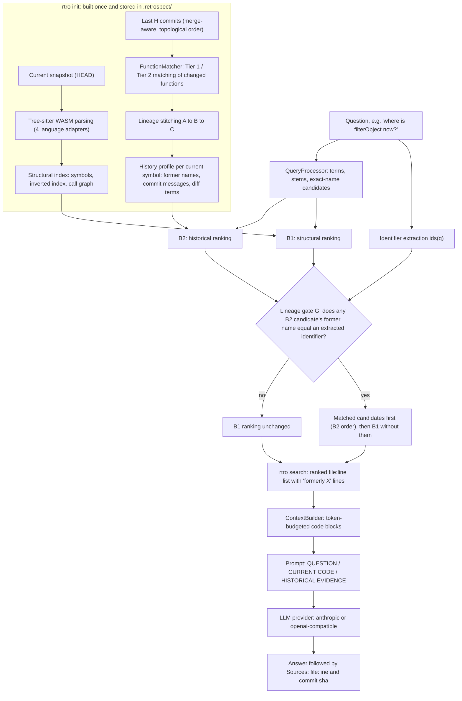

# Retrospect: Evolution-Aware Code Retrieval for LLM Coding Assistants

*Project report, October 2026. Code version: tag `eval-v1` (`1ac3b358c248fab5db2d7618de4cc057a856c9d4`) for all evaluations; tag `cli-v1.0.0` (`90feeeab46e431ad51782b701908547803360bde`) for the released command-line tool. Every number in this report is copied from a file in the repository; see the Appendix for where each one comes from.*

---

## 1. Executive summary

Software keeps changing, but the words people use about it lag behind. A developer asks "where is `filterObject` now?", an old issue mentions a function that has since been renamed, or a code review refers to the name a method had last year. Today's code search, and the retrieval step inside LLM coding assistants, only look at the code as it is now, so they cannot connect an old name to the code that replaced it. **Retrospect** closes that gap. It reads a repository's git history and records, for every current function, the names it used to have and the commits that changed them. When a question mentions a name that history says belonged to a current function, Retrospect puts that function first. In every other case it leaves ordinary code search untouched.

In a pre-registered test on 42 open-source repositories that played no part in its development, this "lineage gate" raised the mean reciprocal rank of the correct function from 0.3628 to 0.7747. It found the right function first in 0.7143 of repositories, against 0.2619 for code search alone, and it never pushed a correct answer out of the top ten.

> **At a glance**
> - **Languages:** Java, Python, JavaScript, TypeScript (Tree-sitter WebAssembly parsers, no native toolchain).
> - **Headline:** On old-name queries, the lineage gate G beats structural search B1. MRR 0.3628 → 0.7747; Δ 0.4119, 95% CI [0.279, 0.5489]; p < 0.0001; 14 rescues, 0 harms. A harm check on current-code queries also passed.
> - **Deliverables:**
>   - the `retrospect-cli` package (`rtro`), packaged and ready to publish to npm;
>   - two evaluation workspaces published under `evaluation-artifacts/`;
>   - tags `eval-v1` and `cli-v1.0.0`;
>   - a jest test suite.

---

## 2. The problem

Code retrieval systems, from grep-style search to the context-retrieval step of repository-level LLM assistants, answer questions against a single snapshot: the code at HEAD. That works when the question uses the code's current vocabulary. It breaks when the question carries a **stale name**, and stale names are everywhere:

- **in questions**, because developers remember the API they learned, not the one that replaced it;
- **in documentation**, tutorials and Stack Overflow answers, which are not updated when a function is renamed;
- **in issue trackers and bug reports**, which quote the names that existed when the issue was filed;
- **in code review and commit discussions**, which refer to symbols by the names they had at the time.

**A concrete case** comes from the external evaluation set. In the JavaScript library ramda, commit `92c182c` (dated 2014-07-01) renamed `filterObject` to `pickWith`; its message is "filterObject->pickWith to match naming convention". At the benchmark pin, `filterObject` no longer exists anywhere in the code. A purely structural search for the old name cannot rank `pickWith` at all: in the external results, B1 leaves `pickWith` unranked for the identifier query. The information needed to answer the question is not in the current code; it is in the history.

**Why this matters for LLM assistants.** An LLM assistant is only as good as the context it retrieves. If retrieval cannot connect an old name to its successor, the assistant either answers from stale memory or says the function does not exist. Prior work has shown the size of the effect at the benchmark level: HumanEvo (ICSE 2025) found that ignoring code evolution inflates LLM code-generation evaluation results by 10.0–61.1%. Retrospect addresses the retrieval side of the problem: given a question that uses an old name, return the current code.

---

## 3. What Retrospect does, from the user's view

Retrospect ships as the npm package `retrospect-cli`. It installs two commands, `rtro` and its alias `retrospect`.

| Command | What it does |
|---|---|
| `rtro init [--history <n>]` | Parses the repository, builds a structural index of the current code and a history index of the last *n* commits (default 400), and stores both in `<repo>/.retrospect/`. Adds `.retrospect/` to `.git/info/exclude`; tracked files are never modified. |
| `rtro status` | Shows whether the index is fresh (indexed HEAD equals current HEAD) or stale, the history window, index sizes and the active LLM provider and model. |
| `rtro search "<question>" [--k <n>] [--json]` | Returns the top *k* (default 10) current functions, as `file:line`. A function that matched through history carries a line "formerly `<oldName>` (renamed in `<sha>`, `<date>`)". Rebuilds the index first if HEAD has moved. |
| `rtro ask "<question>" [--k <n>] [--dry-run] [--provider <p>] [--model <m>]` | Retrieves the top *k* (default 5), builds a token-budgeted context, asks an LLM, and prints the answer followed by a `Sources:` list. `--dry-run` prints the full prompt and makes no network call. |
| `rtro config get\|set <key> [value] [--global]` | Project keys (`history`, `k`, `tokenBudget`) live in `.retrospect/config.json`. Global keys (`provider`, `model`, `baseUrl`) live in `~/.retrospect/config.json`. |

**A real session** on ramda, taken from `docs/demo/ramda_transcript.txt` with local paths removed:

```
$ rtro init
  structural index: 1989 symbols in 75 files (0.7s)
  history index: 261 commits analysed, 621 symbols with history (80.0s, window 400)
Indexed HEAD 0018f70176f5: 1989 symbols, 621 with history (80.7s total)

$ rtro search "where is filterObject now?"
 1. pickWith  ramda.js:2893
    formerly filterObject (renamed in 92c182c, 2014-07-01)
 2. filter  ramda.js:1742
 3. filterIdx  ramda.js:1771
 ...
```

The `--json` form of the same search reports `"mode": "lineage_gate"`, the extracted identifier (`filterObject`), and the rename commit with its subject line, ready for other tools to consume.

**`rtro ask` with a live model.** The excerpt below is from `docs/demo/ramda_live_ask.txt`, in which the user configured the model `openai/gpt-oss-120b`. Asked "what happened to filterObject?", the model's answer began:

```
- The function that used to be called **`filterObject`** was **renamed to `pickWith`**.
...
Sources:
- ramda.js:2893 (pickWith) — history: commit 92c182c
- ramda.js:1742 (filter)
- ramda.js:1771 (filterIdx) — history: commit b2d1fe7
```

This transcript shows the end-to-end path working. It is not an evaluation of answer quality (§11).

**Providers.** Two providers are built in.
- **`anthropic`** (the default) reads `ANTHROPIC_API_KEY`.
- **`openai-compatible`** reads `OPENAI_API_KEY` and a base URL, from config `baseUrl` or `OPENAI_BASE_URL`. It covers OpenAI, Ollama and LM Studio. When the base URL's host is `localhost`, `127.0.0.1` or `::1`, no key is needed and no Authorization header is sent.

The model comes from `--model`, else the config key `model`, else `RETROSPECT_MODEL`. When a key, base URL or model is missing, the CLI names the variable or setting to provide. API keys are never read from or written to files.

---

## 4. How it works



### 4a. Parsing

Parsing uses `web-tree-sitter` with the grammars from `tree-sitter-wasms`, loaded by `src/parser/TreeSitterManager.js`. Because these are WebAssembly builds, installing Retrospect needs no C/C++ toolchain. `TreeSitterManager` creates one parser per language lazily and reuses it.

`src/parser/FunctionExtractor.js` picks a language adapter through `LanguageAdapterRegistry` by file extension, parses the file, asks the adapter for symbols and imports, and then frees the syntax tree (`tree.delete()`). Freeing the tree matters: §9 describes the memory leak that was found when it did not happen.

There are four adapters in `src/languages/`: Java, Python, JavaScript and TypeScript. Between them they extract:
- functions and methods;
- arrow functions and factory-returned callables (JavaScript/TypeScript);
- constructors and getters;
- type declarations (classes, and in Java interfaces, enums and records).

TypeScript overload signatures are collapsed onto their implementation. Each symbol is stored as a `SymbolRecord` (`src/model/SymbolRecord.js`) with an ID of the form `<filePath>::<scope.>name::<startLine>`.

### 4b. The structural index and B1

`src/structural/` turns the parsed symbols into an index:
- `RepoDiscoverer` finds source files, respecting `.gitignore`, a 1 MB file-size cap and a file-count cap;
- `StructuralIndex` holds the symbol table, an exact-name index, an inverted index of stemmed sub-tokens and a forward/reverse call graph.

`QueryProcessor` handles the query side. It splits a question into terms (camelCase and snake_case are split, stopwords removed, terms stemmed). It also lists *exact-name candidates* (identifier-like tokens) and detects a target kind ("class", "function").

**B1 (`StructuralRetriever`)** scores every symbol as a weighted sum of seven signals:

| Signal | Weight | Meaning |
|---|---|---|
| Exact name | 0.35 | 1.0 for a case-sensitive name match; lower for case-insensitive or containment matches |
| Identifier token overlap | 0.25 | Overlap between query terms and the symbol name's sub-tokens |
| Docstring | 0.15 | Query terms found in the doc comment |
| File path | 0.10 | Query terms found in the path |
| Signature | 0.05 | Query terms found in parameters and types |
| Call graph | 0.05 | 0.8 or 0.6 for symbols linked by calls to high-confidence candidates |
| Kind | 0.05 | Matches a requested kind such as "class" |

Symbols scoring below the **minimum threshold of 0.08** are dropped. This threshold matters for one of the natural-language templates (§8.2).

### 4c. History indexing

`HistoricalRetrievalAdapter.indexRepositoryHistory` (`src/retrieval/`) walks the last **H** commits from the indexed HEAD. H is the *history window*; the default is 400.
- **Traversal:** `GitHistoryReader.getCommitHistory` uses merge-aware traversal in topological order (`git log --topo-order`), so commits on merged feature branches are included. Merge commits themselves are skipped, because their changes are already covered by the branch commits.
- **Files:** for each commit, the changed files ending in `.js`, `.ts`, `.py` or `.java` are parsed in both the parent and the child version.

**FunctionMatcher** (`src/matcher/FunctionMatcher.js`) pairs each child-version function with its predecessor.
- **Tier 1: strong identity.**
  - Identical source hash and name → `unchanged`.
  - Identical qualified name, scope and normalized signature with a modified body → `modified`.
  - Identical qualified name and scope with body token overlap → `modified`.
- **Tier 2: similarity.** A weighted similarity covers renames, moves and signature changes:
  - **Weights:** token Jaccard 0.35, name 0.25, signature 0.15, scope 0.15, parameters 0.10.
  - **Thresholds:** a score of at least 0.70 is a high-confidence match and at least 0.50 a moderate one. Either way the pair is labelled `renamed`, `moved` or `renamed_and_moved` according to what differs.
  - **Ambiguity:** if the two best candidates are within 0.08 of each other, the matcher refuses to guess and labels the change `uncertain`.

The full change vocabulary, in `src/model/HistoryGraph.js`, is `unchanged`, `modified`, `renamed`, `moved`, `renamed_and_moved`, `new`, `deleted` and `uncertain`.

**Recording and stitching.** Every non-`unchanged` match is recorded with its commit, the predecessor, the commit message and the diff, keyed by file path and function name.

`stitchLineage` then follows those records backwards from each current symbol. When a record shows a rename or move, tracing continues under the predecessor's name and path, but only through older commits. That is how a chain A → B → C gives C both former names. Stitching stops:
- at an `uncertain` link;
- at a cycle;
- at a severed predecessor;
- after 50 records.

The result is a **history profile** per current symbol: its former names, former qualified names, commit messages, diff snippets (each capped at 1,500 characters), former docstrings, the latest evolution type and a confidence flag.

### 4d. B2: historical ranking

`rankHistoricalOnly` scores every symbol's history profile against the query:

| Component | Weight | Meaning |
|---|---|---|
| Historical name | 0.40 | A former name exactly equals an exact-name candidate (case-sensitive 1.0, case-insensitive 0.95) |
| Commit message | 0.30 | Query terms in the commit messages |
| Diff terms | 0.20 | Query terms in the diffs |
| Historical docstring | 0.10 | Query terms in former doc comments |

Profiles whose lineage passed through an uncertain link are discounted by a factor of 0.65. Scores below 0.05 are set to zero. Ties break deterministically on the symbol ID.

### 4e. Identifier extraction

`extractIdentifiers` in `src/retrieval/LineageGate.js` pulls identifiers out of a question with a fixed rule:
1. the contents of `` `backticks` ``, if any; otherwise
2. tokens that look like code: they contain a lower-to-upper case change, an underscore, a dot, or a trailing `()`; otherwise
3. the whole query, if it is a single token.

A trailing `()` is stripped. For dotted names both the full form and the last segment are kept. So "where is `foo.barBaz()` now" yields `foo.barBaz` and `barBaz`. "Where is the function render now?" yields nothing, because "render" alone is indistinguishable from an English word.

### 4f. The lineage gate G

G (`rankLineageGate`) has no parameters:

> Let **L** be the B2 candidates (in B2 order, with a positive B2 score) whose inherited former names contain an extracted identifier, compared exactly and case-sensitively. If L is empty, G **is** the B1 ranking, the same array in the same order. Otherwise G is L followed by the B1 ranking with L's members removed.

L's members are given scores above the best B1 score, so they also count as retrieved. Every other symbol keeps its B1 score, so a target that B1 does not retrieve, and that is not in L, stays unretrieved. The unit tests check that G equals B1 when L is empty and that G never throws.

### 4g. Context building and prompt assembly

`ContextBuilder.buildContext` (`src/structural/context/`) takes G's top *k* results. It estimates tokens at about four characters per token, plus 30 per block for metadata, and adds complete code blocks until the token budget (default 4,000) would be exceeded. It always includes at least the top result.

`src/cli/prompt.js` assembles the prompt in three sections:
- **QUESTION:** the user's question.
- **CURRENT CODE:** each block with its qualified name, kind and `path:start-end`.
- **HISTORICAL EVIDENCE:** for symbols whose lineage contains a former name, lines of the form `oldName → currentName (path); commit <sha>, <date>; "<first line of the commit message>"`.

The system instructions tell the model to:
- answer only from the provided context;
- say so explicitly if the context is insufficient;
- distinguish clearly between current code and former names;
- cite file paths (and commit shas for history).

### 4h. The LLM call and the sources list

`src/llm/index.js` uses Node's built-in `fetch` with no extra dependencies, and requests at most 1,024 tokens.
- **`anthropic`:** calls the Messages API (`/v1/messages`).
- **`openai-compatible`:** calls `<baseUrl>/chat/completions`.

After the answer, `rtro ask` prints `Sources:`: each context block's `file:line`, plus the commit sha of its historical evidence when it has one.

Since v1.0.1, when retrieval returns no results, `rtro ask` makes no LLM call and prints a hint instead. Only callables are indexed (not README or package files), so a broad question about the project as a whole retrieves nothing; in v1.0.0 the model was still called with an empty context and an empty `Sources:` list was printed.

### 4i. Index storage and staleness

`src/cli/store.js` writes four files to `<repo>/.retrospect/`:
- `config.json`;
- `structural-index.json` (the saved `StructuralIndex`);
- `history.json`, the profiles plus the captured lineage records with commit dates;
- `meta.json`, holding the indexed HEAD, timings and counts.

The lineage records are captured by a small subclass of the history adapter that copies each symbol's stitched records as they are produced, without changing ranking. The index is **stale** when the current HEAD differs from the indexed HEAD. `search` and `ask` then rebuild it first, with a one-line notice.

---

## 5. Key design decisions

**Gating instead of fusion.** The obvious design combines structural and historical scores, with linear fusion (B3: 0.6 structural, 0.4 historical) or reciprocal-rank fusion (B4: k = 60, weights 0.5/0.5). Retrospect measured both on the main benchmark (§8.1).
- **When the rename was inside the history window,** history alone reached MRR 0.6496, against 0.4069 for structural search. Fusion recovered only part of that gain (B4 0.491).
- **Across all held-out old-identifier cases at H = 400,** fusion was worse than structural search alone: B4 harmed 23 cases and rescued 4. History adds noise whenever it has nothing relevant to say, and fusion spreads that noise into every query.

G is the response to this evidence. It intervenes only when the question names a former identifier that history recorded, and otherwise returns structural search untouched. The harm check on current-code queries (§8.2) confirms that this restraint works.

**Deterministic, explainable matching instead of embeddings.** Every lineage link has a recorded reason: an identical hash, a signature match, or a similarity score with named components and a fixed threshold. Every search result can be traced to a commit. This matters both for trust (an assistant can cite the commit) and for evaluation (results are exactly reproducible).

**A 400-commit window.** Parsing every changed file in every commit is the dominant cost. On the external set, for example, history indexing took 76.502 s for ramda and 403.392 s for cassandra (§8.3). A fixed window keeps `rtro init` practical. The cost is reach: older renames are invisible (§11). The window is configurable with `--history`.

**WebAssembly parsing.** Tree-sitter's WASM builds remove the need for a native toolchain, which makes a single `npm install -g` work across platforms. The price was a WebAssembly memory leak that had to be found and fixed (§9).

**No new runtime dependencies for the LLM layer.** The two providers use Node's built-in `fetch`. The package's only runtime dependencies remain the two Tree-sitter packages.

**Keys only in environment variables.** The configuration code refuses to store any key that looks like a secret (`apiKey`, `token`, `password` and similar), so credentials never end up in project or home-directory files.

---

## 6. Research question and hypotheses

**Research question.** Can a repository's git history be used to retrieve the *current* code a question refers to by a *former* name, across four languages, without degrading retrieval for questions about current code?

**Hypotheses, as they evolved:**
1. **H1 (history helps when it can see the change).** When the commit that renamed a function lies inside the history window, history-based ranking (B2) finds the current function better than structural ranking (B1).
2. **H2 (naive fusion is not enough).** Blending structural and historical scores (B3/B4) does not reliably improve on B1, because history adds noise when it has no signal.
3. **H3 (the confirmatory hypothesis, pre-registered).** A parameter-free lineage gate G, which uses history only when the question names a recorded former identifier, beats B1 on old-identifier queries, pooled over independent repositories, without harming current-code queries.

**What had to be shown.**
- **H1 and H2:** shown on a mined, machine-verified four-language benchmark.
- **H3:** shown on an external set the system had never seen, with a single pre-registered test, a fixed decision rule, and a separate non-inferiority (harm) check.

---

## 7. Evaluation methodology

### 7.1 The main four-language mined benchmark

**Construction.** Candidate evolution events were mined from 26 cloned repositories, using the 1,500 most recent topologically ordered commits of each. That produced 17,484 candidate events.

A verifier then applied fixed gates:
- the commit and its parent exist;
- each symbol is at its recorded line;
- the rename really happened (the old name is gone from the successor file, and the new name was absent from the predecessor);
- non-production paths, such as minified builds, documentation sources and integration tests, are excluded;
- duplicates are removed.

**Result:** 11,678 machine-verified events. Of these, 222 are rename-type events, and 1,341 are "strong negatives": deletions with no successor anywhere.

**These labels are machine-verified, not human-reviewed.** A 1,005-event owner review queue was prepared but has not been done.

**Tasks.**

| Task | Query | Purpose |
|---|---|---|
| A | First sentence of the current doc comment | Structural reference: a current-code question |
| B (`B_identifier`) | The old name of a renamed function | Primary: does an old name find the new code? |
| C | First sentence of the old doc comment | Evolution-aware behavioural query (secondary) |
| D | The name of a deleted function | False-lineage check: does history wrongly attach a deleted name to an unrelated current function? |

**Splits and clusters.** Events from the same commit, and chains A→B, B→C, form one *cluster*, the unit of statistical independence. Clusters are assigned by a seeded hash to development, validation and held-out test, about 20% / 15% / 65%. Repositories used earlier in development are forced into the development split.

| Split | Cases | Clusters |
|---|---|---|
| Development | 129 | 73 |
| Validation | 160 | 46 |
| Held-out test | 1,069 | 230 |

**Reachability annotation.** Every case records whether its evolution commit lies inside the history window at H = 400 and was diffed (`IN_WINDOW`), or not (`OUTSIDE_WINDOW`). An out-of-window case is a *reachability* failure, not a ranking failure, and the two are reported separately.

### 7.2 The external confirmation set

To test G on data it was not designed on, a second case set was built from repositories never used in development. Every repository in the main benchmark's inventory, and every earlier clone, was excluded.

| Source | Language | Origin |
|---|---|---|
| **S1** | Java | The RefactoringMiner oracle (validated true-positive "Rename Method" and "Move And Rename Method") |
| **S2** | Python | The PyRef oracle (validated true-positive "Rename Method") |
| **S3** | Python, JavaScript, TypeScript | Developer-attested renames: the commit message names both the old and the new identifier, and Retrospect's extractor confirms the rename. The old callable exists in the parent and not the child, the new one the reverse, and body similarity is at least 0.5 |
| **S3b** | JavaScript only | Fallback (the message says "rename" and names the new identifier); used only because JavaScript ran short |

The idea behind S3 follows AlOmar et al. ("Can Refactoring be Self-Affirmed?", IWoR 2019): developers often document refactorings in their commit messages, so those messages are a natural source of ground truth.

**Unit and pins.** Exactly one event was selected per repository; the repository is the independence unit. The *pin*, the snapshot evaluated, was placed 50 first-parent commits after the first default-branch commit containing the event (10 on retry). The event had to be inside the H = 400 window at that pin, the successor present, and the old name gone.

**Case set.** 42 repositories: Java 12, Python 12 (1 from S2, 11 from S3), JavaScript 7 (5 from S3, 2 from S3b), TypeScript 11.

**Queries per case:**
- **B_id:** the old name itself.
- **B_nl:** three fixed natural-language templates:
  1. "Where is the function OLD now?"
  2. "What happened to OLD after the refactor?"
  3. "Show me the current code for \`OLD\`."
- **A:** the successor's current doc comment, when one existed and mentioned neither name. This gave 14 A cases.

**Owner review.** The 29 developer-attested events were reviewed by the project owner: 26 were confirmed and 3 rejected (django/django, tj/commander.js, trpc/trpc).

### 7.3 Metrics, in plain terms

For each query the systems return a ranked list, and the question is where the correct current function appears.

| Metric | Meaning |
|---|---|
| **Reciprocal rank (RR)** | 1 / rank of the correct answer: 1 if it is first, 0.5 if second, 0 if it is not retrieved |
| **MRR** | The mean of RR. It rewards putting the answer near the top |
| **R@1** | The fraction of queries whose answer is ranked first: top-1 accuracy |
| **R@10** | The fraction with the answer in the top ten |
| **Rescue@10** | B1 missed the top ten (or did not retrieve the answer), and the compared system put it in the top ten |
| **Harm@10** | The reverse: B1 had the answer in the top ten, and the compared system lost it |

### 7.4 Statistics

**Main benchmark.**
- **Test:** per language, the difference in mean RR between two systems is averaged within each cluster and then across clusters. It is tested with a two-sided sign-flip test: exact enumeration up to 20 clusters, otherwise 100,000 Monte Carlo assignments.
- **Uncertainty:** 95% cluster-bootstrap confidence intervals use 10,000 resamples.
- **Multiplicity:** a Holm correction across the four languages.
- **Decision:** a language is "supported" only if ΔMRR > 0, the Holm-adjusted p < 0.05 and harms ≤ rescues. With fewer than 6 clusters it is "not testable".

**External confirmation.** The analysis was pre-registered in `evaluation-artifacts/retrospect_external_4lang/protocol.md` before any run, and pinned to `eval-v1`.
- **The single confirmatory test:** task B_id, G vs B1, pooled. The statistic is the mean over repositories of RR_G − RR_B1. It uses a two-sided Monte Carlo sign-flip test (100,000 assignments, seed 20261023, α = 0.05).
- **Decision rule:**
  - **SUPPORTED:** Δ > 0, p < 0.05 and rescues > harms.
  - **NOT SUPPORTED:** Δ ≤ 0, or harms > rescues.
  - **INCONCLUSIVE:** otherwise.
- **Harm check:** task A must have zero harms and ΔMRR ≥ −0.01.
- **Descriptive analyses** carry repository-bootstrap CIs.

**Deviations.** These are recorded in the protocol's §9.
- **Before the freeze:**
  1. JavaScript's minimum was relaxed from 8 to 7 repositories after its catalog was exhausted.
  2. Clones were retried with long-path support.
  3. Demo and build-tooling files were excluded as non-production code.
- **After the confirmatory result:** a note records the owner-verdict sensitivity analysis and the labelled post-hoc rows.

---

## 8. Results

### 8.1 Main benchmark (v4, parser-fix re-measurement)

All rows are held-out, old-identifier queries (task B), pooled and cluster-level.

| Stratum | Cases / clusters | MRR B1 | MRR B2 | MRR B3 | MRR B4 | B4 − B1 | B4 rescues / harms @10 |
|---|---|---|---|---|---|---|---|
| In window, H = 400 | 14 / 12 | 0.4069 | 0.6496 | 0.528 | 0.491 | +0.0914 | 3 / 0 |
| All indexed, H = 400 | 63 / 49 | 0.4329 | 0.2486 | 0.3464 | 0.2695 | −0.0837 | 4 / 23 |
| All indexed, H = 50 | 63 / 49 | 0.4329 | 0.0883 | 0.3047 | 0.1699 | −0.2141 | 3 / 17 |

**In-window history gain.** When the rename commit was inside the window, history alone (B2, 0.6496) beat structural search (B1, 0.4069). The gain is largest where structural search is helpless.
- **B1 missed the top ten:** on the 6 in-window cases where that happened, B1's MRR was 0.0049, B2's 0.5871 and B4's only 0.09.
- **No shared sub-tokens:** on the 3 in-window cases whose old and new names shared no sub-tokens, B1 scored 0.0023 and B2 0.6735.

**Fusion harm.** Over all held-out task-B cases at H = 400, B4 fell below B1: 0.2695 against 0.4329, with 4 rescues and 23 harms. At the system default H = 50 it was worse still, with 3 rescues and 17 harms. The same pattern appears on current-code questions.
- **Task A at H = 400:** B1 0.8045, B4 0.4149.
- **Task C:** B1 0.6873, B4 0.3197.

**Reachability.** Only **20 of 91** task-B cases across all splits had their rename commit inside the H = 400 window (Java 9 of 27, Python 3 of 24, JavaScript 1 of 14, TypeScript 7 of 26). Most renames in a mined sample are simply older than 400 commits.

**Per-language confirmatory outcomes.** B4 vs B1 on the in-window, held-out population:

| Language | Cases | Clusters | ΔMRR | p (exact) | p (Holm) | Decision |
|---|---|---|---|---|---|---|
| Java | 6 | 6 | 0.1482 | 0.03125 | 0.125 | INCONCLUSIVE |
| Python | 2 | 2 | 0.0 | 1.0 | 1.0 | NOT TESTABLE |
| JavaScript | 1 | 1 | 0.1667 | 1.0 | 1.0 | NOT TESTABLE |
| TypeScript | 5 | 3 | 0.0135 | 1.0 | 1.0 | NOT TESTABLE |

No language reached "supported". The reachability limit left too few in-window clusters.

**E3-Reach.** This was a pre-registered Java study at H = 400 on 18 cases: MRR B1 0.1623, B4 0.2825, Δ +0.1068, exact p = 0.06641, rescues / harms 4 / 2. The outcome was **INCONCLUSIVE**. It was identical after the parser fix: 0 of 72 ranks changed.

**Task D (false lineage).** On held-out deletions, the rate at which B2's top ten wrongly listed the deleted name as a former name of some current function was 0.0 at H = 400 (903 cases, 180 clusters). At H = 50 it was 0.0011 pooled. History almost never invents lineage. This is partly by construction, since negatives were chosen so that no similar body survived; and Retrospect has no "no successor" answer, so correct abstention cannot be measured.

### 8.2 External confirmation

**The confirmatory test (B_id, G vs B1, 42 repositories):**

| MRR B1 | MRR G | R@1 B1 | R@1 G | R@10 B1 | R@10 G | Δ | 95% CI | p | Rescues / harms @10 | Decision |
|---|---|---|---|---|---|---|---|---|---|---|
| 0.3628 | 0.7747 | 0.2619 | 0.7143 | 0.5238 | 0.8571 | 0.4119 | [0.279, 0.5489] | < 0.0001 (minimum attainable with 100,000 Monte Carlo assignments) | 14 / 0 | **SUPPORTED** |

**The harm check (task A, 14 repositories):** MRR B1 0.6512, G 0.6452, Δ −0.006, CI [−0.0179, 0.0], harms 0. The result is a **PASS**. On questions about current code, G behaves like structural search.

**All systems on B_id** (descriptive):

| System vs B1 | MRR | Δ | 95% CI | Rescues / harms |
|---|---|---|---|---|
| B2 historical | 0.653 | 0.2902 | [0.125, 0.4511] | 14 / 4 |
| B3 linear fusion | 0.5533 | 0.1905 | [0.062, 0.3192] | 14 / 1 |
| B4 RRF fusion | 0.5203 | 0.1576 | [0.0458, 0.2754] | 10 / 2 |
| **G lineage gate** | **0.7747** | **0.4119** | [0.279, 0.5489] | **14 / 0** |

G is the only configuration with no harms, and it has the highest MRR. Because every external event lies in the window by construction, fusion helps here, unlike on the main benchmark. It still loses to the gate.

**Per language** (B_id, G vs B1; descriptive, since each language is small):

| Language | Repos | MRR B1 | MRR G | Δ | 95% CI |
|---|---|---|---|---|---|
| Java | 12 | 0.278 | 0.5697 | 0.2917 | [0.0932, 0.5174] |
| Python | 12 | 0.5333 | 0.8362 | 0.303 | [0.0556, 0.5503] |
| JavaScript | 7 | 0.4106 | 1.0 | 0.5894 | [0.2619, 0.8731] |
| TypeScript | 11 | 0.2388 | 0.7879 | 0.5491 | [0.2777, 0.8126] |

**Source strata.** On the oracle sources (S1 + S2, 13 repositories) G raised MRR from 0.3335 to 0.6028. On developer-attested events (S3 + S3b, 29 repositories) it went from 0.3759 to 0.8518. The **S1-only** rows (RefactoringMiner, Java, 12 repositories, post hoc) are:

| Task | MRR B1 → G | Δ | 95% CI | p (exact) | Rescues / harms |
|---|---|---|---|---|---|
| B_id | 0.278 → 0.5697 | 0.2917 | [0.0932, 0.5174] | 0.0625 | 3 / 0 |
| B_nl | 0.2044 → 0.5281 | 0.3237 | [0.1218, 0.5496] | 0.03125 | 10 / 0 |

**Natural-language questions (B_nl, descriptive).** Averaged over the three templates, G vs B1 gave 0.2398 → 0.7242 (Δ 0.4844, 54 rescues, 0 harms).

| Template | MRR B1 | MRR G |
|---|---|---|
| 1 ("Where is the function OLD now?") | 0.3488 | 0.7391 |
| 2 ("What happened to OLD after the refactor?") | 0.0 | 0.6587 |
| 3 ("Show me the current code for \`OLD\`.") | 0.3705 | 0.7747 |

**The template-2 caveat.** B1 scores 0.0 on template 2 because the words "happened" and "refactor" match no code. They dilute every structural score below B1's 0.08 threshold, so template 2 is a degenerate baseline and flatters G. A post-hoc summary that **excludes template 2** gives MRR B1 0.3597, G 0.7569, Δ 0.3972, CI [0.2681, 0.529], 24 rescues and 0 harms. Identifiers were extracted from 39, 39 and 42 of the 42 queries for templates 1, 2 and 3; where no identifier is extracted, G equals B1 by construction.

**Zero-overlap renames.** For the 11 repositories whose old and new names share no sub-tokens, B1 reached MRR 0.0525 and G 0.7153. These are the cases structural search cannot solve by spelling alone.

**Sensitivity with owner verdicts.** On S1 + S2 + the 26 owner-confirmed events (39 repositories), MRR rose from 0.3856 to 0.7574: Δ 0.3718, CI [0.2348, 0.5091], p < 0.0001 (minimum attainable with 100,000 Monte Carlo assignments), 12 rescues and 0 harms. The three rejections do not change the conclusion.

### 8.3 Cost

These figures are from the external run's per-repository cost table. "Median latency" is the median over that repository's queries.

| Repository | Symbols | Index s | History s (H = 400) | Symbols with history | Median latency B1 ms | Median latency G ms |
|---|---|---|---|---|---|---|
| asyml/texar | 517 | 0.24 | 81.874 | 517 | 21.29 | 31.43 |
| ramda/ramda | 1989 | 3.744 | 76.502 | 621 | 45.68 | 59.41 |
| pylint-dev/pylint | 1471 | 0.522 | 124.069 | 860 | 42.53 | 59.26 |
| apache/cassandra | 25291 | 8.833 | 403.392 | 9620 | 943.59 | 1072.12 |

The one-off cost is dominated by history indexing. Per query, G adds the B2 ranking and the gate on top of B1, a modest overhead next to the structural search itself.

### What the numbers mean

When a question names a function by an old name, ordinary code search usually cannot find the function. On the external set it put the right one first in only 0.2619 of repositories (R@1). Retrospect's gate puts it first in most cases, and in every repository where code search already had the answer in its top ten, the gate kept it there. When the question is about the code as it is now, the gate stays out of the way. Blending history into every query, which is the obvious idea, does not work as well. It helps when the rename is recent, but otherwise it pushes correct answers down, so it matters *when* history is used, not just *whether*. Two caveats bound all of this. The gain depends on the rename being inside the analysed history window. And only retrieval was measured, not the quality of the LLM answers built on top of it.

---

## 9. The research journey

**The pilot and E3-Reach.** Early experiments compared structural search, history-only search and fusion on hand-built and audited cases. They established the reproduction baselines that every later code change had to reproduce: E1, the Java case study, at 116/116 ranks, and E2, the four-language Phase B, at 136/136 ranks. The first pre-registered test, **E3-Reach** (Java, H = 400), asked whether RRF fusion beats structural search when history can reach the rename. It came out **INCONCLUSIVE** (Δ +0.1068, p = 0.06641). The direction looked promising, but the sample was too small to decide. **Lesson:** a confirmatory claim needs many more independent units than a hand-built set provides, and reachability must be measured separately from ranking.

**The four-language benchmark.** A mined, machine-verified benchmark across 26 repositories followed, with cluster-level splits and a pre-registered analysis. It confirmed that history helps in window (B2 0.6496 vs B1 0.4069). It also showed something the pilot had not: across all cases, naive fusion *hurts* (23 harms vs 4 rescues at H = 400). And only 20 of 91 rename cases were reachable at H = 400. **Lesson:** "use history" is not a design. The question is *when* to let history change the answer.

**The Tree-sitter WASM memory leak.** During the benchmark, some repositories silently produced truncated history. The parser had aborted partway through the 400-commit history pass of five repositories, and every later parse in the process failed without an error. The cause was that Retrospect never freed Tree-sitter syntax trees or parsers, so WebAssembly memory filled up.

In a stress test the unfixed code failed between the 1,228th and the 1,810th extraction of a large file, depending on the language. The fixed code completed 6,000 extractions in every language. The fix frees the tree after every extraction, reuses one parser per language, and counts extraction failures instead of hiding them.

The affected snapshots were then re-run, and a pre-specified materiality rule was applied:
- **Primary analysis:** every decision was unchanged.
- **E3-Reach:** 0 of 72 ranks changed.
- **Pooled descriptive row:** one row changed materially, with one extra harm.

**Lesson:** silent failure modes in infrastructure can corrupt results without changing headline numbers; guards and health probes belong in the harness.

**Designing the lineage gate.** The evidence pointed to a specific design: history is very good when the question names something history recorded, and harmful otherwise. G encodes exactly that, with no parameters to tune. It was checked on the earlier benchmark's development split only to confirm that G equals B1 when there is no match; its accuracy there was deliberately not measured.

**The pre-registered external confirmation.** Finally, G was tested once, on 42 repositories it had never seen, under a written protocol fixed before any run. The confirmatory test was SUPPORTED, the harm check passed, and the owner-verdict sensitivity analysis agreed. **Lesson:** a small, principled mechanism, designed from failures and tested once on fresh data, gave a clearer answer than tuning a fusion formula would have.

---

## 10. Positioning against related work

**CodeTracker** (Hasan, Tsantalis, Alikhanifard), refactoring-aware tracking of code blocks, is the closest base paper. It builds a precise, complete history for a given method or code block, following it through refactorings. It was evaluated against an oracle of 1,280 code blocks within 200 methods from 20 projects, reaching 99.5% precision and recall at an average of 3.6 s per block. It works on Java only. **CodeShovel** (ICSE 2021) likewise builds method-level histories for Java.

These tools and Retrospect solve **different problems**:

| | CodeTracker / CodeShovel | Retrospect |
|---|---|---|
| Task | Given a method or block, recover its full history | Given a *question*, retrieve the *current* code it refers to, possibly by a former name |
| Input | A known code element | Free text, an identifier, or a natural-language question |
| Output | A complete change history | A ranked list of current functions with "formerly X" evidence, and optionally an LLM answer |
| Languages | Java | Java, Python, JavaScript, TypeScript |
| Depth | The full history of the element | A fixed window (default 400 commits) |
| Granularity | Methods and code blocks (CodeTracker) | Functions and methods |
| Accuracy evidence | Oracle-validated tracking (99.5% precision and recall) | Retrieval metrics on old-name queries; lineage itself not validated against a tracking oracle |

**Where Retrospect falls short as a tracker.**
- **Depth:** it does not try to recover full histories; anything older than the window is invisible.
- **Granularity:** it works at function level, not block level.
- **Tracking accuracy:** its matching (§4c) was never measured against a tracking oracle such as CodeTracker's, so no tracking-accuracy claim is made.

**Where it goes further.**
- **Languages:** it works in four languages through one parser framework.
- **Question-driven:** it starts from a question rather than a known element.
- **LLM-ready:** its output feeds directly into a grounded LLM prompt with commit citations.

**Other related work.**
- **RefactoringMiner 2.0** (IEEE TSE 2020) and **PyRef** (2021) supplied the Java and Python refactoring oracles used as sources S1 and S2.
- **AlOmar et al.** (IWoR 2019) motivate using developer-attested renames in commit messages as ground truth (S3).
- **HumanEvo** (ICSE 2025) shows that ignoring code evolution inflates LLM code-generation evaluation by 10.0–61.1%. Retrospect addresses the retrieval half of that problem.
- **RepoHyper** (FORGE 2025) retrieves repository-level context using semantic graphs. Retrospect's focus is different: it brings git history into retrieval.
- **ReportFL** (IEEE Access 2026) shows that historical bug reports help LLM fault localisation. That is a different kind of history (reports rather than code lineage), but it points in the same direction: history is useful context for LLMs.

---

## 11. Limitations and threats to validity

- **History reach.** Only renames inside the history window can be found. On the mined benchmark only 20 of 91 rename cases were in window at H = 400. On the external set, events were selected to be in window, which by construction removes this limitation from the confirmatory test; real-world benefit depends on how recent the renames people ask about are. `--history` widens the window at a cost in indexing time.
- **Narrow query form.**
  - **The confirmatory test** used the bare old identifier.
  - **The natural-language templates** are descriptive. G relies on extracting an identifier, so a question that never names the old identifier gets plain structural search.
  - **Template 2** is a degenerate baseline for B1 (§8.2).
- **Small JavaScript sample.** JavaScript has 7 repositories in the external set, two of them from the weaker S3b fallback, and its catalog was exhausted. All per-language results are descriptive.
- **Machine-verified main labels.** The main benchmark's labels were verified by rules, not by people; the 1,005-event review queue is still open.
- **Retrieval-only evaluation.** `rtro ask` assembles a grounded prompt and produces answers, but answer quality has **not** been evaluated. Every measured claim in this report is about retrieval.
- **Developer-attested selection bias.** S3 events come from commits whose messages name both identifiers. These may be cleaner, better-documented renames than typical ones. The owner review (26 of 29 confirmed) and the oracle-only S1 rows reduce but do not remove this concern.
- **Clone skips.** Some external candidates were skipped because their clone exceeded 10 minutes or 1.5 GB, or the repository was not found. Windows path-length failures were fixed and those repositories retried. Very large repositories are therefore under-represented.
- **Extractor coverage.** Targets are limited to what Retrospect's own Tree-sitter extractors can parse.
  - **jbpm:** in the external set, the target in droolsjbpm/jbpm was missing from the structural index. Its four queries count as unranked for every system.
  - **Main benchmark:** 4 Python task-B targets were not indexed.
  - **History pass:** the history pass only reads files ending in `.js`, `.ts`, `.py` and `.java`, so `.jsx`, `.tsx`, `.mjs` and `.cjs` changes are not analysed for lineage.
- **No abstention.** Retrospect always returns a ranking. It cannot yet say "this function was deleted and has no successor", so correct abstention on deleted names cannot be measured.

---

## 12. Future work

- **Incremental history indexing and longer windows.** Index only new commits after `init`, so that much longer windows become affordable and reach stops being the main limit.
- **An MCP server.** `rtro search --json` already produces machine-readable output; wrapping it as an MCP server would let IDE assistants call Retrospect directly.
- **Answer-quality evaluation.** Measure whether grounded prompts with HISTORICAL EVIDENCE produce better LLM answers than current-code-only prompts, with human or rubric-based grading.
- **LLM-based query rewriting.** For questions that describe a function without naming it, an LLM could propose candidate former identifiers before the gate runs.
- **Filtering test and example files.** Demo results show test and example code (for example `lib/test/mocha.js`, `examples/generators.js`) among the top ten. Down-weighting such paths would sharpen the results.
- **Comparison against the CodeTracker oracle.** Measure Retrospect's lineage matching on CodeTracker's Java oracle to quantify its tracking accuracy honestly.
- **Owner review of the main benchmark.** Complete the 1,005-event review so the mined benchmark's labels are human-confirmed.

---

## 13. The paper

**Working title.** *Retrospect: Evolution-Aware Code Retrieval for Repository-Level LLM Assistants.*

**Contributions.**
1. **A history-aware retrieval system** for four languages. It records, for each current function, its former names and the commits that changed them, using deterministic, explainable matching.
2. **Evidence that naive structural-plus-history fusion harms retrieval** whenever history lacks signal. It comes from a mined, cluster-split, four-language benchmark with reachability measured separately from ranking.
3. **A parameter-free lineage gate**, designed from that evidence, together with a pre-registered external confirmation on 42 unseen repositories: SUPPORTED, with 14 rescues and 0 harms, and a passed harm check.
4. **An open-source CLI** (`rtro`) that turns the method into a grounded LLM workflow, plus published evaluation artifacts.

**Claims the evidence supports.**
- On old-identifier queries, G retrieves the current function far better than structural search, pooled over 42 repositories, without harming current-code queries.
- History-only ranking beats structural ranking when the rename is inside the history window.
- Fusing history into every query harms retrieval overall.

**Claims it does not support.**
- That G helps any specific language. Per-language results are descriptive.
- That LLM answers improve; answers were not evaluated.
- That Retrospect is an accurate history tracker. Lineage was not validated against a tracking oracle.
- That the benefit extends to renames older than the window, or to questions that never mention the old identifier.
- That the main benchmark's labels are human-verified.

**Planned outline.**
1. Introduction.
2. Background and motivation (stale names, the filterObject example).
3. Retrospect: parsing, the structural index, history indexing, lineage, B2, the gate.
4. The main benchmark and the fusion finding.
5. The pre-registered external confirmation.
6. Results.
7. Threats to validity.
8. Related work (CodeTracker, CodeShovel, RepoHyper, HumanEvo, RefactoringMiner, PyRef).
9. Conclusion and future work.

---

## 14. Deliverables and reproducibility

| Deliverable | Where |
|---|---|
| Source code and tests | This repository: `src/`, `bin/rtro.js` and the jest suite in `tests/` |
| CLI package | `retrospect-cli` on npm, current version 1.0.1 (installs `rtro` and `retrospect`); see [CHANGELOG.md](../CHANGELOG.md) |
| Evaluation code version | Tag `eval-v1` = `1ac3b358c248fab5db2d7618de4cc057a856c9d4` |
| CLI release | Tag `cli-v1.0.0` = `90feeeab46e431ad51782b701908547803360bde` (the relicensing commit; retrieval code identical to `eval-v1`); tag `cli-v1.0.1` = `79c8192bcb8fcd158dd7e124fb53ea18c2fcd9ad` (empty-retrieval guard in `ask`) |
| Main benchmark workspace | `evaluation-artifacts/retrospect_evaluation_2026-10-21/` (authoritative analysis in `evaluation/analysis/v4_parserfix/`) |
| External confirmation workspace | `evaluation-artifacts/retrospect_external_4lang/` (`analysis/external_v1/results.json`, `analysis/external_v1_posthoc/results_posthoc.json`, `protocol.md`) |
| Demo transcripts | `docs/demo/` |
| Documentation map | `docs/DOCS_INDEX.md` |
| License | MIT |

**Reproducing the headline numbers.**
1. **Check out `eval-v1`** and run `npm install`.
2. **Read the confirmatory numbers** from `evaluation-artifacts/retrospect_external_4lang/analysis/external_v1/results.json` (`confirmatory`, `harm_check`).
3. **Recompute them** from the stored per-case run by running, from `evaluation-artifacts/retrospect_external_4lang/`:

   ```bash
   python -I scripts/analyze_external.py --run runs/external_v1 --out analysis/<new>
   ```

   The statistics are seeded, so the output should match.
4. **To re-run the benchmark itself,** you need the 42 clones at their pins. `scripts/build_external_cases.js` and `scripts/run_benchmark_resumable.js` rebuild them; see that workspace's `README.md`.
5. **The main benchmark's numbers** are in `evaluation-artifacts/retrospect_evaluation_2026-10-21/evaluation/analysis/v4_parserfix/` and `reports/parserfix_remeasurement.md`.
6. **Run the tests** with:

   ```bash
   npx jest --runInBand --testPathIgnorePatterns author_pack_blinding
   ```

   That test is excluded because it regenerates tracked Phase C files.

---

## 15. Glossary

| Term | Meaning |
|---|---|
| **Lineage** | The chain of versions of a function across commits, including its former names and locations |
| **Pin** | The commit at which a repository is evaluated: the "current" snapshot |
| **History window (H)** | How many recent commits Retrospect analyses (default 400) |
| **Reachability** | Whether the commit that changed a function lies inside the history window and was analysed (`IN_WINDOW`) |
| **MRR** | Mean reciprocal rank: the average of 1/rank of the correct answer (0 if not retrieved) |
| **R@k** | Recall at k: the fraction of queries whose answer is in the top k. R@1 is top-1 accuracy |
| **Rescue / harm** | A rescue moves the correct answer into the top ten relative to B1; a harm moves it out |
| **Pre-registration** | Writing down the test, its statistic and its decision rule before seeing any results |
| **Oracle** | A curated, validated set of true refactorings (RefactoringMiner, PyRef) used as ground truth |
| **Developer-attested** | A rename named in its commit message by the developer and confirmed by Retrospect's extractor |
| **Cluster** | A group of related events (the same commit, or a chain of renames) treated as one independent unit in statistics |
| **B1 / B2 / B3 / B4 / G** | Structural; history-only; linear fusion; reciprocal-rank fusion; lineage gate |

---

## Appendix: number provenance

Abbreviations:

| Abbreviation | Path |
|---|---|
| **EXT** | `evaluation-artifacts/retrospect_external_4lang/` |
| **MAIN** | `evaluation-artifacts/retrospect_evaluation_2026-10-21/` |
| **R** | `EXT/analysis/external_v1/results.json` |
| **P** | `EXT/analysis/external_v1_posthoc/results_posthoc.json` |
| **V4** | `MAIN/evaluation/analysis/v4_parserfix/BCA/analysis_results.json` |
| **V4D** | `MAIN/evaluation/analysis/v4_parserfix/D/analysis_results.json` |
| **PF** | `MAIN/reports/parserfix_remeasurement.md` |

| Number(s) | Section | Source |
|---|---|---|
| `eval-v1` = `1ac3b358…`, `cli-v1.0.0` = `90feeeab…` | header, §14 | `README.md` §6 tag table |
| Confirmatory: 42 repos; MRR 0.3628 / 0.7747; R@1 0.2619 / 0.7143; R@10 0.5238 / 0.8571; Δ 0.4119; CI [0.279, 0.5489]; p < 0.0001 (value 9.99990000099999e-06); 14 / 0; SUPPORTED | §1, §8.2, §13 | R → `confirmatory` |
| Harm check: 14; 0.6512 / 0.6452; Δ −0.006; CI [−0.0179, 0.0]; harms 0; PASS | §1, §8.2 | R → `harm_check` |
| B_id B2/B3/B4 vs B1: 0.653 / 0.2902 / [0.125, 0.4511] / 14 / 4; 0.5533 / 0.1905 / [0.062, 0.3192] / 14 / 1; 0.5203 / 0.1576 / [0.0458, 0.2754] / 10 / 2 | §8.2 | R → `descriptive.B_id` |
| Per-language B_id G vs B1 (Java 12, 0.278, 0.5697, 0.2917, [0.0932, 0.5174]; Python 12, 0.5333, 0.8362, 0.303, [0.0556, 0.5503]; JavaScript 7, 0.4106, 1.0, 0.5894, [0.2619, 0.8731]; TypeScript 11, 0.2388, 0.7879, 0.5491, [0.2777, 0.8126]) | §8.2 | R → `descriptive.per_language` |
| Source strata: S1+S2 13 repos 0.3335 → 0.6028; S3+S3b 29 repos 0.3759 → 0.8518 | §8.2 | R → `descriptive.source_stratum` |
| B_nl averaged: 0.2398 → 0.7242, Δ 0.4844, 54 / 0 | §8.2 | R → `descriptive.B_nl` |
| Templates: 0.3488 / 0.7391; 0.0 / 0.6587; 0.3705 / 0.7747; identifiers extracted 39 / 39 / 42 | §8.2 | R → `descriptive.per_template`, `descriptive.b_nl_ids_extracted` |
| Zero-overlap: 11 repos, 0.0525 → 0.7153 | §8.2 | R → `descriptive.name_overlap` |
| Template-2-excluded: 0.3597 / 0.7569, Δ 0.3972, [0.2681, 0.529], 24 / 0 | §8.2 | P → `posthoc_bnl_without_template2` |
| S1-only B_id 12, 0.278 → 0.5697, 0.2917, [0.0932, 0.5174], 0.0625, 3 / 0; B_nl 0.2044 → 0.5281, 0.3237, [0.1218, 0.5496], 0.03125, 10 / 0 | §8.2 | P → `posthoc_s1_only` |
| Sensitivity: 29 reviewed, 26 confirmed, 3 rejected (django/django, tj/commander.js, trpc/trpc); 39 repos; 0.3856 / 0.7574; 0.3718; [0.2348, 0.5091]; 12 / 0 | §7.2, §8.2 | P → `sensitivity_owner_confirmed` |
| External case set: Java 12, Python 12 (1 S2 + 11 S3), JavaScript 7 (5 S3 + 2 S3b), TypeScript 11; 14 A cases | §7.2 | R → `funnel`; R → `harm_check.repositories` |
| Pin offsets 50 / 10; H = 400; body similarity ≥ 0.5; clone limits 10 minutes / 1.5 GB | §7.2, §11 | `EXT/scripts/build_external_cases.js` |
| 100,000 assignments, seed 20261023, α = 0.05; decision rule; harm rule; JavaScript minimum 8 → 7 | §7.4 | `EXT/protocol.md` §4, §5, §9 |
| Cost rows (texar, ramda, pylint, cassandra: symbols, index s, history s, profile size, median latencies) | §5, §8.3 | R → `descriptive.cost_per_repository` |
| ramda demo: 1989 symbols, 75 files, 0.7 s; 261 commits, 621 with history, 80.0 s; 80.7 s; ramda.js:2893; 92c182c, 2014-07-01 | §2, §3 | `docs/demo/ramda_transcript.txt` |
| Live-ask excerpt, model `openai/gpt-oss-120b`, Sources lines (commits 92c182c, b2d1fe7) | §3 | `docs/demo/ramda_live_ask.txt` |
| Main benchmark strata: in window 14 / 12, 0.4069 / 0.6496 / 0.528 / 0.491, +0.0914, 3 / 0; all indexed H400 63 / 49, 0.4329 / 0.2486 / 0.3464 / 0.2695, −0.0837, 4 / 23; H50 0.4329 / 0.0883 / 0.3047 / 0.1699, −0.2141, 3 / 17 | §5, §8.1, §9 | V4 → `secondary` (also in PF) |
| Task A H400 B1 0.8045, B4 0.4149; Task C B1 0.6873, B4 0.3197 | §8.1 | V4 → `secondary["H400/held_out_test/pooled/{A_current_doc,C_docstring}/all_indexed"]` |
| In-window B1-miss 6 cases: 0.0049 / 0.5871 / 0.09; zero-overlap 3 cases: 0.0023 / 0.6735 | §8.1 | V4 → `diagnostics.by_b1_success_heldout_inwindow`, `diagnostics.by_overlap_heldout_inwindow` |
| Reachability 20 of 91 (Java 9/27, Python 3/24, JavaScript 1/14, TypeScript 7/26) | §8.1, §9, §11 | V4 → `diagnostics.reach_by_language` |
| Per-language primary (Java 6 / 6, 0.1482, 0.03125, 0.125, INCONCLUSIVE; Python 2 / 2; JavaScript 1 / 1; TypeScript 5 / 3, 0.0135) | §8.1 | V4 → `primary` |
| 4 Python task-B targets not indexed | §11 | V4 → `diagnostics.not_indexed_by_language` |
| Task D: H400 0.0 (903 cases, 180 clusters); H50 pooled 0.0011 | §8.1 | V4D → `secondary` |
| E3-Reach: 18 cases; 0.1623 / 0.2825; +0.1068; p 0.06641; 4 / 2; INCONCLUSIVE; 0 of 72 ranks changed | §8.1, §9 | PF (E3-Reach section) |
| Parser leak: unfixed failures at extractions 1,228–1,810; 6,000 extractions in every language; five repositories affected | §9 | `MAIN/reports/deviations_log.md` (Deviation 2: stress table and re-run snapshots); PF (re-run table) |
| Materiality outcome: one pooled row changed (one extra harm), decisions unchanged | §9 | PF (Materiality section) |
| Mining: 26 repositories, 1,500 commits, 17,484 candidates, 11,678 verified, 222 rename-type, 1,341 strong negatives; splits 129 / 73, 160 / 46, 1,069 / 230 | §7.1, §9 | `MAIN/DATASET_STATUS.md` |
| 1,005-event review queue | §7.1, §11, §12 | `MAIN/PROGRESS_MANIFEST.md` step 14 |
| Split shares 20% / 15% / 65% | §7.1 | `MAIN/DATASET_DESIGN.md` |
| Exact ≤ 20 clusters, 100,000 Monte Carlo, 10,000 bootstrap, Holm over 4, "not testable" below 6 clusters | §7.4 | `MAIN/reports/evaluation_protocol.md` §3 |
| E1 116/116, E2 136/136 | §9 | `docs/DOCS_INDEX.md` (*Where results live*) |
| B1 weights 0.35 / 0.25 / 0.15 / 0.10 / 0.05 / 0.05 / 0.05, graph scores 0.8 / 0.6, threshold 0.08; FunctionMatcher weights 0.35 / 0.25 / 0.15 / 0.15 / 0.10, thresholds 0.70 / 0.50, ambiguity 0.08; B2 weights 0.40 / 0.30 / 0.20 / 0.10, uncertainty factor 0.65, threshold 0.05; 50-record stitching cap; 1,500-character diff cap; 1 MB file cap; ~4 characters per token + 30; token budget 4,000; k 5 / 10; max 1,024 answer tokens; B3 0.6 / 0.4; B4 k = 60, 0.5 / 0.5 | §4, §5 | `src/structural/retrieval/StructuralRetriever.js`, `src/matcher/FunctionMatcher.js`, `src/retrieval/HistoricalRetrievalAdapter.js`, `src/structural/discovery/RepoDiscoverer.js`, `src/structural/context/ContextBuilder.js`, `src/cli/config.js`, `src/cli/index.js`, `src/llm/index.js`, `README.md` §2 |
| CodeTracker 1,280 blocks / 200 methods / 20 projects / 99.5% / 3.6 s; HumanEvo 10.0–61.1% | §2, §10 | Related-work facts supplied for this report |
