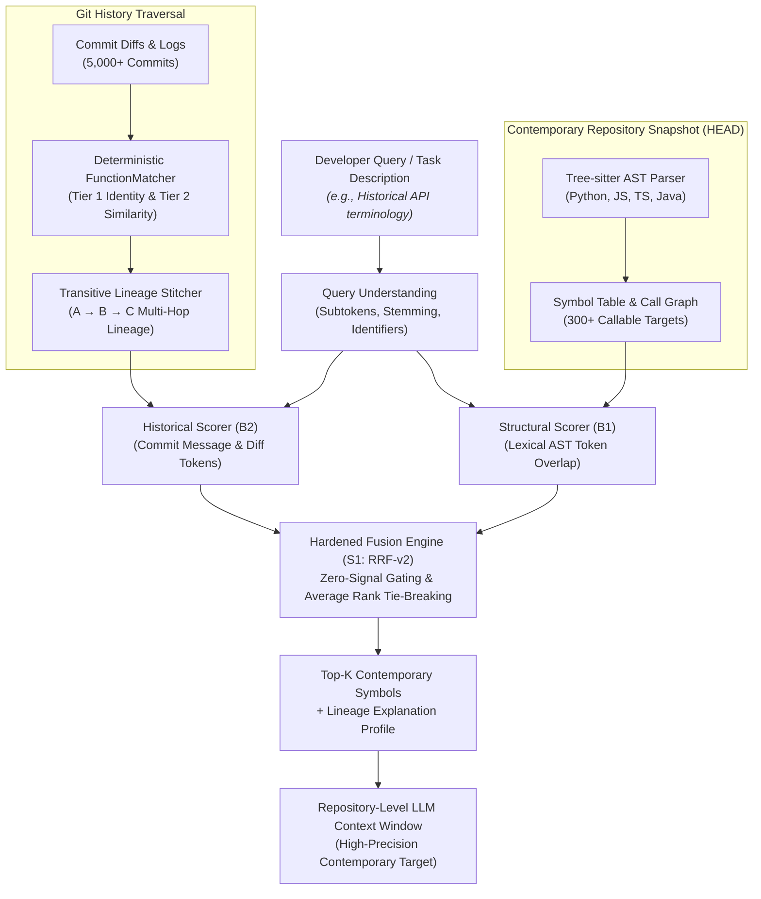
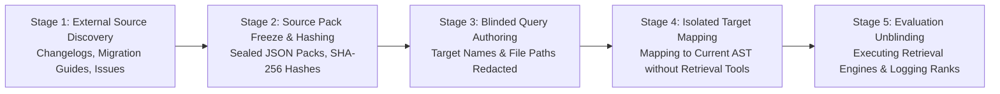
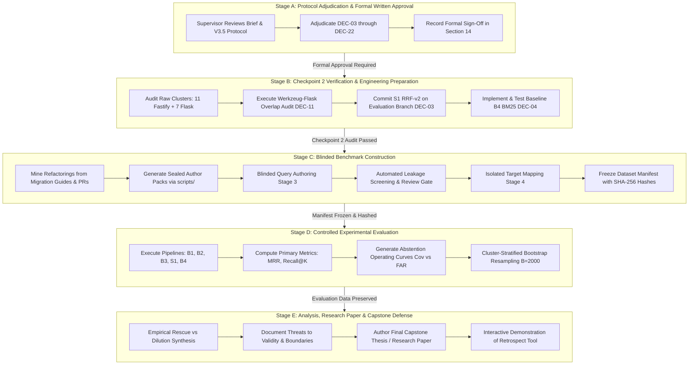

# Retrospect — Comprehensive Project Progress & Research Report
**Evolution-Aware Context Retrieval for Repository-Level Large Language Models**

> **Document Type:** Comprehensive Academic & Technical Project Progress Report  
> **Target Audience:** Academic Project Supervisor & Methodological Advisory Committee  
> **Report Date:** October 15, 2026  
> **Project Repository:** `Retrospect` (B.Tech Final-Year Capstone / Research Project)  
> **Frozen Baseline Commit:** `17ea399217737f8d5fe2c32c310b69c2f812b84d` on `main`  
> **Current Research Phase Status:** **PHASE D — STRICTLY CLOSED / BLOCKED (FORMAL HUMAN PROTOCOL APPROVAL REQUIRED)**  
> **Active Protocol Proposal:** Version 3.5 ([`phase_d_v3_5_exploratory_protocol.md`](file:///C:/Users/ASUS/.gemini/antigravity-ide/brain/739cb121-0ee8-4c36-a7ca-d249d8a7bb85/phase_d_v3_5_exploratory_protocol.md))  
> **Supervisor Decision Brief:** [`phase_d_v3_5_supervisor_review_brief.md`](file:///C:/Users/ASUS/.gemini/antigravity-ide/brain/739cb121-0ee8-4c36-a7ca-d249d8a7bb85/phase_d_v3_5_supervisor_review_brief.md)

---

## Table of Contents

1. [Executive Summary](#1-executive-summary)
2. [Project Identity, Motivation & Problem Formulation](#2-project-identity-motivation--problem-formulation)
3. [Research Questions, Epistemic Scope & Hypotheses](#3-research-questions-epistemic-scope--hypotheses)
4. [System Architecture & Retrieval Implementation](#4-system-architecture--retrieval-implementation)
5. [Chronological Development & Research Journey](#5-chronological-development--research-journey)
6. [Empirical Evaluations, Diagnostic Findings & Methodological Audits](#6-empirical-evaluations-diagnostic-findings--methodological-audits)
7. [Benchmark Integrity, Lineage Auditing & Blinding Infrastructure](#7-benchmark-integrity-lineage-auditing--blinding-infrastructure)
8. [Phase D Feasibility Analysis & The Current Operational Blocker](#8-phase-d-feasibility-analysis--the-current-operational-blocker)
9. [Protocol Version 3.5 & Master Decision Register](#9-protocol-version-35--master-decision-register)
10. [Comprehensive Deliverables Inventory & Current Project Status](#10-comprehensive-deliverables-inventory--current-project-status)
11. [Realistic Staged Roadmap & Human Approval Dependencies](#11-realistic-staged-roadmap--human-approval-dependencies)
12. [Expected Research Contributions & Final Project Outcomes](#12-expected-research-contributions--final-project-outcomes)
13. [Threats to Validity & Methodological Limitations](#13-threats-to-validity--methodological-limitations)
14. [Conclusion & Immediate Next Actions for the Supervisor](#14-conclusion--immediate-next-actions-for-the-supervisor)
15. [Key Artifact Index & Technical Glossary](#15-key-artifact-index--technical-glossary)

---

## 1. Executive Summary

### 1.1 The Research Problem in Brief
Repository-level Large Language Models (LLMs) and autonomous AI coding agents increasingly assist software engineers with complex code maintenance, bug localization, and refactoring tasks. However, these systems rely heavily on **context retrieval engines** to select relevant code fragments from massive codebases. Contemporary state-of-the-art code retrieval systems—whether based on Abstract Syntax Tree (AST) symbol indexing, BM25 lexical search, or dense vector embeddings—operate exclusively over the *current working snapshot* (`HEAD`) of a repository.

When developer queries refer to historical terminology, moved modules, renamed APIs, extracted helper classes, or refactored functions, snapshot-based structural search suffers from **structural blindness**: it cannot bridge the semantic gap between obsolete query terms and modern implementation symbols. Conversely, feeding an entire repository's cumulative Git history into an LLM context window is financially prohibitive, computationally inefficient, and induces severe attention degradation ("lost in the middle").

**Retrospect** investigates whether integrating Git history signals—specifically commit diffs, commit messages, and deterministic function-level rename/relocation tracking—via rank fusion algorithms can rescue historically evolved symbols into the top retrieval ranks without polluting or diluting retrieval performance for static, contemporary code.

### 1.2 What Has Been Completed to Date
1. **Multi-Language Retrieval Engine (Implemented & Tested):** Built a Node.js framework utilizing Tree-sitter WebAssembly parsers (`web-tree-sitter`) supporting Python, JavaScript, TypeScript, and Java. Implemented lexical/AST structural retrieval, Git commit traversal (`GitHistoryReader`), deterministic identity and similarity matching (`FunctionMatcher`), and multi-hop transitive lineage stitching (`HistoricalRetrievalAdapter`).
2. **Comprehensive Test Suite (Passing):** The test suite contains **17 test suites and 107 tests passing** (verified on October 15, 2026), encompassing parser adapters, AST extraction, commit traversal, storage recovery, deterministic ranking, tie-breaking, and leak-prevention utilities.
3. **Controlled Baseline Experiments (Phase B):** Evaluated 40 lineage queries across 4 open-source repositories (`bottle`, `express`, `zod`, `gson`). The evaluation demonstrated that Reciprocal Rank Fusion (RRF $k=60$) resolved severe score dilution seen in linear fusion, achieving the highest blind test Mean Reciprocal Rank (MRR = **0.3318** vs. 0.2833 for structural-only and 0.2600 for linear fusion).
4. **Methodological Defect Identification & Audit:** An independent audit identified a critical defect in earlier abstention claims: a global score threshold of `0.20` had been applied to RRF scores whose theoretical mathematical maximum is $\approx 0.01639$, creating an artificial 0.0% false-positive rate. This finding proved that ranking and abstention must be decoupled.
5. **Air-Gapped Blinding & Leakage Infrastructure (Phase C):** Implemented an automated author-pack generator and leak screening scanner to enforce complete physical isolation between query authors and ground-truth answers.
6. **Phase D Feasibility & Governance Redesign:** Audited candidate repositories Fastify (JavaScript, 394 symbols, 4,902 commits) and Flask (Python, 389 symbols, 5,562 commits). Identified that while callable symbol counts are abundant, refactoring events cluster heavily into shared commits, yielding only **18 provisional lineage clusters** (11 Fastify, 7 Flask). This deficit mathematically prohibited confirmatory hypothesis testing ($N \ge 68$), prompting a responsible pivot to an exploratory multi-repository protocol (Version 3.5).

### 1.3 Why Phase D is Currently Blocked
Phase D benchmark data collection and evaluation are **STRICTLY BLOCKED** under a formal operational gate:
$$\text{Gate Status: CLOSED / BLOCKED — FORMAL HUMAN PROTOCOL APPROVAL REQUIRED}$$

The feasibility investigation revealed that proceeding with a confirmatory trial on 18 clusters would commit a severe methodological error (inflated type-I error rate from correlated observations). Rather than forcing an invalid experiment, the project paused execution to develop a rigorous, peer-review-grade exploratory protocol (Version 3.5) with a Master Register of 22 decisions. Exactly **12 decisions remain pending supervisor and reviewer sign-off** before any data collection, query authoring, or benchmark execution can begin.

---

## 2. Project Identity, Motivation & Problem Formulation

### 2.1 The Engineering Context: Repository-Level Coding LLMs
Modern AI programming assistants (e.g., GitHub Copilot Workspace, Cursor, Claude Code, Devin) operate across entire software repositories containing hundreds of thousands of lines of code. Because an entire repository exceeds practical LLM context windows—and because stuffing irrelevant files into the prompt degrades reasoning performance—retrieval-augmented generation (RAG) for code is mandatory.

A typical repository context retrieval pipeline operates in two stages:
1. **Candidate Retrieval:** Given a user prompt $q$, a retrieval system scores and ranks all symbols $\mathcal{S} = \{s_1, s_2, \dots, s_N\}$ in the repository snapshot.
2. **Context Window Packing:** The top-$K$ candidates (e.g., $K \in \{5, 10\}$) are extracted along with their surrounding source code, signatures, and docstrings, and formatted into the prompt budget (e.g., 2,000–8,000 tokens) for the downstream LLM.

### 2.2 The Phenomenon of Code Evolution & "Structural Blindness"
Software repositories are not static artifacts; they are dynamic historical progressions. Over years of development:
- Functions are **renamed** for API clarity (e.g., `process` $\to$ `processSchema`).
- Methods are **relocated** across module boundaries (e.g., moving helper utilities from monolithic `app.py` into `sansio/scaffold.py`).
- Subsystems are **extracted** into dedicated controllers or external libraries (e.g., schema compilation extracted into `lib/schema-controller.js`).
- Legacy APIs are **deprecated or rewritten** to improve performance or modern protocols.

When a developer queries a codebase using historical vocabulary (e.g., *"How do I configure the route schema compiler?"* when referencing legacy v2 Fastify terminology, or *"Where is the request ID generator factory?"* after it was renamed to kebab-case), **structural-only retrieval fails completely**:
- The current checkout contains the target implementation under a new name or file path.
- The user query contains zero token overlap with the new identifier.
- AST symbol matching produces a rank $> 100$ (effective total failure, $\text{RR} = 0.0$).

This failure mode is termed **Structural Blindness**: the current AST snapshot is oblivious to the historical thread connecting the user's intent to the modern symbol.

### 2.3 The Git History Opportunity and Why Naive Approaches Fail
Every Git repository contains a complete, immutable historical audit trail:
- **Commit diffs:** Show the exact line deletions and additions connecting old code to new code.
- **Commit logs:** Contain human explanations of architectural migrations (e.g., *"Refactor: extract scaffold base class from app and blueprints"*).
- **Rename & move tracking:** Diffs record file and method relocations.

However, **naive historical retrieval fails**:
1. **Massive Search Space:** A repository with 5,000 commits contains tens of thousands of historical function versions. Searching history without contemporary grounding retrieves dead code, obsolete implementations, and deleted functions.
2. **Rank Dilution:** If a developer asks for static, unrefactored code, adding historical scores often pulls obsolete historical symbols into the top-5, displacing the true contemporary implementation.
3. **Score Incompatibility:** AST matching produces structural similarity scores $[0, 1]$, while Git log matching produces unnormalized frequency counts $[0, \infty)$ or reciprocal ranks $[0, 0.0164]$. Naive linear combinations ($0.6S + 0.4H$) severely penalize valid structural symbols whenever historical evidence is absent.

### 2.4 The Retrospect Proposition
Retrospect is designed as a **deterministic, evolution-aware hybrid retrieval pipeline**:
- It evaluates current-checkout symbols as the sole primary retrieval targets.
- It extracts Git commit diffs and commit messages along verifiable function-level lineage chains.
- It projects historical evidence forward onto modern `HEAD` symbols using **transitive lineage stitching**.
- It fuses structural and historical evidence using **hardened Reciprocal Rank Fusion (RRF-v2)** to eliminate score-scale distortion and prevent rank dilution.



---

## 3. Research Questions, Epistemic Scope & Hypotheses

### 3.1 Primary Exploratory Research Question (EQ1)
> **EQ1:** *Under what conditions does Git history help an LLM retrieve the relevant current code symbol, particularly when that symbol has been renamed, moved, extracted, or substantially rewritten?*

### 3.2 Secondary Research Dimensions
- **EQ2 (Differential Utility by Evolution Type):** Does Git history provide stronger retrieval utility for renames and file moves than for complex extractions and substantial rewrites?
- **EQ3 (Rescue Rate vs. Structural Blindness):** In what fraction of cases where structural retrieval fails completely ($\text{rank} > 100$) does historical fusion rescue the target into the top-10?
- **EQ4 (Rank Dilution & Regressions):** When does incorporating Git history degrade retrieval performance, introduce obsolete symbols into top ranks, or dilute rankings for unrefactored contemporary code (Category C controls)?
- **EQ5 (Fusion vs. Standalone History):** Does multi-modal rank fusion (S1) outperform standalone historical retrieval (B2), and when does structural noise pull down high-confidence historical matches?
- **EQ6 (RRF-v2 vs. BM25 Lexical Text Baseline):** Does AST-guided rank fusion provide measurable advantages over a standard Okapi BM25 lexical baseline indexing raw commit diffs and logs (B4)?
- **EQ7 (Abstention on Negative Queries):** Can retrieval scores reliably differentiate answerable queries from permanently deleted functionality (Category D) without cross-repository retraining?

### 3.3 Core Research Hypotheses (Explicitly Labeled)
To preserve strict scientific integrity, the following statements are pre-registered as **formal hypotheses to be empirically tested**, rather than established project conclusions:
- **Hypothesis H1 (Evolution Rescue Hypothesis):** *For queries targeting symbols that have undergone documented rename or relocation refactorings, multi-modal fusion (S1) achieves statistically significantly higher Recall@10 than structural-only retrieval (B1).*
- **Hypothesis H2 (Scale-Invariance Superiority Hypothesis):** *Reciprocal Rank Fusion achieves higher Mean Reciprocal Rank on heterogeneous candidate sets than fixed linear score weighting ($0.6S + 0.4H$) by preventing score-scale suppression when historical signals are absent.*
- **Hypothesis H3 (Zero-Signal Gating Invariant):** *Enforcing zero-signal gating ($S_{\text{hist}} = 0 \implies \text{Rank Contribution} = 0$) prevents historical hallucination and guarantees that static contemporary symbols suffer zero rank dilution from absent historical evidence.*
- **Hypothesis H4 (Abstention Separation Hypothesis):** *A score-based threshold calibrated on answerable validation queries can identify permanently deleted symbols with a False Alarm Rate $\le 10\%$ without suppressing more than $20\%$ of true answerable targets.*

### 3.4 Epistemic Boundaries: What the Study Can and Cannot Claim
Because the Phase D study was restructured into an **exploratory multi-repository investigation**:
- **What the study CAN claim:** Descriptive empirical characterization of Git-history retrieval utility across real refactoring events; observed rescue and regression frequencies within audited repositories; exploratory contrasts between heuristic fusion (S1), legacy fusion (B3), and pure history (B2); and bootstrap-based resampling uncertainty summaries conditional on the sampled clusters.
- **What the study CANNOT claim:** Universal algorithmic superiority of RRF-v2 across all software engineering; continuous-moment population inference; causal treatment effects (refactorings are purposively sampled from history, not randomized interventions); or generalizability to unstudied programming languages and proprietary enterprise architectures.

---

## 4. System Architecture & Retrieval Implementation

### 4.1 Subsystem Decomposition
Retrospect is implemented in JavaScript (Node.js runtime) and structured into clean, modular subsystems:

```
src/
├── git/GitHistoryReader.js          # Deterministic git-cli wrapper; commit traversal, diff extraction
├── parser/
│   ├── TreeSitterManager.js         # Singleton manager for web-tree-sitter WASM grammars
│   └── FunctionExtractor.js         # Language-agnostic AST visitor extracting callable symbols
├── languages/
│   ├── LanguageAdapter.js           # Abstract adapter interface
│   ├── PythonAdapter.js             # Python function, class method, decorator extraction
│   ├── JavaScriptAdapter.js         # JS declarations, expressions, arrow functions, class methods
│   ├── TypeScriptAdapter.js         # TS typed functions, access modifiers, interface signatures
│   └── JavaAdapter.js               # Java class methods, constructors, overloaded signatures
├── model/
│   ├── SymbolRecord.js              # Canonical symbol model, SHA-256 source hashing, qualified IDs
│   └── HistoryGraph.js              # Directed function-evolution graph (nodes, edges, commit tags)
├── matcher/
│   ├── SimilarityUtils.js           # Subtoken Jaccard, Levenshtein edit distance, signature distance
│   └── FunctionMatcher.js           # Tier 1 exact match & Tier 2 multi-signal similarity matcher
├── tracker/HistoryTracker.js        # Historical commit graph walker & evolution edge builder
├── storage/
│   ├── HistoryStore.js              # Streaming JSONL persistence with line-corruption recovery
│   └── HistoryCache.js              # Immutable commit-level symbol cache
├── structural/
│   ├── StructuralDiscovery.js       # .gitignore-aware file discovery with size/count guards
│   ├── StructuralIndex.js           # Inverted token index, forward/reverse call graph
│   ├── StructuralQueryUnderstanding.js # Identifier extraction, subtoken splitting, stemming
│   └── StructuralRetriever.js       # Multi-signal deterministic candidate scoring
└── retrieval/
    ├── UnifiedSearch.js             # Public search API facade (retrospect.search) — Legacy RRF-v1
    ├── HistoricalRetrievalAdapter.js# Transitive lineage stitcher & historical scoring
    ├── HistoricalRetriever.js       # Public historical evidence inspection API
    └── RRFv2.js                     # Hardened RRF-v2 implementation (post-baseline candidate)
```

### 4.2 Candidate Retrieval Paradigms: The Five Experimental Systems

| System ID | Retrieval Paradigm | Underlying Mechanism | Implementation Path | Git Tracking Status | Study Role |
|:---:|---|---|---|:---:|---|
| **B1** | **Structural-Only** | Inverted index token matching, exact identifier bonus, call-graph proximity, test-path deprioritization. | [`src/structural/retrieval/StructuralRetriever.js`](file:///d:/base%20papers%20considered/Retrospect/src/structural/retrieval/StructuralRetriever.js) | Tracked at baseline commit `17ea399` | **Negative Control** (measures contemporary structural blindness) |
| **B2** | **Historical-Only** | Git commit log and diff association count retrieval; predecessor token scoring. | [`src/retrieval/HistoricalRetrievalAdapter.js`](file:///d:/base%20papers%20considered/Retrospect/src/retrieval/HistoricalRetrievalAdapter.js) | Tracked at baseline commit `17ea399` | **Ablation Baseline** (evaluates raw history without AST fusion) |
| **B3** | **Legacy Fusion (RRF-v1)** | Reciprocal Rank Fusion ($k=60$) with synthetic fallback rank padding ($1/(60+N)$) and alphabetical tie leakage. | [`src/retrieval/UnifiedSearch.js`](file:///d:/base%20papers%20considered/Retrospect/src/retrieval/UnifiedSearch.js) | Tracked at baseline commit `17ea399` | **Legacy Reference** (documents unhardened fusion behavior) |
| **S1** | **Hardened Fusion (RRF-v2)** | Zero-signal gating ($S > 0$), exact fractional average rank tie-breaking, no artificial fallback ranks. | [`src/retrieval/RRFv2.js`](file:///d:/base%20papers%20considered/Retrospect/src/retrieval/RRFv2.js) | Untracked post-baseline candidate file | **Primary Proposed Candidate System** (subject of DEC-03) |
| **B4** | **Lexical Text (BM25)** | Standard Okapi BM25 indexing concatenated historical commit logs and diff text. | `src/retrieval/HistoricalBM25Retriever.js` | **Unimplemented** (formally specified in Protocol v3.5 §8.2) | **Standard IR Contrast Baseline** (subject of DEC-04) |

### 4.3 Key Architectural Innovations in S1 (RRF-v2)
The hardened RRF-v2 engine resolves four critical mathematical and algorithmic weaknesses identified in legacy RRF-v1:
1. **Zero-Signal Gating:** In RRF-v1, candidates absent from a retrieval channel were assigned an artificial fallback rank $N_{\text{pool}} + 1$. This added a non-zero score $w / (k + N + 1)$ to completely unretrieved symbols. In RRF-v2, candidates lacking positive evidence in a channel receive exactly $0.0$ rank contribution:
   $$\text{Contribution}(c) = \begin{cases} \frac{w}{k + \text{Rank}(c)} & \text{if candidate } c \text{ has verified positive evidence} \\ 0.0 & \text{if candidate } c \text{ has no evidence in channel} \end{cases}$$
2. **Fractional Average Rank Tie-Breaking:** When multiple candidates have identical scores (common in AST matching when multiple symbols share a token), ordinal ranking arbitrarily breaks ties based on array traversal order. RRF-v2 computes the arithmetic mean of tied ordinal positions:
   $$\text{Rank}_{\text{avg}} = \frac{1}{|T|} \sum_{i \in T} i$$
   *(Example: three candidates tied for positions 2, 3, 4 each receive rank 3.0).*
3. **Strict Weak Ordering Comparator:** Prevents non-transitive sorting cycles when grouping scores within floating-point tolerance ($\epsilon = 10^{-9}$).
4. **Deterministic Post-Scoring Presentation:** Final candidate ties with identical combined scores are broken alphabetically by canonical SymbolID, ensuring 100% bit-level reproducibility across operating systems.

---

## 5. Chronological Development & Research Journey

The Retrospect project developed across 15 distinct, verifiable milestones from initial exploration through the current Phase D proposal:

```
[Milestone 1: ACE / Track Evaluation Roots]
       │
       ▼
[Milestone 2: Multi-Language Historical AST Tracking]
       │
       ▼
[Milestone 3: Structural Retrieval Subsystem]
       │
       ▼
[Milestone 4: Multi-Modal Fusion Engine (RRF-v1)]
       │
       ▼
[Milestone 5: Initial Benchmark Construction (Phase 1)]
       │
       ▼
[Milestone 6: Controlled Multi-Repo Benchmark (Phase B)]
       │
       ▼
[Milestone 7: Discovery of Evaluation Flaws & The 0.20 Threshold Defect]
       │
       ▼
[Milestone 8: Benchmark Leakage, Air-Gapped Author Pack & Quarantine (Phase C)]
       │
       ▼
[Milestone 9: Establishment of Frozen Baseline Commit 17ea399]
       │
       ▼
[Milestone 10: Isolation of Experimental S1 (RRF-v2)]
       │
       ▼
[Milestone 11: 40-Case Lineage Benchmark Audit & Reclassification]
       │
       ▼
[Milestone 12: Phase C Blinding Protocols & Express Feasibility]
       │
       ▼
[Milestone 13: Phase D Feasibility Investigation (Fastify & Flask)]
       │
       ▼
[Milestone 14: Discovery of Cluster Deficit & Protocol Redesign (v3.0 → v3.5)]
       │
       ▼
[Milestone 15: Final Consistency Check & Preparation for Supervisor Review]
```

### Milestone 1: Initial Idea & Evolution from Earlier Track Evaluation Concepts
- **What Was Done:** Explored multi-track evaluation architectures (documented in [`scripts/create_tracks.py`](file:///d:/base%20papers%20considered/Retrospect/scripts/create_tracks.py) and [`scripts/create_adapters.py`](file:///d:/base%20papers%20considered/Retrospect/scripts/create_adapters.py)), reviewing external dataset adapters such as RefactoringMiner 2.0, ManySStuBs4J, and SWE-bench.
- **Why It Was Done:** To evaluate whether existing software engineering benchmark datasets could be directly repurposed to measure historical code retrieval.
- **What Was Learned:** External refactoring datasets focus on commit-to-commit AST diffs; they do not evaluate end-to-end repository context retrieval, lack contemporary checkout targets, and do not provide realistic natural-language developer queries. Retrospect was re-scoped as a standalone, end-to-end repository context retrieval framework.

### Milestone 2: Multi-Language Historical Lineage Pipeline (Commit `1b44d64`)
- **What Was Done:** Implemented core Tree-sitter WebAssembly extractors for Python, JavaScript, TypeScript, and Java, alongside Git commit traversal (`GitHistoryReader.js`) and function identity tracking (`FunctionMatcher.js`).
- **Why It Was Done:** To establish an automated, deterministic mechanism for tracking callable symbols across commit boundaries without language-specific compiler toolchains.
- **Artifacts:** `src/languages/`, `src/git/`, `src/matcher/`, commit `1b44d64`.

### Milestone 3: Syntax-Aware Structural Retrieval Subsystem (Commit `f083a64`)
- **What Was Done:** Built the contemporary structural search engine: `.gitignore`-aware file discovery, inverted token index, query subtoken tokenizer, stemming, and call-graph link analysis.
- **Why It Was Done:** To provide a rigorous contemporary baseline (B1) representing the state-of-the-art in snapshot-based AST retrieval.
- **Artifacts:** `src/structural/`, [`STRUCTURAL_RETRIEVAL.md`](file:///d:/base%20papers%20considered/Retrospect/STRUCTURAL_RETRIEVAL.md).

### Milestone 4: Multi-Modal Rank Fusion Engine (Commit `f083a64`)
- **What Was Done:** Implemented `UnifiedSearch.js` combining structural and historical scores via linear combination, adaptive weighting, residual boosting, and Reciprocal Rank Fusion ($k=60$).
- **Why It Was Done:** To bridge the structural blindness gap by uniting AST lexical matching with historical refactoring signals.

### Milestone 5: Creation of Initial Benchmark Suites (Phase 1 & Structural Eval)
- **What Was Done:** Created two initial test suites: Phase 1 multi-language lineage benchmark (13 instances) and the Structural benchmark (22 instances, [`data/structural_eval_benchmark.json`](file:///d:/base%20papers%20considered/Retrospect/data/structural_eval_benchmark.json)).
- **Results:** Achieved 100% Top-1 accuracy on 13 Phase 1 examples and 100% Recall@5 on the 16 held-out structural queries.
- **What Was Learned:** Small synthetic datasets validate engine plumbing and parsing correctness, but cannot prove real-world retrieval effectiveness on complex, evolving repositories.

### Milestone 6: Phase B Controlled Multi-Repository Fusion Benchmark
- **What Was Done:** Constructed a 40-query benchmark across 4 real-world repositories (`bottle` [Python], `express` [JavaScript], `zod` [TypeScript], `gson` [Java]), split into 20 development (17 answerable, 3 unanswerable) and 20 held-out test queries (17 answerable, 3 unanswerable).
- **Why It Was Done:** To conduct the first controlled empirical comparison between structural-only, historical-only, linear fusion, and RRF.
- **Artifacts:** [`data/phase_b_evaluation_results.json`](file:///d:/base%20papers%20considered/Retrospect/data/phase_b_evaluation_results.json), [`scripts/evaluate_phase_b_fusion.js`](file:///d:/base%20papers%20considered/Retrospect/scripts/evaluate_phase_b_fusion.js).

### Milestone 7: Discovery of Evaluation Flaws & The 0.20 Abstention Threshold Defect
- **What Was Done:** Conducted an independent audit of Phase B results ([`phase_b_evaluation_audit_report.md`](file:///C:/Users/ASUS/.gemini/antigravity-ide/brain/739cb121-0ee8-4c36-a7ca-d249d8a7bb85/phase_b_evaluation_audit_report.md)).
- **The Critical Defect Discovered:** `evaluate_phase_b_fusion.js` applied a uniform score threshold of `0.20` across all configurations to test rejection of unanswerable queries. However, RRF ($k=60$) reciprocal ranks are mathematically bounded by:
  $$\text{Score}_{\max} = \frac{0.60}{61} + \frac{0.40}{61} = \frac{1}{61} \approx 0.01639$$
  Because RRF scores can *never* reach $0.20$, testing $\text{Score} \ge 0.20$ produced a guaranteed 0% false-positive rate purely as a scale artifact.
- **What Changed:** Ranking and abstention were formally decoupled. Abstention analysis now requires separate, normalized operating curves, and earlier abstention claims were explicitly retracted as invalid.

### Milestone 8: Benchmark Leakage, Secret-Exposure Concerns & Quarantine (Phase C)
- **What Was Done:** Formulated the Phase C protocol for Express 5.x. During the pre-recruitment security audit ([`phase_c_operational_security_and_readiness_audit.md`](file:///C:/Users/ASUS/.gemini/antigravity-ide/brain/739cb121-0ee8-4c36-a7ca-d249d8a7bb85/phase_c_operational_security_and_readiness_audit.md)), two critical vulnerabilities were identified:
  1. *Workspace Isolation Flaw:* Restricted answer keys and discovery logs resided in the same repository filesystem as the working tree.
  2. *Cryptographic Secret Risk:* Storing raw HMAC keys or salts alongside authoring materials could allow reverse-engineering of target identities.
- **Corrective Actions Taken:**
  - Implemented an isolated, air-gapped Author-Pack generator ([`scripts/generate_author_pack.js`](file:///d:/base%20papers%20considered/Retrospect/scripts/generate_author_pack.js)) that strips all restricted fields and emits standalone `.zip` bundles.
  - Formally quarantined and blacklisted all Phase B and Phase C target repositories, files, and queries from future benchmark phases. Express was completely blacklisted to prevent target-familiarity leakage.

### Milestone 9: Establishment of the Frozen Baseline Repository State
- **What Was Done:** Synchronized documentation and committed all core baseline implementations at commit `17ea399217737f8d5fe2c32c310b69c2f812b84d` on `main`.
- **Why It Was Done:** To establish an immutable, cryptographically verifiable reference point for all subsequent research. Tracked project files were frozen, and strict working-tree cleanliness was mandated.

### Milestone 10: Isolation of Experimental System S1 (RRF-v2)
- **What Was Done:** Implemented hardened RRF-v2 in an isolated file ([`src/retrieval/RRFv2.js`](file:///d:/base%20papers%20considered/Retrospect/src/retrieval/RRFv2.js)) and verified it with 15 dedicated unit tests ([`tests/unit/rrf_v2.test.js`](file:///d:/base%20papers%20considered/Retrospect/tests/unit/rrf_v2.test.js)).
- **Why It Was Done:** To fix RRF-v1 defects (fallback ranks, unhandled ties) in experimental space without modifying frozen baseline code, preserving exact Phase B reproducibility under DEC-03.

### Milestone 11: 40-Case Lineage Benchmark Audit & Taxonomy Disambiguation
- **What Was Done:** Executed a full manual and automated audit of the 40 Phase B lineage cases ([`lineage_benchmark_audit_report.md`](file:///C:/Users/ASUS/.gemini/antigravity-ide/brain/739cb121-0ee8-4c36-a7ca-d249d8a7bb85/lineage_benchmark_audit_report.md)).
- **Corrections Made:**
  - Reclassified 9 out of 19 claimed `rewrite` cases to `routine_modification` (minor 1–3 line bugfixes) to prevent inflating rewrite capability metrics.
  - Resolved 8 file path and symbol errors (e.g., correcting `classic/from-json-schema.ts` to `core/to-json-schema.ts`).
  - Added an automated structural validator ([`scripts/validate_lineage_benchmark.js`](file:///d:/base%20papers%20considered/Retrospect/scripts/validate_lineage_benchmark.js)) passing 40/40 cases.

### Milestone 12: Phase C Blinding Protocols & Express Feasibility
- **What Was Done:** Developed the Phase C protocol specifying 18 Express candidates, a 5-stage firewall, and 3 provenance tiers (Tier 1: verified user issues; Tier 2: changelogs/CVEs; Tier 3: synthetic diff reconstructions).
- **Outcome:** Infrastructure proved operational security feasibility, but single-repository evaluation on Express was superseded by Phase D's multi-repository design.

### Milestone 13: Phase D Feasibility Investigation (Fastify & Flask)
- **What Was Done:** Cloned and audited two major open-source repositories in isolated directories: Fastify (JavaScript) and Flask (Python) ([`phase_d_feasibility_audit_report.md`](file:///C:/Users/ASUS/.gemini/antigravity-ide/brain/739cb121-0ee8-4c36-a7ca-d249d8a7bb85/phase_d_feasibility_audit_report.md)).
- **Findings:** Confirmed full Git histories (Fastify: 4,902 commits; Flask: 5,562 commits) and high callable symbol density (Fastify: 394 symbols; Flask: 389 symbols) with zero parser crashes.

### Milestone 14: Discovery of Cluster Deficit & Protocol Redesign (Version 3.0 $\to$ 3.5)
- **What Was Done:** Grouped candidate symbols into lineage clusters based on refactoring co-occurrence in atomic commits.
- **The Critical Sample-Size Deficit:** Merging correlated refactorings revealed only **18 provisional lineage clusters** (11 Fastify, 7 Flask). This made confirmatory hypothesis testing mathematically impossible (Gate 1 required $\ge 68$ clusters; Gate 2 required $\ge 32$).
- **The Pivot:** Rather than abandoning the project or faking statistical power, the research design was pivoted from a confirmatory trial into an **exploratory multi-repository investigation**, progressively refined through Versions 3.1, 3.2, 3.3, 3.4, and 3.5.

### Milestone 15: Final Consistency Check & Preparation for Supervisor Review
- **What Was Done:** Completed the final technical consistency check on Protocol Version 3.5:
  - Corrected SHA-256 claims: length-prefixed serialization makes field encoding injective and eliminates delimiter ambiguity; hash collisions are computationally infeasible ($2^{128}$), not mathematically impossible.
  - Reconciled DEC-19 approval scope: proposed approval covers only provisional JavaScript and Python rules; Java and advanced TypeScript remain strictly blocked.
  - Verified empirical cluster inventory: confirmed 11 Fastify + 7 Flask = 18 provisional clusters, correcting an unverified "10 Fastify, 8 Flask" drafting error.
  - Prepared the comprehensive supervisor review package.

---

## 6. Empirical Evaluations, Diagnostic Findings & Methodological Audits

### 6.1 Summary of Benchmark Evaluations Conducted to Date

All numerical figures reported below are transcribed directly from preserved raw result files in `data/` and verified audit reports:

| Evaluation Suite | Evaluated Systems | Dataset Scope | Primary Reported Metrics | Primary Empirical Finding | Scientific Validity / Limitations |
|---|---|---|---|---|---|
| **Phase 1 Historical Matcher** | FunctionMatcher (Tier 1 & Tier 2) | 13 synthetic multi-language examples | Top-1 Accuracy: **100.0%**<br>Category Accuracy: **100.0%**<br>Avg Latency: **0.11 ms** | Validated deterministic AST matching and change vocabulary (`renamed`, `moved`, `modified`). | **Diagnostic Only:** Evaluates engine plumbing on small synthetic cases; cannot prove retrieval on large codebases. |
| **Structural Baseline Benchmark** | StructuralRetriever (B1) | 22 labeled instances across Python, JS, TS, Java | Held-Out Test ($N=16$):<br>Recall@1: **100.0%**<br>Recall@5: **100.0%**<br>MRR: **1.0000** | Proved that current-code lexical/AST indexing accurately finds symbols when query matches current names. | **Diagnostic Only:** Queries were authored internally with known targets; evaluates structural parser, not refactoring rescue. |
| **Phase B Controlled Fusion Evaluation** | B1 (Structural)<br>B2 (Historical)<br>Linear Fusion<br>Adaptive Fusion<br>B3 (RRF-v1)<br>Residual Boost | 40 lineage queries (Bottle, Express, Zod, Gson); 17 Dev Answerable, 17 Test Answerable, 6 Negatives | Held-Out Test ($N=17$):<br>B1 MRR: **0.2833**<br>B2 MRR: **0.1959**<br>Linear MRR: **0.2600**<br>B3 (RRF) MRR: **0.3318**<br>Residual MRR: **0.2844** | RRF achieved the highest test MRR (**0.3318**) and Recall@10 (**58.8%** vs. 35.3% for B1), eliminating the `currencyCode` regression. | **Diagnostic Only:** Proved scale-invariance benefits of RRF for ranking. Unanswerable query results invalidated by the 0.20 threshold defect. |
| **Phase B Independent Evaluation Audit** | All 7 Phase B configurations audited on raw lists | 40 lineage queries recomputed; frozen dev threshold calibration ($\tau$) | Held-Out Test ($N=17$):<br>All ranking metrics verified to exact decimal.<br>Dev-calibrated $\tau$ caused **41%–65% false rejections** on answerable queries. | Decoupled ranking from abstention. Proved that raw RRF scores ($\le 0.01639$) cannot use static score cutoffs. | **Methodological Audit:** Fully invalidated earlier claims of 0% FP rate for RRF. Mandated separate abstention operating curves. |

### 6.2 Detailed Breakdown of Phase B Held-Out Test Results
The table below reproduces the independently audited ranking metrics on the **17 answerable queries of the Held-Out Test Set** (evaluating against 11,915 total repository symbols):

| Retrieval Strategy | Recall@1 | Recall@5 | Recall@10 | Mean Reciprocal Rank (MRR) | Ranking Behavior Characteristics |
|---|:---:|:---:|:---:|:---:|---|
| **Config 1: Structural-Only (B1)** | 23.5% (4/17) | 35.3% (6/17) | 35.3% (6/17) | 0.2833 | Fails completely on renamed/moved symbols ($\text{rank} > 100$). Strong when current name matches. |
| **Config 2: Historical-Only (B2)** | 5.9% (1/17) | 35.3% (6/17) | 41.2% (7/17) | 0.1959 | Surfaces historical names, but lacks structural precision; introduces noise on static code. |
| **Config 3: Linear Fusion ($0.6S + 0.4H$)** | 17.6% (3/17) | 29.4% (5/17) | 52.9% (9/17) | 0.2600 | **Suffers rank dilution:** multiplying structural score by 0.60 drops valid structural targets. |
| **Config 4: Adaptive Fusion** | 11.8% (2/17) | 29.4% (5/17) | 52.9% (9/17) | 0.2322 | Sensitive to cross-modal score distribution mismatch; historical noise degrades MRR. |
| **Config 5: Structural Max-Anchor** | 17.6% (3/17) | 29.4% (5/17) | 52.9% (9/17) | 0.2564 | Protects high structural scores, but fails to boost moderate structural candidates with strong history. |
| **Config 6: Reciprocal Rank Fusion (B3 RRF-v1)** | **23.5% (4/17)** | **41.2% (7/17)** | **58.8% (10/17)** | **0.3318** | **Leading ranking candidate:** scale-invariant; restores `currencyCode` to Rank 1; highest MRR. |
| **Config 7: Residual Historical Boost** | 17.6% (3/17) | 35.3% (6/17) | **58.8% (10/17)** | 0.2844 | Preserves continuous $[0, 1]$ score space; matches RRF Recall@10, but lower MRR. |

### 6.3 The Abstention Threshold Defect and Lessons Learned
In the original Phase B report, RRF was reported to have achieved a **0.0% False Positive Rate on negative queries** (queries targeting deleted APIs), compared to 33.3% for Structural and 100.0% for Historical.

The independent audit investigated the evaluation code in `evaluate_phase_b_fusion.js` (lines 37–39):
```javascript
const top1 = ranked[0];
const isFP = top1 && top1.score >= 0.20;
```
- For structural, historical, and linear fusion, scores operate on a $[0, 1]$ scale. A score of `0.20` represents a 20% confidence threshold.
- For RRF ($k=60$):
  $$\text{Score}_{\text{RRF}} = \frac{0.60}{60 + r_S} + \frac{0.40}{60 + r_H} \le \frac{1}{61} \approx 0.01639$$
- Even if a candidate is ranked #1 in both channels, its maximum score is $0.01639$.
- Comparing an RRF score against $0.20$ meant **it was mathematically impossible for RRF to trigger a false positive**.
- **Lesson Learned:** Cross-configuration score comparisons using absolute cutoffs are scientifically invalid when underlying scoring functions have disparate domains. In Protocol Version 3.5, systems with incompatible score scales are formally segregated (§9.1), and abstention is evaluated via empirical operating curves ($\text{Cov}(\tau)$ vs. $\text{FAR}_D(\tau)$) rather than uncalibrated static thresholds.

---

## 7. Benchmark Integrity, Lineage Auditing & Blinding Infrastructure

### 7.1 Verified Symbol Histories vs. Superficial Text Matches
A central methodological contribution of Retrospect is distinguishing **genuine architectural lineages** from coincidental identifier overlap:
- A text match (e.g., finding the word `route` across commits) does not prove that two function implementations share an evolutionary relationship.
- Retrospect enforces deterministic multi-tiered matching:
  - **Tier 1 (Exact Identity):** Identical source hash, exact qualified signature, or matching name/scope with body token continuity.
  - **Tier 2 (Similarity Matching):** Normalized token Jaccard similarity ($\ge 0.35$), identifier Levenshtein similarity ($\ge 0.25$), and signature similarity ($\ge 0.15$), with an explicit ambiguity rejection policy: if the top two candidate scores are within $0.08$, the matcher declares `uncertain`.

### 7.2 The Necessity of Lineage Clusters as the Unit of Independence
In early benchmark iterations, individual functions were treated as independent observations. The Phase D audit revealed this to be statistically invalid:
- When maintainers execute a refactoring (e.g., modularizing request handling), multiple methods in `app.js` and `blueprints.js` are modified or moved in a single atomic commit or pull request.
- Retrieval performance on these symbols is **spatially and historically correlated**: if the retrieval engine indexes the refactoring commit, it finds all associated symbols; if it misses the commit, it misses them all.
- Counting multiple symbols from one refactoring event artificially inflates degrees of freedom, producing invalidly narrow confidence intervals and spurious $p$-values.
- **Protocol Rule:** Candidate symbols are grouped into indivisible **Lineage Clusters** ($C_j$). The cluster is the fundamental unit of analysis for dataset splitting and statistical resampling.

### 7.3 Structural Validation vs. Semantic Ground Truth
Retrospect provides automated structural validators (such as [`scripts/validate_lineage_benchmark.js`](file:///d:/base%20papers%20considered/Retrospect/scripts/validate_lineage_benchmark.js)):
- **What Structural Validation Proves:** That the commit SHA exists in the Git object database; that the referenced file exists in the tree; that the symbol is parsed by the AST extractor at the recorded line numbers; and that diff heuristics are satisfied.
- **What Structural Validation Does NOT Prove:** It does **not** prove that the developer query reflects authentic user behavior, that the refactoring was semantically necessary, or that the ground-truth target is the sole correct implementation. Semantic validity requires independent, external human documentation.

### 7.4 The 5-Stage Independent Ground-Truth Firewall
To prevent experimental circularity—where knowledge of Git blame, commit diffs, or retrieval engine outputs leaks into query authoring—Protocol Version 3.5 establishes a strict 5-stage firewall:



1. **Stage 1 (Source Discovery):** Refactoring events are mined exclusively from external user-facing documentation (`Migration-Guide.md`, `CHANGES.rst`, closed GitHub PR discussions).
2. **Stage 2 (Source Pack Freeze):** Discovered events are sealed and hashed. All modern file paths and modern symbol names are redacted.
3. **Stage 3 (Blinded Query Authoring):** Query authors receive only the sanitized context card. Authors are strictly forbidden from inspecting Git diffs, running `git blame`, or accessing retrieval engine outputs.
4. **Stage 4 (Isolated Target Mapping):** Ground truth is independently mapped to contemporary AST SymbolIDs by an adjudicator.
5. **Stage 5 (Evaluation Unblinding):** Retrieval engines (B1–B4, S1) are executed on the finalized queries in a single automated pass.

### 7.5 Air-Gapped Author Pack Generator ([`scripts/generate_author_pack.js`](file:///d:/base%20papers%20considered/Retrospect/scripts/generate_author_pack.js))
To enforce physical isolation during authoring, Retrospect includes an air-gapped export utility:
- Deep-scans every exported JSON file against a blacklist of forbidden properties (`target_symbol`, `source_file`, `commit_sha`, `diff_text`, `internal_diff`).
- Rejects any `.git` metadata or internal source files from the export bundle.
- Generates an opaque, compressed `.zip` distribution bundle with a cryptographic SHA-256 manifest.

---

## 8. Phase D Feasibility Analysis & The Current Operational Blocker

### 8.1 The Feasibility Audit Findings
An empirical feasibility audit was conducted across two candidate repositories outside the Retrospect working tree:
- **Fastify (`fastify/fastify`):** Checked out at pinned commit `f736849a10a9b2ca57fb09437feb8294cda76234` (770 commits ahead of tag `v5.0.0`). Contains 4,902 commits, 335 release tags, and **394 callable production symbols** across 32 JavaScript runtime files with 0 parser errors.
- **Flask (`pallets/flask`):** Checked out at pinned commit `d086db856be187255b8ec61ef409357393020f32` (99+ commits ahead of tag `3.1.0`). Contains 5,562 commits, 69 release tags, and **389 callable production symbols** across 24 Python runtime files with 0 parser errors.

### 8.2 Documented Provisional Lineage Inventory

Auditing refactoring lineages against cluster independence rules in Section 2.4 of [`phase_d_data_collection_plan_draft.md`](file:///C:/Users/ASUS/.gemini/antigravity-ide/brain/739cb121-0ee8-4c36-a7ca-d249d8a7bb85/phase_d_data_collection_plan_draft.md) revealed:
- **Fastify:** **11 provisional clusters** (27 candidate symbols). Includes `FASTIFY-CLUSTER-KEBAB` (PR #6331, 10 renamed files), `FASTIFY-CLUSTER-SCHEMA-CTRL` (PR #2755, schema extraction), and `FASTIFY-CLUSTER-RAW-RENAME` (PR #2008, `reply.res` $\to$ `reply.raw`).
- **Flask:** **7 provisional clusters** (27 candidate symbols). Flask originally had 8 provisional clusters, but `FLASK-CLUSTER-SCAFFOLD` (PR #3823, commit `b146a13f`) and `FLASK-CLUSTER-SANSIO-APP` (PR #5127, commit `0ec7f713`) share direct commit overlap (`0ec7f713` and `a64588f8`), requiring mandatory consolidation into a single cluster **`FLASK-CLUSTER-SANSIO-CORE`** (16 candidate symbols, primary evolution type `extraction`).
- **Aggregate Total:** **18 provisional clusters** (54 candidate symbols).

> [!IMPORTANT]
> **Provisional Status Disclosure:** The cluster counts of 11 Fastify and 7 Flask (18 total) are documented provisional counts from planning documents. Raw commit diff histories and AST mappings require independent verification during Checkpoint 2 before being treated as finalized study data.

### 8.3 Why the 18 Provisional Clusters Cause an Operational Blocker
The original Phase D Confirmatory Plan (Version 2.7) defined strict statistical sample-size gates:
- **Gate 1 (Confirmatory Benchmark Execution):** Required at least **68 total independent clusters** ($\ge 34$ in Held-Out Test, with $\ge 17$ per repository in Test) to achieve 80% continuous-moment statistical power. The available inventory of 18 clusters cannot pass Gate 1.
- **Gate 2 (Constrained Benchmark Execution):** Required at least **32 total independent clusters** ($\ge 16$ in Held-Out Test, with $\ge 8$ per repository in Test). Flask has only 7 clusters in total across its entire 14-year history. Even if all 7 Flask clusters were placed in the Test split (leaving 0 for Dev, which violates split constraints), Flask falls short of the Gate 2 minimum of 8 test clusters. The inventory cannot pass Gate 2.
- **Consequence:** Under strict scientific governance, Phase D was placed in **Gate 4 (HARD STOP / METHODOLOGICAL REDESIGN)**.

### 8.4 Why the Blocker is a Success of Research Governance
A common failure mode in academic software engineering projects is discovering an insufficient sample size and quietly proceeding anyway—pooling correlated symbols, claiming statistical significance on non-independent observations, or peeking at test data.

In Retrospect, the operational gate functioned exactly as designed:
- It halted execution before invalid data collection could occur.
- It prevented the authoring of hundreds of hours of invalid benchmark annotations.
- It led to the development of **Protocol Version 3.5**, which formulates an honest, scientifically valid exploratory methodology that does not rely on false statistical power claims.

---

## 9. Protocol Version 3.5 & Master Decision Register

### 9.1 Summary of Methodological Safeguards in Version 3.5
Protocol Version 3.5 ([`phase_d_v3_5_exploratory_protocol.md`](file:///C:/Users/ASUS/.gemini/antigravity-ide/brain/739cb121-0ee8-4c36-a7ca-d249d8a7bb85/phase_d_v3_5_exploratory_protocol.md)) establishes comprehensive reproducibility safeguards:
1. **Pre-Deduplication Canonicalization (§4.3):** Input validation, Unicode NFC normalization, and explicit ASCII whitespace trimming (`ASCII_WHITESPACE_CHARS = ' \t\r\n'`) occur *before* candidate deduplication, preventing identical identities from occupying duplicate slots.
2. **Binary Length-Prefixed Serialization (`RetrospectSymbolIDV1:` §5.2):** Replaces ambiguous string concatenation with big-endian 32-bit length-prefixed binary serialization over 5 fields (`repo`, `file`, `scope`, `name`, `sig`). This eliminates delimiter ambiguity and guarantees injective payload encoding ($\text{Payload}_1 \ne \text{Payload}_2$). Under standard cryptographic properties of SHA-256 ($2^{128}$ collision resistance), digest collisions are computationally infeasible, though not described as mathematically impossible.
3. **Python Case Sensitivity (§5.2):** Parameter names strictly preserve exact case (e.g., `data` $\ne$ `Data`), protecting Python's case-sensitive keyword parameter semantics.
4. **Disambiguated Revision Alignment (§6.1):** Separates evaluated modern checkout commits (October 2026) from historical release tags (late 2024), documenting that Fastify commit `f736849` heads 770 commits ahead of `v5.0.0`, and Flask commit `d086db8` heads 99+ commits ahead of `3.1.0`.
5. **Authoritative GitHub Search API (§6.2):** Replaces invalid REST endpoints with the official GitHub Search API endpoint (`/search/issues?q=repo:...`).
6. **Harmonized Abstention Semantics (§9.3):** Candidate-level score invalidation ($\text{Score}^*(s) = -\infty$) is mathematically unified with query-level abstention ($R_{\text{valid}} = \emptyset \lor S_{\text{top}} < \tau$). Systems with incompatible score scales (B1, B2, B3) are explicitly excluded from score-threshold abstention comparisons.

### 9.2 Master Lifecycle Decision Register (DEC-01 through DEC-22)
Section 14 of Protocol Version 3.5 catalogs all 22 decisions across the project lifecycle. Ten decisions represent verified documentary baselines or consensus approvals:
- **DEC-01 (APPROVED):** Multi-Language Native AST Parsing via Tree-sitter.
- **DEC-02 (APPROVED):** Deterministic Identity Matching Hierarchy (Tier 1 & Tier 2).
- **DEC-05 (APPROVED):** RRF Smoothing Parameter ($k=60$).
- **DEC-08 (APPROVED):** BM25 Positive-Score Gating ($\text{score} > 0.0$).
- **DEC-09 (APPROVED):** Source Discovery Procedure & 10-Field Ledger.
- **DEC-10 (APPROVED):** Layered Contamination Framework (6 layers beyond file hashes).
- **DEC-12 (APPROVED):** Express Contamination Blacklist (34 symbols, 15 files, 40 queries).
- **DEC-14 (APPROVED):** Abstention Evaluation Scope (S1/B4 included; B1/B2/B3 excluded).
- **DEC-15 (APPROVED):** Bootstrap Uncertainty Language (conditional resampling summaries).
- **DEC-16 (APPROVED):** Two-Tier Governance Model (Supervisor primary; Reviewer peer audit).

### 9.3 Dedicated Table of 12 Decisions Pending Human Sign-Off

The table below catalogs all 12 decisions currently `PENDING APPROVAL` requiring formal human review:

| Decision ID | Area / Dimension | Status | Options Considered | Neutral Trade-Off Summary | Provisional Recommendation | Evidence Needed | Approving Authority |
|:---:|---|:---:|---|---|---|---|:---:|
| **DEC-03** | **Candidate S1 Status** | **PENDING APPROVAL** | **Option A:** Commit S1 to repository git tree.<br>**Option B:** Freeze working-tree file via SHA-256 seal. | Committing establishes clean git tracking but alters baseline repo state. SHA-256 seal preserves baseline commit `17ea399` but leaves file untracked. | **Option A (commit on evaluation branch)**. | Git repository branching strategy. | Academic Project Supervisor |
| **DEC-04** | **Baseline B4 Inclusion** | **PENDING APPROVAL** | **Option A:** Implement B4 (`HistoricalBM25Retriever.js`).<br>**Option B:** Exclude B4 from Phase D scope. | Implementing B4 provides standard IR baseline contrast (EQ6). Excluding B4 simplifies scope and avoids new engineering. | **Option A (Implement B4)** to satisfy reviewer baseline rigor. | Engineering resource availability. | Academic Project Supervisor |
| **DEC-06** | **Unit of Analysis Estimand** | **PENDING APPROVAL** | **Option A:** Equal cluster weighting ($1/M$).<br>**Option B:** Raw query-weighted mean. | Equal cluster weighting estimates performance over refactoring events; query weighting estimates performance over developer query instances. | **Option A as primary**, with mandatory dual reporting of Option B. | Statistical protocol review. | Independent Methodological Reviewer |
| **DEC-07** | **Cluster Query Count Cap** | **PENDING APPROVAL** | **Option A:** Include all eligible queries.<br>**Option B:** Fixed cap $m_{\max}$ per cluster. | Option A maximizes refactoring coverage but allows large clusters to dominate query-weighted metrics. Option B balances cluster representation but discards mined refactorings. | **Option B ($m_{\max}=5$)** with CSPRNG salt commitment. | Cluster size distributions from Fastify/Flask audits. | Academic Project Supervisor |
| **DEC-11** | **Werkzeug–Flask Audit Hypothesis** | **PENDING APPROVAL** | **Option A:** Retain as audit hypothesis to be empirically tested in Checkpoint 2.<br>**Option B:** Treat as a priori independent Pallets repositories. | Option A guarantees rigorous verification of shared committer overlap and architectural coupling before declaring cross-repo independence; Option B avoids pre-study audit overhead but risks evaluating coupled codebases maintained by the same core authors. | **Option A (retain as audit hypothesis to be verified during Checkpoint 2)**. | Git commit-log author intersection, shared release governance review, and submodule/utility import audit between Pallets repositories. | Independent Methodological Reviewer |
| **DEC-13** | **AST Parser Compatibility Threshold** | **PENDING APPROVAL** | **Option A:** Require strict $\ge 95\%$ parse-success rate over production runtime files.<br>**Option B:** Evaluate parser compatibility strictly at the candidate cluster level. | Option A ensures overall repository parse hygiene and prevents systemic AST indexing blind spots; Option B maximizes repository eligibility but risks unnoticed corpus truncation from unparsed files. | **Option A ($\ge 95\%$ parse success over production runtime files)**, with cluster-level exclusion fallback. | Empirical Tree-sitter / Babel / Python AST parser runs across candidate repository trees, logging syntax error rates by directory. | Academic Project Supervisor |
| **DEC-17** | **Primary Estimand Population** | **PENDING APPROVAL** | **Option 1:** Evolution-focused (A & B primary, C control).<br>**Option 2:** All-answerable (A, B, C pooled). | Option 1 directly evaluates EQ1 on refactored code without dilution from static code. Option 2 evaluates broad utility but dilutes measured effect size with easy static queries. | **Option 1 (Evolution-focused)** with mandatory Category C control reporting. | Qualitative review of research objectives (EQ1). | Academic Project Supervisor |
| **DEC-18** | **BM25 Abstention Grid Strategy** | **PENDING APPROVAL** | **Option 1:** Pre-registered fixed numerical grid.<br>**Option 2:** Dev-set calibrated percentile grid. | Option 1 guarantees zero data peeking but may miss empirical score densities. Option 2 aligns grid points with data but requires spending sample size on a dev set. | **Option 1** if sample size is constrained; **Option 2** if pilot split is approved. | Pilot score distribution analysis. | Academic Project Supervisor |
| **DEC-19** | **Language SymbolID Rules & Grammar Scope** | **PENDING APPROVAL** | **Option A (Provisional Approval Scoped to JS & Python Only):** Formally approve provisional JavaScript and Python SymbolID rules in Section 5.2 for Phase D, while keeping Java, advanced TypeScript types, and other language grammars strictly blocked pending dedicated grammar audits and separate formal sign-off.<br>**Option B (Universal Grammar Block):** Maintain a complete operational block across all languages (including JS and Python) until formal AST grammar audits and round-trip identity verifications are completed across all planned target repositories. | Option A enables proceeding with audited Fastify (JS) and Flask (Python) codebases while protecting against unvetted grammar ambiguities; Option B provides maximal conservatism upfront but delays any evaluation until multi-language audits are finalized. | **Option A (provisional approval scoped strictly to JavaScript and Python)**; Java and advanced TypeScript remain strictly blocked. | Tree-sitter AST extraction validation on Fastify and Flask; dedicated grammar audit reports required before unblocking Java or TypeScript. | Independent Methodological Reviewer |
| **DEC-20** | **Evaluated Revision Alignment** | **PENDING APPROVAL** | **Option A:** Retain October 2026 commits (`f736849`, `d086db8`).<br>**Option B:** Re-pin checkouts to official release tags (`v5.0.0`, `3.1.0`). | Option A evaluates modern cumulative history but heads past release tags. Option B evaluates historical state at tagged releases but truncates recent history. | **Option A** (retain pinned checkouts; document relationship to tags). | Feasibility audit of existing repository checkouts. | Academic Project Supervisor |
| **DEC-21** | **Solo-Researcher Adjudication Workflow** | **PENDING APPROVAL** | **Option A:** Staged temporal firewall with self-adjudication.<br>**Option B:** Dual-reviewer blinded adjudication. | Option A is practically feasible for a solo student but retains cognitive bias risk. Option B eliminates bias but requires external faculty/reviewer labor. | **Option B** for sample audit (e.g. 20% of cases); **Option A** for primary authoring. | Availability of independent secondary reviewer. | Independent Methodological Reviewer |
| **DEC-22** | **Lineage Cluster Inventory Target** | **PENDING APPROVAL** | **Option A:** Minimum 18 audited clusters across Fastify/Flask (verified as 11 Fastify + 7 Flask in Section 2.4 of data collection plan).<br>**Option B:** Strictly require $\ge 20$ clusters via third repository. | Option A enables immediate study progression on verified codebases. Option B increases cluster diversity but delays unblocking for expansion audits. | **Option A** with expansion repositories serving as exploratory generalization checks. | Cluster validity audit report. | Academic Project Supervisor |

### 9.4 The Six Decisions with Greatest Impact on Project Validity
1. **DEC-22 (Lineage Cluster Inventory Target):** Determines whether the study can proceed immediately with the 18 audited clusters across Fastify and Flask, or whether unblocking must wait for a 3rd repository to be discovered, cloned, and audited.
2. **DEC-20 (Evaluated Revision Alignment):** Determines whether Retrospect evaluates modern October 2026 cumulative history or rolls back checkouts to late 2024 official release tags.
3. **DEC-19 (Language Scope Approval):** Approves JavaScript and Python rules while enforcing strict operational blocks on Java and advanced TypeScript.
4. **DEC-06 (Unit of Analysis Estimand):** Establishes equal cluster weighting ($1/M$) as the primary estimand, preventing large clusters from distorting results.
5. **DEC-17 (Primary Estimand Population):** Decides whether the primary metric focuses strictly on refactored code (Categories A & B) or pools static contemporary code (Category C).
6. **DEC-21 (Solo-Researcher Blinding Governance):** Balances student operational feasibility against cognitive bias by deciding whether secondary reviewer audit sampling (20%) is required.

---

## 10. Comprehensive Deliverables Inventory & Current Project Status

### 10.1 Structured Deliverables Inventory

| Deliverable Category | Artifact / File Path | Epistemic Status | Operational Description |
|---|---|:---:|---|
| **Core Software Engine** | [`src/index.js`](file:///d:/base%20papers%20considered/Retrospect/src/index.js)<br>[`src/structural/`](file:///d:/base%20papers%20considered/Retrospect/src/structural/)<br>[`src/retrieval/`](file:///d:/base%20papers%20considered/Retrospect/src/retrieval/) | **IMPLEMENTED & TESTED** | Complete multi-language structural retrieval, AST symbol extraction, Git commit tracking, and RRF-v1 fusion engine. Fully passing 17 test suites (107 tests). |
| **Experimental System S1** | [`src/retrieval/RRFv2.js`](file:///d:/base%20papers%20considered/Retrospect/src/retrieval/RRFv2.js)<br>[`tests/unit/rrf_v2.test.js`](file:///d:/base%20papers%20considered/Retrospect/tests/unit/rrf_v2.test.js) | **IMPLEMENTED & ISOLATED** | Hardened RRF-v2 with zero-signal gating, average rank tie-breaking, and deduplication. Maintained as an untracked post-baseline candidate file. |
| **Baseline Experimental Data** | [`data/phase_b_evaluation_results.json`](file:///d:/base%20papers%20considered/Retrospect/data/phase_b_evaluation_results.json)<br>[`data/structural_eval_benchmark.json`](file:///d:/base%20papers%20considered/Retrospect/data/structural_eval_benchmark.json) | **FROZEN & PRESERVED** | Preserved raw baseline result files and 40-query Phase B evaluation data across 4 repositories. |
| **Quarantined Materials** | `data/phase_c/`<br>`data/external_repos/express/` | **QUARANTINED & BLACKLISTED** | Preserved Phase C artifacts and Express repository; blacklisted from future phases to eliminate contamination and secret leakage risks. |
| **Blinding & Security Utilities** | [`scripts/generate_author_pack.js`](file:///d:/base%20papers%20considered/Retrospect/scripts/generate_author_pack.js)<br>[`scripts/screen_query_leakage.js`](file:///d:/base%20papers%20considered/Retrospect/scripts/screen_query_leakage.js) | **TESTED INFRASTRUCTURE** | Air-gapped author-pack generator and automated subword/n-gram leak detector. |
| **Lineage Audit Artifacts** | [`data/benchmark_lineage_audited_v3.json`](file:///d:/base%20papers%20considered/Retrospect/data/benchmark_lineage_audited_v3.json)<br>[`scripts/validate_lineage_benchmark.js`](file:///d:/base%20papers%20considered/Retrospect/scripts/validate_lineage_benchmark.js) | **STRUCTURALLY VALIDATED** | 40-case audited lineage dataset passing 100% of structural AST and Git object checks. |
| **Active Protocol Proposal** | [`phase_d_v3_5_exploratory_protocol.md`](file:///C:/Users/ASUS/.gemini/antigravity-ide/brain/739cb121-0ee8-4c36-a7ca-d249d8a7bb85/phase_d_v3_5_exploratory_protocol.md) | **PROPOSAL ONLY — BLOCKED** | Peer-review-grade exploratory protocol Version 3.5. Strictly blocked pending human approval. |
| **Supervisor Review Brief** | [`phase_d_v3_5_supervisor_review_brief.md`](file:///C:/Users/ASUS/.gemini/antigravity-ide/brain/739cb121-0ee8-4c36-a7ca-d249d8a7bb85/phase_d_v3_5_supervisor_review_brief.md) | **SUBMITTED FOR REVIEW** | High-density decision brief presenting trade-offs for DEC-03 through DEC-22. |
| **Baseline B4 (BM25)** | `src/retrieval/HistoricalBM25Retriever.js` | **UNIMPLEMENTED** | Okapi BM25 baseline indexing commit logs and diffs. Formally specified in §8.2; implementation deferred to Stage B. |

### 10.2 Clear Status Summary: Answers to the Eight Critical Project Questions

1. **What has been built?**  
   A complete, multi-language context retrieval system (Node.js + Tree-sitter WASM) combining contemporary structural search with deterministic Git history lineage tracking; an isolated RRF-v2 fusion engine; air-gapped author pack export tools; and automated benchmark validation scripts.
2. **What has been tested?**  
   All core components are validated by a passing Jest suite of 17 test suites (107 tests). Controlled retrieval experiments were executed across 4 repositories (Bottle, Express, Zod, Gson) on 40 queries, recomputed and verified by independent script audits.
3. **What has been learned?**  
   Git history provides genuine retrieval signal for renamed, relocated, and refactored code. Reciprocal Rank Fusion ($k=60$) successfully eliminates the score dilution that crippled linear weighting ($0.6S + 0.4H$), recovering unretrievable targets without tuning.
4. **What was found to be methodologically invalid or insufficient?**  
   - The reported 0.0% false-positive rate for RRF in Phase B was invalid, caused by testing a global 0.20 cutoff against scores bounded by 0.01639.
   - Counting individual functions as independent observations was invalid due to refactoring commit co-occurrence.
   - The provisional candidate inventory of 18 clusters across Fastify and Flask is statistically insufficient for confirmatory hypothesis testing ($N \ge 68$).
5. **What has been corrected?**  
   Ranking and abstention were decoupled; RRF-v2 was hardened; Phase B/C materials and Express were quarantined; SymbolID binary length-prefixed serialization was codified; and Phase D was redesigned as an exploratory study with cluster-weighted estimands.
6. **What remains unverified?**  
   The raw commit diffs and AST mappings for the 18 provisional clusters in Fastify and Flask have not yet undergone independent verification; Baseline B4 (BM25) is not yet implemented; and Java and advanced TypeScript grammars remain unverified and blocked.
7. **Why is the next phase blocked?**  
   Phase D is blocked because data collection on an unapproved protocol or underpowered sample risks invalid research. Strict scientific governance mandates formal human review of Protocol Version 3.5 before data collection begins.
8. **What decision or approval is needed next?**  
   The Academic Project Supervisor and Independent Methodological Reviewer must review [`phase_d_v3_5_supervisor_review_brief.md`](file:///C:/Users/ASUS/.gemini/antigravity-ide/brain/739cb121-0ee8-4c36-a7ca-d249d8a7bb85/phase_d_v3_5_supervisor_review_brief.md) and adjudicate the 12 pending decisions (DEC-03 through DEC-22) in Section 14.2 of the protocol.

---

## 11. Realistic Staged Roadmap & Human Approval Dependencies

The roadmap below defines the path forward from the current research blocker to project completion:



### Stage A — Supervisor Review and Protocol Approval
- **Objective:** Obtain formal written adjudication on the 12 pending protocol decisions from project authorities.
- **Prerequisites:** Submission of this progress report, Protocol Version 3.5, and the Supervisor Review Brief.
- **Deliverables:** Signed Section 14.2 decision register with chosen options (Option A/B) and formal authorization to unblock Checkpoint 2.
- **Completion Criteria:** Written sign-off from Academic Project Supervisor and Independent Methodological Reviewer.
- **Prohibited Actions:** No query authoring, no dataset splitting, no benchmark runs.

### Stage B — Feasibility and Independence Verification (Checkpoint 2)
- **Objective:** Independently audit the raw Fastify and Flask cluster records, execute the Werkzeug coupling check, and complete required baseline engineering.
- **Prerequisites:** Formal written approval of Stage A.
- **Deliverables:** Checkpoint 2 Audit Report; git evaluation branch with S1 committed; working implementation and unit tests for Baseline B4 (`HistoricalBM25Retriever.js`).
- **Completion Criteria:** Verified $\ge 18$ independent clusters across Fastify and Flask; 0% AST parser crashes on production files; B4 passes unit tests.
- **Prohibited Actions:** No query authoring without sealed author packs.

### Stage C — Ground Truth and Dataset Construction
- **Objective:** Construct the blinded evaluation benchmark using external documentation and the 5-stage firewall.
- **Prerequisites:** Successful completion of Stage B.
- **Deliverables:** Sealed author packs; mined 10-Field Ledger records; authored queries passing `screen_query_leakage.js`; isolated target mapping ledger; frozen dataset manifest with SHA-256 hashes.
- **Completion Criteria:** All queries pass automated leak screening and human review; zero mention of target symbols in author cards.
- **Prohibited Actions:** No retrieval engine execution on benchmark queries during authoring.

### Stage D — Experimental Evaluation
- **Objective:** Execute the approved retrieval configurations (B1, B2, B3, S1, B4) across the finalized benchmark.
- **Prerequisites:** Cryptographically frozen dataset manifest from Stage C.
- **Deliverables:** Raw execution logs, candidate rank lists, recomputation scripts, cluster-stratified bootstrap confidence intervals ($B=2000$), and empirical abstention operating curves.
- **Completion Criteria:** 100% reproducible execution runs; identical metrics across repeated runs; dual reporting of cluster-weighted and query-weighted means.
- **Prohibited Actions:** No post-hoc tuning of retrieval weights ($0.6/0.4$) or threshold calibration against test data.

### Stage E — Analysis, Final Research Paper & Capstone Defense
- **Objective:** Synthesize findings into the final capstone thesis and prepare the project defense.
- **Prerequisites:** Completed evaluation results from Stage D.
- **Deliverables:** Final Capstone Thesis / Research Paper (*Evolution-Aware Context Retrieval for Repository-Level LLMs*); complete replication package; interactive CLI demonstration.
- **Completion Criteria:** Complete thesis addressing all 7 research questions, documenting verified limitations and negative findings.

---

## 12. Expected Research Contributions & Final Project Outcomes

Subject to empirical findings following protocol unblocking, the project expects to deliver the following tangible contributions:
1. **The Retrospect Open-Source Retrieval Engine:** A standalone, explainable Node.js library integrating Tree-sitter AST parsing with Git commit history tracking, usable as an external context retrieval tool by AI coding agents.
2. **The Hardened RRF-v2 Algorithm:** A mathematically disciplined rank fusion algorithm featuring zero-signal gating, fractional average rank tie-breaking, and deterministic post-scoring presentation, solving score-dilution failures inherent to linear fusion.
3. **The Multi-Repository Lineage Benchmark:** A curated, blinded benchmark dataset spanning real-world refactorings across Fastify (JavaScript) and Flask (Python), constructed under a 5-stage independent firewall with zero target leakage.
4. **Empirical Characterization of Git History in Code Retrieval:** The first systematic academic study quantifying the exact conditions under which Git history rescues unretrievable contemporary code versus when it introduces obsolete rank dilution.
5. **Methodological Blueprints for Software Engineering RAG:** Reusable methodologies for cluster-level independence, air-gapped author pack generation, and abstention scale separation for code retrieval research.

---

## 13. Threats to Validity & Methodological Limitations

To maintain the highest standards of scientific rigor, the project explicitly identifies and monitors the following validity threats:

### 13.1 Construct Validity
- **Retrieval Metrics vs. Downstream LLM Generation:** The benchmark evaluates retrieval ranking (Recall@K, MRR). While placing the correct symbol in the top-5 is necessary for an LLM to generate correct code, high retrieval recall does not guarantee that every downstream LLM will correctly interpret the context.
- **Synthetic vs. Organic Developer Queries:** Because queries are authored in a research setting from historical release documentation, they may reflect more formal vocabulary than spontaneous, informal developer prompts entered into chat interfaces.

### 13.2 Internal Validity & Residual Bias
- **Solo-Researcher Setup:** Because primary research is conducted by a solo student researcher, absolute cognitive blinding is challenging: the researcher who discovers refactoring events in Stage 1 is familiar with the repository history. Protocol Version 3.5 mitigates this through temporal separation, redacting author packs, automated leak screening, and requesting an independent secondary reviewer audit (DEC-21 Option B).
- **Purposive Refactoring Sampling:** Lineage clusters are identified from documented release notes and migration guides (where changes are significant enough to document), rather than uniform random sampling across all 10,000 commits.

### 13.3 External Validity & Generalizability
- **Language Scope:** Phase D evaluates JavaScript (`fastify`) and Python (`flask`). While these represent dynamic, multi-paradigm ecosystems, findings cannot be extrapolated to statically typed compiled languages (Java, Rust, C++) without dedicated grammar audits (DEC-19).
- **Repository Architecture:** Fastify and Flask are mature, highly disciplined open-source frameworks with rigorous commit message conventions. Retrieval utility may differ in enterprise repositories with low-quality commit logs or squashed merge histories.

### 13.4 Computational Overhead
- **AST and Git Traversal Latency:** Traversing 5,000 Git commits and extracting ASTs requires initial indexing time (typically 30–90 seconds per repository). Retrospect mitigates this through immutable commit-level disk caching (`HistoryStore.js` and `HistoryCache.js`), but real-time index updates during continuous editing require future optimization.

---

## 14. Conclusion & Immediate Next Actions for the Supervisor

### 14.1 Concluding Assessment
The Retrospect project has established a solid, production-quality engineering foundation: a 107-test multi-language retrieval engine, validated baseline experiments, and proven algorithmic improvements in RRF-v2. 

Crucially, the project has demonstrated exceptional scientific maturity by identifying subtle evaluation flaws (the 0.20 threshold artifact, cluster correlation) and halting execution to resolve them, rather than rushing an invalid study to completion. The transition to Protocol Version 3.5 transforms Retrospect from a vulnerable confirmatory trial into a resilient, highly defensible exploratory investigation.

### 14.2 Immediate Actions Requested from the Supervisor
To unblock the project and initiate Stage B, the Academic Project Supervisor and Independent Methodological Reviewer are requested to:
1. **Review the Supervisor Brief:** Inspect [`phase_d_v3_5_supervisor_review_brief.md`](file:///C:/Users/ASUS/.gemini/antigravity-ide/brain/739cb121-0ee8-4c36-a7ca-d249d8a7bb85/phase_d_v3_5_supervisor_review_brief.md).
2. **Adjudicate the 12 Pending Decisions:** Provide formal written selections (Option A or Option B) for DEC-03, DEC-04, DEC-06, DEC-07, DEC-11, DEC-13, DEC-17, DEC-18, DEC-19, DEC-20, DEC-21, and DEC-22 in Section 14.2 of Protocol Version 3.5.
3. **Authorize Checkpoint 2:** Formally sign off on transitioning Phase D from `CLOSED / BLOCKED` to `STAGE B ACTIVE` for read-only cluster verification and baseline B4 implementation.

---

## 15. Key Artifact Index & Technical Glossary

### 15.1 Key Repository Artifacts
- **Primary Public API:** [`src/index.js`](file:///d:/base%20papers%20considered/Retrospect/src/index.js)
- **Structural Retrieval Engine:** [`src/structural/retrieval/StructuralRetriever.js`](file:///d:/base%20papers%20considered/Retrospect/src/structural/retrieval/StructuralRetriever.js)
- **Historical Retrieval Adapter:** [`src/retrieval/HistoricalRetrievalAdapter.js`](file:///d:/base%20papers%20considered/Retrospect/src/retrieval/HistoricalRetrievalAdapter.js)
- **Legacy Fusion Engine (B3 RRF-v1):** [`src/retrieval/UnifiedSearch.js`](file:///d:/base%20papers%20considered/Retrospect/src/retrieval/UnifiedSearch.js)
- **Hardened Fusion Candidate (S1 RRF-v2):** [`src/retrieval/RRFv2.js`](file:///d:/base%20papers%20considered/Retrospect/src/retrieval/RRFv2.js)
- **RRF-v2 Test Suite:** [`tests/unit/rrf_v2.test.js`](file:///d:/base%20papers%20considered/Retrospect/tests/unit/rrf_v2.test.js)
- **Phase B Frozen Results:** [`data/phase_b_evaluation_results.json`](file:///d:/base%20papers%20considered/Retrospect/data/phase_b_evaluation_results.json)
- **Author Pack Generator:** [`scripts/generate_author_pack.js`](file:///d:/base%20papers%20considered/Retrospect/scripts/generate_author_pack.js)
- **Leakage Screening Utility:** [`scripts/screen_query_leakage.js`](file:///d:/base%20papers%20considered/Retrospect/scripts/screen_query_leakage.js)
- **Lineage Benchmark Validator:** [`scripts/validate_lineage_benchmark.js`](file:///d:/base%20papers%20considered/Retrospect/scripts/validate_lineage_benchmark.js)
- **Active Protocol Proposal (V3.5):** [`phase_d_v3_5_exploratory_protocol.md`](file:///C:/Users/ASUS/.gemini/antigravity-ide/brain/739cb121-0ee8-4c36-a7ca-d249d8a7bb85/phase_d_v3_5_exploratory_protocol.md)
- **Supervisor Review Brief:** [`phase_d_v3_5_supervisor_review_brief.md`](file:///C:/Users/ASUS/.gemini/antigravity-ide/brain/739cb121-0ee8-4c36-a7ca-d249d8a7bb85/phase_d_v3_5_supervisor_review_brief.md)
- **Protocol Correction Report:** [`phase_d_v3_5_correction_report.md`](file:///C:/Users/ASUS/.gemini/antigravity-ide/brain/739cb121-0ee8-4c36-a7ca-d249d8a7bb85/phase_d_v3_5_correction_report.md)

### 15.2 Technical Glossary
- **AST (Abstract Syntax Tree):** Tree representation of source code structure produced by formal grammar parsers (Tree-sitter), enabling syntax-aware symbol extraction.
- **RRF (Reciprocal Rank Fusion):** Rank-based fusion algorithm combining ordered lists from disparate search channels by summing reciprocal ranks $1 / (k + r)$, avoiding raw score calibration mismatches.
- **Structural Blindness:** The inability of snapshot-based code search engines to retrieve relevant contemporary symbols when developer prompts use historical, moved, or renamed terminology.
- **Lineage Cluster ($C_j$):** An indivisible group of candidate symbols refactored together in a coordinated historical commit or pull request, serving as the unit of statistical independence.
- **Transitive Lineage Stitching:** Algorithm tracing multi-hop function evolution ($A \to B \to C$) across sequential Git commits to project historical diffs onto contemporary `HEAD` symbols.
- **Zero-Signal Gating:** Invariant requiring that a retrieval channel contribute zero rank score to candidates lacking verified positive evidence in that channel.
- **SymbolID (`RetrospectSymbolIDV1:`):** Unambiguous 64-character SHA-256 hash of a big-endian 32-bit length-prefixed binary serialization representing repository, file path, lexical scope, identifier name, and normalized signature.
- **Abstention ($\tau$):** The decision of a retrieval engine to return an empty result list ($R(q) = \emptyset$) when candidate scores fall below threshold $\tau$, indicating an unanswerable or permanently deleted target query.
- **cMRR@100 (Conditional MRR):** Mean Reciprocal Rank calculated strictly over queries where the system actively answers, separating ranking quality from coverage.
