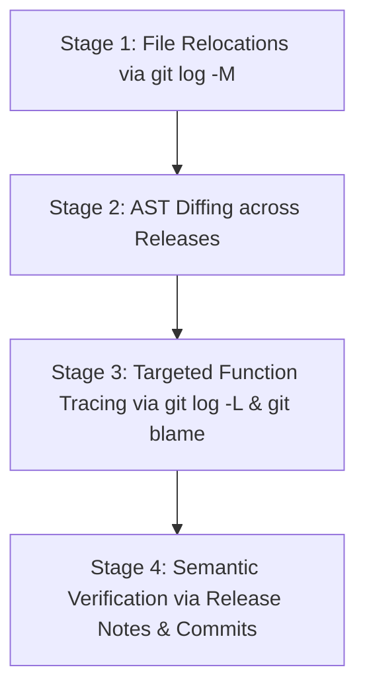

# Retrospect Phase D — Annotation Guidelines & Sourcing Protocol

> **Status:** Standard Operating Procedure (SOP) & Sourcing Specification (Version 1.7 — Final Permutation-Test Edge-Case Audit)  
> **Governance:** Pre-registered for Phase D evaluation (`fastify/fastify` and `pallets/flask`).  
> **Integrity Rule:** All query authoring and ground-truth verification must be conducted using independent external tools and materials. Retrospect search outputs must **never** be consulted during data collection.

---

## 1. Roles & Operational Independence Protocols

To guarantee procedural independence, the benchmark preparation workflow enforces strict operational role separation.

### 1.1 Preferred Dual-Researcher Model

```
+-----------------------------------------------------------------------------------+
|                           PREFERRED DUAL-RESEARCHER MODEL                         |
+-----------------------------------------------------------------------------------+
|  [Researcher 1: Lineage Auditor]               [Researcher 2: Blinded Author]     |
|  - Mines CLI git history (diff, log, blame)    - Reads ONLY external release      |
|  - Maps refactoring chains & cluster bounds    notes, migration guides, issues    |
|  - Establishes ground-truth symbol IDs         - Formulates natural language      |
|  - Blind to query authoring process            developer queries                  |
|                                                - BLIND to modern target code,     |
|                                                  symbol IDs, and file paths       |
+-----------------------------------------------------------------------------------+
                                         │
                                         ▼
                      [Lead Adjudicator / Third-Party Reviewer]
                      - Audits anti-leakage compliance checklist
                      - Reconciles disputed lineage chains
                      - Approves immutable manifest freeze
```

1. **Researcher 1 (Lineage Auditor)**: Identifies refactoring chains using command-line Git tools (`git log`, `git diff -M`, `git blame -C -C`). Documents commit SHAs, dates, and diff snippets. Assigns symbols to **Lineage Clusters**.
2. **Researcher 2 (Blinded Query Author)**: Formulates natural language queries based **exclusively** on independent external documents (release notes, migration guides, issue discussions). The author is blinded to the target's modern implementation and docstrings.
3. **Lead Adjudicator / Third-Party Reviewer**: Audits evidence provenance, validates schema compliance, checks the anti-leakage checklist, resolves disputes between auditors, and enforces the cluster split freeze.

### 1.2 Staged Cryptographically Sealed Single-Researcher Fallback Model

If institutional or resource constraints permit only a single researcher to prepare the benchmark, the researcher must follow a **staged and cryptographically sealed procedure**:

1. **Stage 1 (Query Formulation & Freezing)**:
   - The researcher reviews historical release notes and migration guides **first**, without inspecting modern codebase files.
   - Queries for Categories A, B, C, and D are authored and saved into a sealed text registry.
   - The registry is cryptographically hashed:
     $$\text{Registry Hash} = \text{SHA256}(\text{all\_query\_texts\_and\_categories})$$
   - The hash is committed or timestamped publicly (e.g., Git tag or public gist) **before any modern code mapping or lineage tracing begins**.
2. **Stage 2 (Lineage Tracing & Target Mapping)**:
   - The researcher performs Git history and AST analysis to identify modern ground-truth symbols.
3. **Stage 3 (Query Immutability & Exclusion)**:
   - If lineage tracing reveals that an authored query is misspecified, invalid, or ambiguous, the researcher **cannot edit the query text**.
   - The query must either be retained exactly as originally authored or flagged as `is_excluded: true` with `exclusion_reason: "EXCLUDED_RETROACTIVE_EDIT"`.
4. **Epistemic Disclosure**:
   - Single-researcher staged collection must be explicitly declared in any publication or technical report.
   - The evaluation cannot claim "blinded authoring independence" without third-party adjudication.

---

## 2. Practical Refactoring Discovery Workflow

### 2.1 Essential Distinction: Symbol Density vs. Lineage vs. Eligible Queries

Annotators and auditors must keep three tiers of feasibility evidence strictly distinct:

```
+-----------------------------------------------------------------------------------+
|                           FEASIBILITY EVIDENCE HIERARCHY                          |
+-----------------------------------------------------------------------------------+
|  Tier 1: Callable-Symbol Pool Density                                             |
|  - Raw count of parsed callable symbols (e.g. 300+ symbols in Fastify/Flask).     |
|  - Proves: Candidate pool has realistic distracters.                             |
|  - DOES NOT PROVE: That any symbols were refactored or documented.                |
+-----------------------------------------------------------------------------------+
                                         │  (Requires Git history analysis)
                                         ▼
+-----------------------------------------------------------------------------------+
|  Tier 2: Verified Historical Lineage Chains                                       |
|  - Verified renames, moves, or rewrites in Git commit diffs.                      |
|  - Proves: Refactorings occurred historically in the repository.                  |
|  - DOES NOT PROVE: That external documentation exists or that queries can be      |
|    authored without circularity or code peeking.                                  |
+-----------------------------------------------------------------------------------+
                                         │  (Requires external document search)
                                         ▼
+-----------------------------------------------------------------------------------+
|  Tier 3: Independently Sourceable, Non-Leaking Benchmark Queries                  |
|  - Documented refactorings with archived public release notes or migration guides |
|    permitting blinded query formulation without leaking target modern names.      |
|  - ONLY THIS TIER SUPPORTS VALID BENCHMARK INSTANCES.                             |
+-----------------------------------------------------------------------------------+
```

Treating Tier 1 (symbol count) or Tier 2 (Git renames) as proof of Tier 3 (eligible benchmark queries) is a severe methodological fallacy. Each tier must be audited independently.

### 2.2 Tool Capabilities & Inherent Limitations

Relying on a single Git command is insufficient for refactoring discovery:
- **`git log -M` limitation**: Detects **file renames and relocations only**. It is completely blind to function renames within existing files.
- **`git log -L :<funcName>:<filePath>` limitation**: Relies on built-in regex heuristics for function headers. It frequently fails on nested closures, arrow functions, or decorated Python methods, and breaks if function signatures change significantly.
- **Line-range `git log -L <start>,<end>:<filePath>` limitation**: Breaks across substantial rewrites when line numbers shift or logic is partitioned.
- **AST Diffing limitation**: May struggle with dynamic JavaScript idioms or Python metaprogramming.

### 2.3 Four-Stage Discovery Workflow (Auditor)

Auditors must combine these tools in four sequential stages:



1. **Stage 1 (File-Level Relocations)**: Run `git log --name-status -M --diff-filter=R` to detect file-level renames and cross-directory moves.
2. **Stage 2 (AST Symbol Diffing Across Releases)**: Parse symbol declarations at major release tags (e.g., Fastify v2.0 vs v3.0 vs v4.0; Flask 1.0 vs 2.0 vs 3.0) using tree-sitter or AST parsers to identify vanished vs newly introduced identifiers.
3. **Stage 3 (Targeted Function History Tracing)**: For candidate refactorings identified in Stage 2, trace block-level evolution using `git log -L` and `git blame -C -C` to verify continuity of logic across commits.
4. **Stage 4 (Manual Commit & Release Notes Verification)**: Cross-reference candidate refactorings with official changelogs, migration guides, and commit messages to verify semantic continuity.

---

## 3. Query Categories & Authoring Rules

Queries must be authored according to four disjoint categories:

### Category A: Historical-Vocabulary Queries
- **Source**: Major version migration guides, changelogs, deprecation notices.
- **Objective**: Developer knows an old symbol name or deprecated method name and wants to find the modern replacement.
- **Rules**:
  - The query text **must** include the predecessor name or historical API syntax.
  - The predecessor name **must not** appear verbatim in the target symbol's modern identifier, modern docstring, or modern file path.
  - *Example Pattern*: "How do I register request middleware using the legacy use function syntax?"

### Category B: Historical-Behavior Queries
- **Source**: Release announcement blog posts, issue tracker performance discussions, RFC PRs.
- **Objective**: Developer describes a specific algorithm modification, bug fix, or behavioral shift introduced in the past.
- **Rules**:
  - The query text describes the behavior, performance consideration, or internal mechanism.
  - The query **must not** mention the target's modern symbol name or modern file path.
  - *Example Pattern*: "Which function handles Radix tree route matching with support for wildcard URL parameters?"

### Category C: Current-Code Control Queries
- **Source**: Current official API documentation, current README, current tutorials.
- **Objective**: Routine query answerable directly from modern code identifiers and comments.
- **Rules**:
  - Sourced from current documentation.
  - Serves as baseline to verify that historical indexing does not cause rank dilution on routine queries.
  - *Example Pattern*: "How to define a JSON response schema for route validation?"

### Category D: Unanswerable Negative Queries
- **Source**: Feature requests for unsupported paradigms, competing framework APIs, or features removed without replacement.
- **Objective**: Realistic developer request that has zero valid implementation in the target codebase.
- **Rules**:
  - Must use realistic technical phrasing that creates lexical overlap with common words (e.g., `session`, `database`, `template`).
  - Must have `ground_truth: []`, `is_multi_target: false`, and a mandatory `negative_query_rationale`.
  - Must be accompanied by a manual audit certifying that the feature is completely absent at the evaluated commit.
  - *Example Pattern*: "Configure built-in active record ORM database connection pool" (in Flask or Fastify core, which do not ship built-in ORMs).

---

## 4. Multi-Target Policy & Metric Alignment (Option B)

Phase D adopts **Option B (Unified Multi-Target Metrics)** with an explicit rank-100 cutoff (**MRR@100**):

- **Single-Target Default**: Overwhelming majority of queries target exactly one current symbol (`ground_truth.length === 1`). `is_multi_target` must be `false`.
- **Multi-Target Exception**: Permitted if and only if an atomic refactoring split a historical function into two co-equal modern functions (e.g., `parsePayload` split into `parseJsonPayload` and `parseBufferPayload`).
  - Must set `"is_multi_target": true`.
  - Must provide `"multi_target_rationale"` explaining the architectural division.
  - `ground_truth` array must have at least 2 target symbols (`minItems: 2`).
- **Evaluation Metric Alignment**:
  $$\text{RR@100}(q) = \begin{cases} \frac{1}{\min_{t \in \text{GroundTruth}(q)} \text{rank}(t)} & \text{if } \min_{t \in \text{GroundTruth}(q)} \text{rank}(t) \le 100 \\ 0 & \text{otherwise} \end{cases}$$
  $$\text{Recall@k}(q) = \frac{|\{t \in \text{GroundTruth}(q) : \text{rank}(t) \le k\}|}{|\text{GroundTruth}(q)|}$$
- **Sensitivity Check**: The evaluation runner will automatically report both the unified dataset and the strictly single-target cohort (`is_multi_target === false`) to verify that split functions do not distort primary MRR@100 outcomes.

---

## 5. Primary Analysis Population & Cluster Inclusion

Annotators must adhere to the formal primary population rules:
- **Primary Estimand & Hypotheses**: Population mean paired difference in cluster MRR@100 ($\theta = \mathbb{E}[\text{MRR@100}_{\text{RRF-v2}}(C) - \text{MRR@100}_{\text{Structural}}(C)]$). The primary test directly evaluates the weak null hypothesis of zero mean difference ($H_0: \theta = 0$) against the two-sided alternative ($H_1: \theta \ne 0$) with directional confirmatory interest in $\theta > 0$.
- **Primary Statistical Test & CI**: The **Studentized paired sign-permutation test** ($R = 100{,}000$ sign permutations) evaluated two-sided at $\alpha = 0.05$.
  - *Exact vs. Asymptotic Validity*: Sign-flip permutation inference is **finite-sample exact** under the sharp reflection-symmetry / exchangeability null ($D_j \stackrel{d}{=} -D_j$). For the primary weak null of zero mean difference ($H_0: \theta = 0$), validity is strictly **asymptotic** as $M_{\text{test}} \to \infty$ and conditional on cluster independence, positive sample variance ($s_D^2 > 0$), and bounded support ($D_j \in [-1, +1]$). Cluster independence is an **empirical modeling assumption justified by benchmark design** (disjoint symbol sets and isolated refactoring histories), not an automatic mathematical guarantee.
  - *Monte Carlo p-Value Rule*: Computed using the authoritative plus-one correction:
    $$p = \frac{1 + \text{extreme\_count}}{R + 1} = \frac{1 + \sum_{r=1}^R \mathbb{I}\left( |T^{*(r)}| \ge |T_{\text{obs}}| \right)}{R + 1}$$
    where $R = 100{,}000$ and $R + 1 = 100{,}001$. This strictly bounds $p \in [\frac{1}{100001}, 1]$, prevents an impossible $p = 0.0$, and accounts for random permutation sampling under permutation-validity assumptions. It does **not** make the primary studentized test finite-sample exact under the weak mean-zero null, where validity remains strictly asymptotic.
  - *Zero-Variance Handling (Exact Zero vs. Non-Zero Variance)*: Exact zero variance is determined explicitly by checking whether all permuted values are identical ($\max_j D_j^{*(r)} == \min_j D_j^{*(r)}$) before division. Permutations with identical values are never silently omitted, resampled, or replaced with `NaN`. If all values are zero ($\min D^* == \max D^* == 0$), $T^{*(r)} = 0.0$; if all values are an identical non-zero constant, $|T^{*(r)}| = +\infty$ (evaluating deterministically to $|T^{*(r)}| \ge |T_{\text{obs}}|$ as `true`, $\mathbb{I} = 1$, incrementing `extreme_count`) as a pre-registered convention for an undefined denominator. For non-identical draws ($\max D^* \ne \min D^*$), standard division is computed without ad-hoc tolerance thresholding, preserving valid finite comparisons.
  - *Primary Confidence Interval*: Pre-specified as the **Stratified Cluster Percentile Bootstrap** ($B = 2{,}000$, stratified by repository) using **NumPy's linear percentile interpolation** (`method='linear'`) as authoritative.
  - *Secondary Sensitivity Checks*: Exact unstudentized sign-permutation test (under reflection symmetry), paired Student's t-test, and Wilcoxon signed-rank test.
- **Primary Endpoint Inclusion**: A cluster $C_j$ is evaluated in the primary confirmatory comparison if and only if it is assigned to `HELD_OUT_TEST` and contains at least one valid, unexcluded Category A or Category B query ($|Q_{AB,\text{valid}}(C_j)| \ge 1$).
- **Control & Negative Clusters**: Clusters that contain only Category C queries or only Category D queries are excluded from primary MRR@100. They are analyzed in secondary (Category C rank dilution) and exploratory (Category D rejection) evaluations.
- **Pre-Unblinding Lock**: All exclusion decisions must be finalized and locked before test set retrieval is executed. No post-retrieval query dropping or cluster alteration is permitted.

---

## 6. Anti-Leakage Checklist

Before any candidate instance is accepted into the manifest, the Lead Adjudicator must verify each item:

- [ ] **No Current Code Peeking**: Did the query author confirm in writing that they did not read the target symbol's modern code prior to authoring?
- [ ] **No Verbatim Commit Copying**: Is the query text free from copy-pasting the commit message or PR title of the target commit?
- [ ] **No Target Identifier Bleed**: For Categories A, B, and D, does the query text omit the exact modern identifier and file path?
- [ ] **Zero Prior Benchmark Overlap**: Is the target confirmed **not** to exist in the Phase B (40 cases) or Phase C Express (19 cases) target lists?
- [ ] **External Source Provenance**: Is there a valid URL, document title, or commit SHA cited for the provenance?
- [ ] **Independent Ground-Truth Tracing**: Was the ground truth established via CLI Git tools without running Retrospect?

---

## 7. Target Blacklist Scope

To eliminate cross-phase contamination, the following symbols are blacklisted from Phase D:
1. **Phase B Blacklist**: All 40 target symbols evaluated in Phase B (from `data/benchmark_lineage.json`), including Express, Commander, and Zod targets.
2. **Phase C Express Blacklist**: All 19 Express candidates and held-out symbols evaluated in Phase C.
3. **Blacklisting Rule**: A candidate is disqualified if its qualified symbol name and file path match any Phase B or Phase C target. (No keys, HMAC salts, or confidential Phase C mappings are exposed).

---

## 8. Refactoring Classification & Adjudication Rules

Annotators must classify lineage into one of the following formal types:

| Refactoring Type | Definition | Ground-Truth Handling |
| :--- | :--- | :--- |
| **`RENAME`** | Method/function renamed within the same file or module. | Primary target is the renamed modern symbol. |
| **`CROSS_FILE_MOVE`** | Symbol relocated to a different directory or module file. | Target is the symbol at its new file path. |
| **`SUBSTANTIAL_REWRITE`** | Body replaced or re-architected; signature preserved or adapted. | Target is modern symbol implementing the responsibility. |
| **`EXTRACTION`** | Monolithic function split into core + helpers. | Target is primary caller; helpers recorded if co-equal. |
| **`MERGED_FUNCTIONS`** | Multiple historical functions consolidated into one. | Target is consolidated modern symbol. |
| **`DELETED_NO_REPLACEMENT`**| Feature removed completely. | Classified as Category D (Unanswerable Negative). |
| **`AMBIGUOUS_LINEAGE`** | Conflicting evolution; logic scattered without clear successor. | **EXCLUDED** from benchmark; logged in exclusion table. |

### Handling Ambiguous Lineage
If two annotators disagree on whether a historical symbol evolved into symbol $X$ or symbol $Y$, the candidate is automatically flagged as `AMBIGUOUS_LINEAGE` and **excluded**. A clean, uncontroversial ground truth is mandatory.

---

## 9. Illustrative Manifest Examples (Non-Data Synthetic Placeholders Only)

> **Notice:** The following examples are illustrative, synthetic non-data placeholders demonstrating schema compliance. No actual benchmark instances or ground-truth annotations are created here.

### Synthetic Category A Placeholder (Historical-Vocabulary, Single-Target)
```json
{
  "query_id": "QRY-PHASED-FASTIFY-001",
  "repository": "fastify/fastify",
  "evaluated_commit_sha": "f736849a10a9b2ca57fb09437feb8294cda76234",
  "query_text": "How do I register request middleware using the legacy use function syntax?",
  "category": "HISTORICAL_VOCABULARY",
  "lineage_cluster_id": "FASTIFY-CLUSTER-SYNTHETIC-01",
  "split": "HELD_OUT_TEST",
  "is_multi_target": false,
  "provenance": {
    "source_type": "MIGRATION_GUIDE",
    "source_url": "https://example.org/docs/synthetic-migration-guide",
    "historical_excerpt": "Synthetic excerpt: The legacy use() method has been deprecated and replaced by plugin registration hooks."
  },
  "ground_truth": [
    {
      "symbol_id": "lib/pluginOverride.js::registerPlugin::function",
      "qualified_name": "FastifyInstance.register",
      "file_path": "lib/pluginOverride.js",
      "line_start": 42,
      "line_end": 115,
      "lineage_type": "RENAME",
      "lineage_commits": ["0000000000000000000000000000000000000000"]
    }
  ],
  "annotation_metadata": {
    "annotator_id": "RESEARCHER_SYNTHETIC_A",
    "adjudicator_id": "LEAD_ADJUDICATOR_SYNTHETIC",
    "status": "APPROVED"
  },
  "exclusion_status": {
    "is_excluded": false,
    "exclusion_reason": "NONE"
  }
}
```

### Synthetic Category D Placeholder (Unanswerable Negative)
```json
{
  "query_id": "QRY-PHASED-FLASK-045",
  "repository": "pallets/flask",
  "evaluated_commit_sha": "d086db856be187255b8ec61ef409357393020f32",
  "query_text": "Configure built-in active record database connection pool and model migration generator",
  "category": "UNANSWERABLE_NEGATIVE",
  "lineage_cluster_id": "FLASK-CLUSTER-SYNTHETIC-NEG-02",
  "split": "DEVELOPMENT",
  "is_multi_target": false,
  "provenance": {
    "source_type": "NEGATIVE_SPECIFICATION",
    "source_url": "https://example.org/docs/synthetic-negative-spec",
    "historical_excerpt": "Synthetic excerpt: Flask core provides WSGI routing and request dispatching, delegating ORM operations to external extensions."
  },
  "ground_truth": [],
  "negative_query_rationale": "Flask core provides WSGI request/response handling and routing, explicitly delegating database and ORM operations to external packages.",
  "annotation_metadata": {
    "annotator_id": "RESEARCHER_SYNTHETIC_B",
    "adjudicator_id": "LEAD_ADJUDICATOR_SYNTHETIC",
    "status": "APPROVED"
  },
  "exclusion_status": {
    "is_excluded": false,
    "exclusion_reason": "NONE"
  }
}
```

---

## 10. Manifest Quality Assurance Protocol

Before the manifest is frozen:
1. **Schema Validation with Active Format Checking**: Must validate without errors against [`docs/phase_d/dataset_manifest.schema.json`](file:///d:/base%20papers%20considered/Retrospect/docs/phase_d/dataset_manifest.schema.json) using a certified Draft 2020-12 validator with `format_checker=Draft202012Validator.FORMAT_CHECKER` actively enforcing URI (RFC 3986) and date-time (ISO 8601 / RFC 3339) specifications.
2. **Validation Runner Semantic Line Ordering Check**: The validation runner enforces the cross-property invariant that `line_end >= line_start` for all ground-truth targets (relational cross-field numeric comparisons are not natively expressible in pure Draft 2020-12 JSON Schema).
3. **Ground-Truth Existence Check**: Every `file_path` and `symbol_id` in `ground_truth` must exist in the target repository snapshot at the specified commit SHA.
4. **Cluster Partition Purity**: An automated script must verify that `Set(clusters(DEV)) ∩ Set(clusters(TEST)) === ∅`.
5. **Cryptographic Checksumming**: Generate SHA-256 digests for both `manifest_phase_d_dev.json` and `manifest_phase_d_test.json` to seal the benchmark prior to evaluation.
