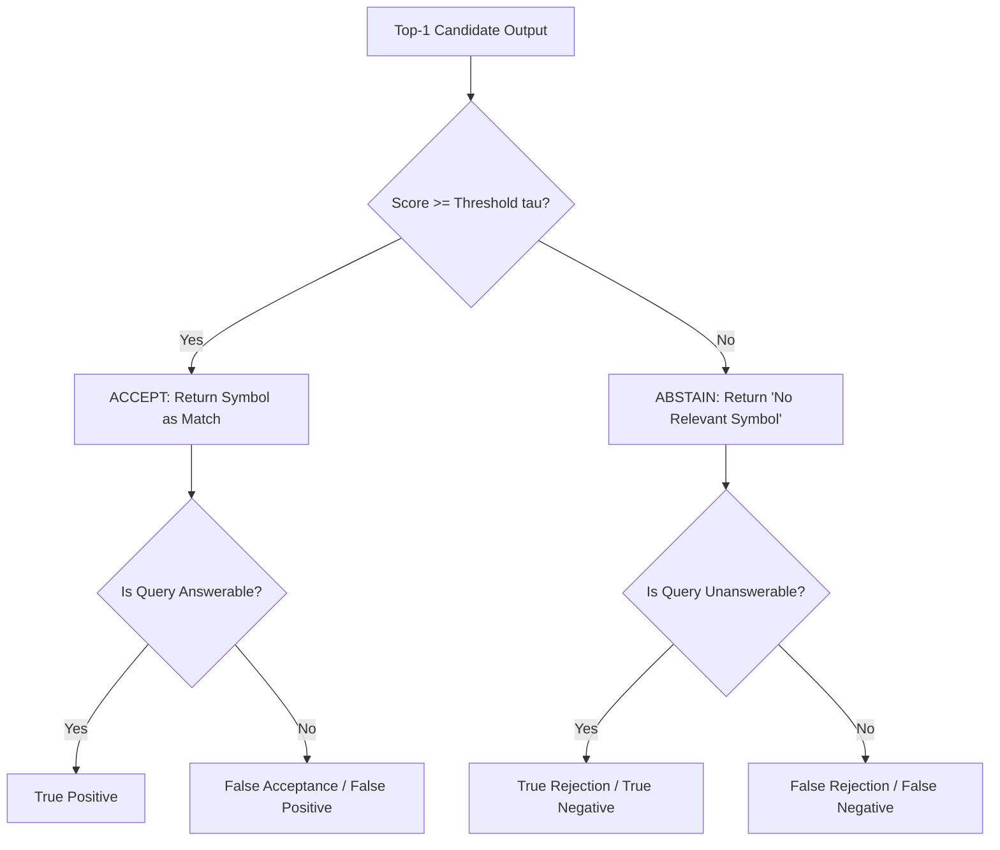

# Retrospect — Phase D Benchmark Protocol: Independent Evaluation of Historical Code Retrieval

> **Status:** Pre-registered Benchmark Protocol & Methodology Specification (Version 1.7 — Final Permutation-Test Edge-Case Audit)  
> **Repository Baseline:** Commit `17ea399217737f8d5fe2c32c310b69c2f812b84d` (`main`)  
> **Evaluation Systems:** Isolated RRF-v2 (`src/retrieval/RRFv2.js`) vs. Structural-Only Baseline vs. Frozen RRF-v1 (`src/retrieval/UnifiedSearch.js`)  
> **Execution Constraint:** Protocol and methodology design only. No benchmarking, query mining, dataset cloning, or evaluation script execution.

---

## 1. Executive Summary & Epistemic Scope

Retrospect investigates whether augmenting structural code retrieval (AST structure, symbol identifiers, call-graph relationships) with repository version history (commit messages, diff tokens, transitive lineage chains) improves code symbol retrieval in real-world maintenance workflows.

Prior project phases established the following **confirmed facts**:
1. **Phase B Diagnostic Baseline (40 queries)**: Demonstrated initial retrieval capabilities on a developmental dataset, but queries were repeatedly observed and tuned against during development. Phase B results are diagnostic only and cannot support claims of generalizable retrieval superiority.
2. **Phase B Evaluation Harness Defect**: In `scripts/evaluate_phase_b_fusion.js`, the negative-query rejection threshold (`top1.score >= 0.20`) was mathematically unreachable for Reciprocal Rank Fusion ($k = 60, \max \text{score} \approx 0.01639$), resulting in an artificially reported 0.0% false-positive rate.
3. **Phase C Express Author Pack Independence Failure**: Sourced from a public repository, suffered 80% target overlap with Phase B (8 of 10 Express targets), contained hardcoded HMAC exporter salts, and held only 9 held-out cards. Phase C has been quarantined and cannot be used for independent empirical claims.
4. **RRF-v1 Algorithmic Asymmetries**: RRF-v1 injected an artificial fallback rank $N$ for symbols missing structural signal and assigned sequential integer ranks $1 \dots N$ sorted alphabetically by symbol ID for zero-score historical candidates, creating score leaks based purely on symbol naming.
5. **RRF-v2 Isolated Hardening**: An isolated RRF-v2 module was implemented in `src/retrieval/RRFv2.js` featuring zero-signal gating ($\mathbb{I}(\text{score} > 0)$), fractional average rank tie-breaking, strict total order comparators, finite-number input sanitization, max-pooling deduplication, and zero fallback contributions for missing symbols. All 15 unit tests pass deterministically.

**Scope of Phase D**: Phase D defines a new, independent, dual-language benchmark across two external codebases (`fastify/fastify` and `pallets/flask`), enforcing lineage cluster split isolation, strict source independence, a pre-registered primary endpoint, and cluster-aware statistical analysis.

---

## 2. Pre-Registered Research Questions & Hypotheses

To prevent post-hoc outcome switching, Phase D strictly separates the **single confirmatory primary endpoint** from secondary and exploratory analyses.

### 2.1 Primary Confirmatory Endpoint (RQ1)

- **Research Question 1 (Primary Confirmatory Comparison)**:  
  *Does combining structural retrieval with Git-history signals via Reciprocal Rank Fusion (RRF-v2) significantly improve the population mean cluster-level Mean Reciprocal Rank at cutoff 100 (MRR@100) over a structural-only retrieval baseline on independently sourced historical queries in the held-out test set?*
  - **Comparison**: RRF-v2 Candidate System (S1) vs. Structural-Only Baseline (B1).
  - **Evaluation Population**: Independently sourced historical queries (Category A: Historical-Vocabulary and Category B: Historical-Behavior) evaluated exclusively on the **Held-Out Test Set** across eligible lineage clusters ($M_{\text{test}}$).
  - **Primary Estimand ($\theta$)**: The population mean paired cluster difference in MRR@100 between RRF-v2 and Structural-Only:
    $$\theta = \mathbb{E}\left[ \text{MRR@100}_{\text{RRF-v2}}(C) - \text{MRR@100}_{\text{Structural}}(C) \right]$$
  - **Sample Point Estimate ($\hat{\theta}$)**: Mean paired difference across eligible test clusters:
    $$\hat{\theta} = \Delta \overline{\text{MRR@100}} = \frac{1}{M_{\text{test}}} \sum_{j=1}^{M_{\text{test}}} D_j$$
    where $D_j = \text{MRR@100}_{\text{RRF-v2}}(C_j) - \text{MRR@100}_{\text{Structural}}(C_j)$.
  - **Unit of Analysis**: The **Lineage Cluster**. For each eligible cluster $C_j$ in the test set, the cluster score is the arithmetic mean of reciprocal ranks of the valid historical queries belonging to that cluster:
    $$\text{MRR@100}(C_j) = \frac{1}{|Q_{AB,\text{valid}}(C_j)|} \sum_{q \in Q_{AB,\text{valid}}(C_j)} \text{RR@100}(q)$$
  - **Statistical Hypotheses**:
    - **Primary Scientific Null Hypothesis ($H_0$)**:  
      The primary confirmatory test directly evaluates the **weak null hypothesis of zero population mean difference**:
      $$H_0: \theta = \mathbb{E}[D] = 0$$
      (RRF-v2 confers no mean retrieval advantage or disadvantage over Structural-Only across the population of lineage clusters).
    - **Alternative Hypothesis ($H_1$)**:  
      $$H_1: \theta \ne 0$$
      (evaluated two-sided at $\alpha = 0.05$ to penalize performance regressions, with directional confirmatory interest in $\theta > 0$).
  - **Primary Significance Test**: The **Studentized Paired Sign-Permutation Test** (Chung & Romano, 2013; Janssen, 1997, 1999) with $R = 100{,}000$ sign permutations evaluated two-sided at $\alpha = 0.05$.
    - *Terminology & Inferential Foundation*:  
      This procedure is a **Studentized sign-flip permutation test**, not a "Fisher randomization test." Because retrieval algorithms are deterministic systems evaluated on fixed benchmark codebases rather than experimental subjects receiving physically randomized treatments, the reference distribution is constructed via independent sign inversions across clusters.
    - *Distinction Between Exact and Asymptotic Validity*:  
      - **Exact Sign-Flip Validity under Symmetry/Exchangeability Null**: Sign-flip permutation inference provides **finite-sample exact** Type I error control if and only if one assumes the sharp reflection-symmetry / exchangeability null hypothesis ($H_0^{\text{sym}}: D_j \stackrel{d}{=} -D_j$). Under $H_0^{\text{sym}}$, the conditional distribution of paired differences given their absolute magnitudes $|D_j|$ is strictly symmetric about zero across all $2^{M_{\text{test}}}$ sign configurations.
      - **Asymptotic Validity under the Weak Mean-Zero Null**: The primary confirmatory hypothesis of Phase D is the **weak null of zero population mean difference** ($H_0: \theta = \mathbb{E}[D] = 0$), which does *not* assume reflection symmetry or identical error distributions, allowing skewed or asymmetric differences where sign-symmetry fails. Under this weak null, the unstudentized sign-flip test is invalid, and the studentized test is **not exact in finite samples**. Instead, studentizing by the permuted standard error normalizes the test statistic such that the permutation distribution asymptotically matches the standard Gaussian limit of the sample mean difference as $M_{\text{test}} \to \infty$ (Chung & Romano, 2013; Janssen, 1997). This validity is **strictly asymptotic** and conditional on:
        1. Mutual independence of cluster differences $D_1, \dots, D_{M_{\text{test}}}$ (an empirical modeling assumption justified by benchmark design).
        2. Non-degenerate positive variance ($\sigma_D^2 > 0$).
        3. Standard regularity conditions (bounded support $D_j \in [-1, +1]$ guaranteeing finite moments).
      - *No Conflation of Justifications*: The exact finite-sample property belongs exclusively to the sign-symmetry null. Under the weak mean-zero null, all confirmatory inferences are asymptotic approximations.
    - *Observed Test Statistic ($T_{\text{obs}}$)*:  
      The studentized sample mean difference:
      $$T_{\text{obs}} = \frac{\bar{D}}{\widehat{\text{SE}}(\bar{D})} = \frac{\frac{1}{M_{\text{test}}} \sum_{j=1}^{M_{\text{test}}} D_j}{\sqrt{\frac{s_D^2}{M_{\text{test}}}}}$$
      where $s_D^2 = \frac{1}{M_{\text{test}} - 1} \sum_{j=1}^{M_{\text{test}}} (D_j - \bar{D})^2$.
      *Precondition*: The observed sample variance must be strictly positive ($s_D^2 > 0$). If $s_D^2 = 0$ (all observed cluster differences are identical), $T_{\text{obs}}$ is undefined; confirmatory testing is halted, and descriptive statistics and bootstrap intervals are reported instead.
    - *Permutation Procedure*:  
      In each permutation $r \in \{1, \dots, R\}$ ($R = 100{,}000$):
      1. Draw independent Rademacher signs $s_j \in \{-1, +1\}$ with $P(s_j = +1) = 0.5$ for $j = 1, \dots, M_{\text{test}}$.
      2. Form permuted differences $D_j^{*(r)} = s_j D_j$.
      3. Compute permuted sample mean $\bar{D}^{*(r)} = \frac{1}{M_{\text{test}}} \sum_{j=1}^{M_{\text{test}}} D_j^{*(r)}$.
      4. Compute permuted sample variance $s_D^{*2(r)} = \frac{1}{M_{\text{test}} - 1} \sum_{j=1}^{M_{\text{test}}} (D_j^{*(r)} - \bar{D}^{*(r)})^2$ and standard error $\widehat{\text{SE}}^{*}(r) = \sqrt{\frac{s_D^{*2(r)}}{M_{\text{test}}}}$.
      5. Compute the permuted studentized statistic $T^{*(r)}$ subject to the Zero-Variance Handling Rule below.
    - *Monte Carlo p-Value Calculation (Plus-One Correction)*:  
      Define the two-sided extreme count across the $R = 100{,}000$ sampled permutations:
      $$\text{extreme\_count} = \sum_{r=1}^R \mathbb{I}\left( |T^{*(r)}| \ge |T_{\text{obs}}| \right)$$
      The Monte Carlo p-value is computed using the authoritative plus-one correction (Davison & Hinkley, 1997; Phipson & Smyth, 2010):
      $$p = \frac{1 + \text{extreme\_count}}{R + 1} = \frac{1 + \sum_{r=1}^R \mathbb{I}\left( |T^{*(r)}| \ge |T_{\text{obs}}| \right)}{R + 1}$$
      where $R = 100{,}000$ and $R + 1 = 100{,}001$.  
      - *Monte Carlo Sampling Guarantee*: Incorporating the observed test statistic as one configuration within the reference ensemble prevents an impossible empirical $p = 0.0$ (minimum attainable $p = \frac{1}{100001} \approx 9.9999 \times 10^{-6}$) and properly accounts for the discrete sampling variability of drawing $R$ random sign vectors from $\{-1, +1\}^{M_{\text{test}}}$. Under an exact permutation null where signs are conditionally exchangeable (such as the sharp reflection-symmetry null $H_0^{\text{sym}}$), this correction guarantees valid Type I error control ($\mathbb{P}(p \le \alpha) \le \alpha$).
      - *Inferential Scope & Asymptotic Distinction*: The plus-one correction addresses only Monte Carlo sampling variance of the permutation distribution; it does **not** make the primary studentized sign-flip test finite-sample exact under the weak mean-zero null ($H_0: \theta = \mathbb{E}[D] = 0$). Because paired differences under the weak null may be skewed or asymmetric, the studentized test's validity under $H_0$ remains strictly **asymptotic** ($M_{\text{test}} \to \infty$) and conditional on cluster independence, positive variance ($\sigma_D^2 > 0$), and bounded support ($D_j \in [-1, +1]$). Finite-sample exactness is possessed exclusively by the unstudentized sign-flip test under the sharp reflection-symmetry null ($D_j \stackrel{d}{=} -D_j$).
    - *Zero-Variance Permutation Handling (Exact Zero vs. Non-Zero Variance)*:  
      In discrete or tie-heavy distributions, a sampled sign flip may produce identical permuted differences ($D_1^{*(r)} = \dots = D_{M_{\text{test}}}^{*(r)}$), yielding an exact sample variance of zero ($s_D^{*2(r)} = 0.0$) and an undefined ratio $0/0$ or $c/0$. The evaluation harness handles this deterministically according to the following pre-registered rules:
      1. **Explicit Implementation Criterion (`max === min`)**:  
         Before computing variance or division, the evaluator explicitly tests whether all permuted cluster differences in that draw are identical:
         $$\max_{j} D_j^{*(r)} == \min_{j} D_j^{*(r)}$$
         Testing equality of extremes directly on the sample vector is numerically exact and independent of floating-point rounding in computed sums of squared deviations. If and only if $\max_j D_j^{*(r)} == \min_j D_j^{*(r)}$, the sample variance is mathematically zero ($s_D^{*2(r)} = 0.0$).
      2. **Strict Prohibition of Permutation Omission or Resampling**: Evaluators must **never silently omit, skip, or resample** a sign-flipped draw whose denominator is zero. Discarding draws alters the uniform probability measure over the Rademacher hypercube $\{-1, +1\}^{M_{\text{test}}}$, introducing selection bias. All $R$ sampled permutations must be evaluated, and the denominator remains strictly $R + 1 = 100{,}001$.
      3. **Strict Prohibition of `NaN` Statistics**: Under no circumstances may `NaN` enter the comparison $|T^{*(r)}| \ge |T_{\text{obs}}|$. In standard IEEE 754 implementations, `NaN >= x` silently evaluates to `false`, which would spuriously misclassify extreme draws as non-extreme. The explicit `max === min` check prior to division guarantees that `0 / 0` and `c / 0` are intercepted before any undefined floating-point division occurs.
      4. **Deterministic Handling for Exact Zero Variance ($\max_j D_j^{*(r)} == \min_j D_j^{*(r)}$)**:
         - *Case 1 (Identical Zero Differences)*: If $\min_j D_j^{*(r)} == 0.0$ (all permuted differences are zero, $D_j^{*(r)} = 0$ for all $j$), there is zero directional signal and zero dispersion. The statistic is deterministically resolved to $T^{*(r)} = 0.0$. The comparison $|T^{*(r)}| \ge |T_{\text{obs}}|$ evaluates to $0.0 \ge |T_{\text{obs}}|$, which yields `true` (1) if $|T_{\text{obs}}| == 0.0$ and `false` (0) if $|T_{\text{obs}}| > 0$.
         - *Case 2 (Identical Non-Zero Differences)*: If $\min_j D_j^{*(r)} \ne 0.0$ (all permuted cluster differences equal an identical non-zero constant $c \ne 0$), the permuted sample exhibits unanimous directional agreement with zero sample variance. The evaluator deterministically assigns $|T^{*(r)}| = +\infty$. For any finite observed statistic $|T_{\text{obs}}| < \infty$, the comparison $|T^{*(r)}| \ge |T_{\text{obs}}|$ evaluates deterministically to **`true`** ($\mathbb{I} = 1$), incrementing `extreme_count`.  
           *Inferential Limitation*: Assigning an infinite statistic ($|T^{*(r)}| = +\infty$) in this zero-variance, non-zero-mean case is a **pre-registered handling convention for an otherwise undefined statistic**, not a mathematical proof of finite-sample exactness or validity under the weak null.
      5. **Handling of Positive Variance ($\max_j D_j^{*(r)} \ne \min_j D_j^{*(r)}$)**:
         - Whenever cluster differences are not all identical, sample variance is strictly positive ($s_D^{*2(r)} > 0$). Standard floating-point division is computed directly: $T^{*(r)} = \bar{D}^{*(r)} / \widehat{\text{SE}}^{*}(r)$ where $\widehat{\text{SE}}^{*}(r) = \sqrt{s_D^{*2(r)} / M_{\text{test}}}$.
         - Positive variance is never coerced into zero or infinity based on an ad-hoc numerical tolerance threshold.
         - *Implication for Small Positive Denominators*: In samples where differences are clustered closely with slight dispersion, $\widehat{\text{SE}}^{*}(r)$ can be small, yielding a large finite statistic $|T^{*(r)}|$. This is evaluated directly by numerical comparison against $|T_{\text{obs}}|$ without heuristic truncation. This sensitivity to small denominators in discrete or tied cluster samples is an inherent finite-sample property of studentization ($M_{\text{test}} < 25$), reinforcing that the studentized test's validity under the weak mean-zero null is asymptotic.
    - *Underlying Assumptions & Asymptotic vs. Finite-Sample Validity*:
      1. **Cluster Independence (Modeling Assumption)**: Cluster differences $D_1, \dots, D_{M_{\text{test}}}$ are assumed to be mutually independent. This is an **empirical modeling assumption justified by benchmark design** (ensuring disjoint symbol membership, isolating co-refactoring histories, and preventing shared parent classes/modules across clusters). Disjoint partitioning mitigates direct symbol linkage, but independence is an empirical modeling assumption rather than an automatic mathematical guarantee, as all clusters within a repository share repository-wide architectural conventions and global commit graphs.
      2. **Bounded Support / Finite Moments**: $D_j \in [-1, +1]$ almost surely, guaranteeing finite moments and bounding extreme outlier influence.
      3. **Non-Degenerate Sample Variance**: $s_D^2 > 0$ (at least two distinct difference values exist in the sample, so the standard error is strictly positive).
      4. **Asymptotic Validity for Weak Mean Null**: As proven by Chung & Romano (2013, Theorem 3.1) and Janssen (1997), studentizing by the permuted standard error normalizes the test statistic, ensuring that the permutation distribution asymptotically matches the standard Gaussian limit of $T$ under the weak null $\theta = \mathbb{E}[D] = 0$. The test asymptotically controls Type I error at nominal $\alpha = 0.05$ **even if the underlying distribution of paired differences is skewed or asymmetric**.
      5. **Finite-Sample Limitations**:
         - The test is **asymptotically valid**, not exact in small finite samples.
         - In small cluster samples ($M_{\text{test}} < 25$), the denominator $s_D^*$ can fluctuate across permutations, particularly if differences exhibit discrete lumps or high tie rates ($D_j = 0$).
         - If paired differences are degenerate ($> 70\%$ zeros), the studentized statistic can be unstable.
         - The test does not solve cluster dependence: if residual correlation exists across clusters within a repository, the effective sample size is reduced, potentially inflating Type I error.
    - *Secondary Sensitivity Analyses*:
      1. **Exact Unstudentized Sign-Flip Permutation Test**: Reported as a sensitivity check under the sharp exchangeability / reflection-symmetry null ($D_j \stackrel{d}{=} -D_j$), under which it provides finite-sample exact inference.
      2. **Standard Paired Student's t-test**: Parametric check on $T_{\text{obs}}$ evaluated against the $t(M_{\text{test}} - 1)$ distribution.
      3. **Wilcoxon Signed-Rank Test & Hodges-Lehmann Pseudomedian**: Evaluates median/pseudomedian shift.
  - **Primary Confidence Interval**: The **Stratified Cluster Percentile Bootstrap** ($B = 2{,}000$ resamples with replacement at the cluster level, stratified by repository).
    - *Resampling Algorithm*:
      1. Partition test clusters into Stratum 1 (Fastify, $M_{\text{fastify}}$) and Stratum 2 (Flask, $M_{\text{flask}}$).
      2. In each replicate $b \in \{1, \dots, B\}$, sample $M_{\text{fastify}}$ clusters with replacement from Fastify, and $M_{\text{flask}}$ clusters with replacement from Flask.
      3. Compute bootstrap mean difference $\hat{\theta}^{*(b)}$ on the combined sample of $M_{\text{test}}$ clusters.
      4. Sort the $B = 2{,}000$ bootstrap replicates: $\hat{\theta}^{*(1)} \le \hat{\theta}^{*(2)} \le \dots \le \hat{\theta}^{*(B)}$.
    - *Authoritative Percentile Convention (NumPy Linear Interpolation)*:  
      The 95% Confidence Interval is computed authoritative using **NumPy's linear percentile interpolation** (`np.percentile(replicates, [2.5, 97.5], method='linear')`).
      For $B = 2{,}000$ sorted replicates $T_{(1)} \le \dots \le T_{(B)}$ (1-indexed), the virtual index for percentile $q \in [0, 100]$ is $idx = 1 + \frac{q}{100}(B - 1)$:
      - At $q = 2.5\%$, $idx = 1 + 0.025 \times 1999 = 50.975$, interpolating linearly between $T_{(50)}$ and $T_{(51)}$:
        $$\hat{\theta}^*_{0.025} = T_{(50)} + 0.975 \times (T_{(51)} - T_{(50)})$$
      - At $q = 97.5\%$, $idx = 1 + 0.975 \times 1999 = 1950.025$, interpolating linearly between $T_{(1950)}$ and $T_{(1951)}$:
        $$\hat{\theta}^*_{0.975} = T_{(1950)} + 0.025 \times (T_{(1951)} - T_{(1950)})$$
      These bounds are **linearly interpolated percentiles**, not exact discrete order statistics.
    - *Methodological Justification over BCa*: Percentile bootstrap is chosen because BCa requires jackknife acceleration estimation $\hat{a}$, which is erratic and numerically unstable with clustered, discrete, bounded differences and small cluster counts per stratum. The percentile interval is range-preserving ($\text{CI} \subseteq [-1, +1]$) and monotonic.
    - *Stratification Limitations with $K = 2$ Repositories*:
      1. **Fixed Stratum Assumption**: Stratification fixes the Fastify/Flask cluster ratio across resamples. It models repository identity as a **fixed factor**, not a random effect; inferences do not generalize to unobserved third-party repositories.
      2. **Small Strata Support**: If either repository has $M_k < 15$ clusters, the empirical bootstrap distribution has limited discrete support, which may cause slight undercoverage.
  - **Confirmatory Family**: Exactly one single pre-registered test. No multiple-testing penalty is required for this primary confirmatory endpoint. Point estimates alone cannot establish statistical significance.

### 2.2 Secondary Confirmatory & Diagnostic Outcomes

Secondary outcomes provide detailed diagnostic insight and are evaluated with the **Benjamini-Hochberg False Discovery Rate (FDR)** procedure at $q = 0.05$:

- **Secondary Outcome 2A (Recall Profile on Historical Queries)**:  
  Recall@1, Recall@5, and Recall@10 of RRF-v2 vs. Structural-Only on Categories A & B in the held-out test set.
- **Secondary Outcome 2B (Fusion Architecture Validation — RRF-v2 vs. RRF-v1)**:  
  Paired cluster-level $\Delta \overline{\text{MRR@100}}$ between RRF-v2 (S1) and the frozen RRF-v1 baseline (B3) on Categories A & B, testing whether eliminating fallback ranks and alphabetical rank leakage improves ranking accuracy.
- **Secondary Outcome 2C (Current-Code Rank Dilution / Regression Check)**:  
  Performance of RRF-v2 vs. Structural-Only on **Category C (Current-Code Controls)**:
  $$\Delta \overline{\text{MRR@100}}_{\text{control}} = \text{MRR@100}_{\text{RRF-v2}}(C_{\text{control}}) - \text{MRR@100}_{\text{Structural}}(C_{\text{control}})$$
  *Hypothesis under test*: Does adding historical signals introduce noise or rank dilution when modern structural identifiers are already sufficient?
- **Secondary Outcome 2D (Per-Category & Per-Repository Breakdowns)**:  
  Independent reporting of MRR@100 and Recall@k for:
  - Category A (Historical-Vocabulary) alone.
  - Category B (Historical-Behavior) alone.
  - Fastify (JavaScript/TypeScript) alone.
  - Flask (Python) alone.

### 2.3 Exploratory Analyses

- **Exploratory Outcome 3A (Lexical BM25 Text Baseline)**: Comparison against a standard Okapi BM25 index over concatenated current code and historical commit logs (System B4).
- **Exploratory Outcome 3B (Negative Query Abstention Trade-offs)**: Empirical operating curves (ROC/DET) and rejection accuracy on Category D unanswerable queries under calibrated decision thresholds.

---

## 3. Primary Analysis Population & Lineage Cluster Inclusion

To ensure the primary analysis population is unambiguous and immune to post-hoc selection, the following inclusion rules are strictly pre-registered:

### 3.1 Primary Cluster Eligibility Rule

A lineage cluster $C_j$ enters the primary confirmatory dataset if and only if all of the following conditions are satisfied:
1. **Split Assignment**: The cluster is assigned to the `HELD_OUT_TEST` partition ($C_j \in \text{Clusters}(\text{HELD\_OUT\_TEST})$).
2. **Category Representation**: The cluster contains **at least one valid (unexcluded) query** belonging to Category A (Historical-Vocabulary) or Category B (Historical-Behavior):
   $$Q_{AB,\text{valid}}(C_j) = \{ q \in C_j : q.\text{split} = \text{"HELD\_OUT\_TEST"} \land q.\text{category} \in \{A, B\} \land \neg q.\text{exclusion\_status.is\_excluded} \}$$
   $$|Q_{AB,\text{valid}}(C_j)| \ge 1$$

### 3.2 Excluded Clusters & Handling of Excluded Queries

- **Non-Target Clusters**: Clusters that contain **only** Category C queries (Current-Code Controls) or **only** Category D queries (Unanswerable Negatives) are **excluded** from the primary cluster-level calculation. They are analyzed exclusively in secondary (Category C rank dilution) and exploratory (Category D rejection) evaluations.
- **Handling Excluded Queries**: Queries marked `is_excluded: true` are completely excluded from both the numerator and denominator of metric calculations. If all queries in a cluster are excluded, that cluster drops from the primary analysis.
- **Pre-Unblinding Lock**: All exclusion decisions must be finalized and locked **before** unblinding or executing retrieval on the test set. Once test set retrieval is executed, **no queries may be excluded and no cluster membership may be altered**. This prevents selective attrition or silent population shifts.

---

## 4. Benchmark Repositories & Feasibility Discovery

### 4.1 Candidate Repositories

| Property | Repository 1: Fastify | Repository 2: Flask |
| :--- | :--- | :--- |
| **Canonical Identity** | `fastify/fastify` | `pallets/flask` |
| **Repository URL** | `https://github.com/fastify/fastify` | `https://github.com/pallets/flask` |
| **Primary Languages** | JavaScript (Node.js), TypeScript | Python |
| **License** | MIT License | BSD-3-Clause License |
| **Evaluated Commit SHA** | `f736849a10a9b2ca57fb09437feb8294cda76234` | `d086db856be187255b8ec61ef409357393020f32` |
| **Commit Range** | Root commit (`2016-10-18`) to Evaluated SHA (`2026`) | Root commit (`2010-04-16`) to Evaluated SHA (`2026`) |
| **Commit Depth** | ~4,902 commits, 450+ releases | ~5,562 commits, 30+ releases |
| **Source Scope** | `lib/**/*.js`, `fastify.js`, `types/**/*.d.ts` | `src/flask/**/*.py` |
| **Candidate Pool Scope** | All exported and top-level functions, methods, plugin hooks | All module functions, class methods, blueprint dispatchers |
| **Excluded Scope** | `test/**`, `docs/**`, `examples/**`, `benchmark/**` | `tests/**`, `docs/**`, `examples/**`, `artwork/**` |

### 4.2 Essential Distinction: Symbol Density vs. Lineage vs. Eligible Queries

A critical methodological rule of Phase D is that three levels of feasibility evidence must be kept strictly distinct:

```
+-----------------------------------------------------------------------------------+
|                           FEASIBILITY EVIDENCE HIERARCHY                          |
+-----------------------------------------------------------------------------------+
|  Tier 1: Callable-Symbol Pool Density                                             |
|  - Raw count of parsed callable symbols (e.g. 300+ symbols in Fastify/Flask).     |
|  - Proves: Candidate pool has realistic distracters.                             |
|  - DOES NOT PROVE: That any symbols were refactored or documented.                |
+-----------------------------------------------------------------------------------+
                                         │  (Requires Git history analysis)
                                         ▼
+-----------------------------------------------------------------------------------+
|  Tier 2: Verified Historical Lineage Chains                                       |
|  - Verified renames, moves, or rewrites in Git commit diffs.                      |
|  - Proves: Refactorings occurred historically in the repository.                  |
|  - DOES NOT PROVE: That external documentation exists or that queries can be      |
|    authored without circularity or code peeking.                                  |
+-----------------------------------------------------------------------------------+
                                         │  (Requires external document search)
                                         ▼
+-----------------------------------------------------------------------------------+
|  Tier 3: Independently Sourceable, Non-Leaking Benchmark Queries                  |
|  - Documented refactorings with archived public release notes or migration guides |
|    permitting blinded query formulation without leaking target modern names.      |
|  - ONLY THIS TIER SUPPORTS VALID BENCHMARK INSTANCES.                             |
+-----------------------------------------------------------------------------------+
```

Treating Tier 1 (symbol count) or Tier 2 (Git renames) as proof of Tier 3 (eligible benchmark queries) is a severe methodological fallacy. Each tier must be audited independently.

### 4.3 Inherent Tool Limitations & Discovery Protocol

- **`git log -M` limitation**: Detects **file renames and relocations only**. It does **not** detect function renames inside existing files.
- **`git log -L :<funcName>:<filePath>` limitation**: Relies on built-in regex heuristics for function headers. It frequently fails on nested closures, arrow functions, or decorated Python methods, and breaks if function signatures change significantly.
- **Line-range `git log -L <start>,<end>:<filePath>` limitation**: Breaks across substantial rewrites when line numbers shift or logic is partitioned.
- **AST Diffing limitation**: May struggle with dynamic JavaScript idioms or Python metaprogramming.

#### Four-Stage Discovery Protocol
1. **Stage 1 (File-Level Relocations)**: Run `git log --name-status -M --diff-filter=R` to detect file-level renames and cross-directory moves.
2. **Stage 2 (AST Symbol Diffing Across Releases)**: Parse symbol declarations at major release tags (e.g., Fastify v2.0 vs v3.0 vs v4.0; Flask 1.0 vs 2.0 vs 3.0) using tree-sitter or AST parsers to identify vanished vs newly introduced identifiers.
3. **Stage 3 (Targeted Function History Tracing)**: For candidate refactorings identified in Stage 2, trace block-level evolution using `git log -L` and `git blame -C -C` to verify continuity of logic across commits.
4. **Stage 4 (Manual Commit & Release Notes Verification)**: Cross-reference candidate refactorings with official changelogs, migration guides, and commit messages to verify semantic continuity.

#### Refactoring Classification Criteria
- **Verified Rename**: An unbroken continuity of semantic responsibility where an identifier changed from $name_1$ to $name_2$, corroborated by commit diffs and migration/changelog documentation.
- **Verified Move**: Symbol relocated from file $X$ to file $Y$, with body similarity $\ge 70\%$ or explicit commit documentation detailing the move.
- **Substantial Rewrite**: The function's internal algorithm was largely or entirely replaced, but it preserves the architectural contract or public interface responsibility.

#### Audit Pass Criteria
- $\ge 300$ callable symbols parsed without errors in each codebase snapshot.
- Full Git history present (`git rev-parse --is-shallow-repository` returns `false`).
- $\ge 25$ verified refactor chains identified per repository.
- Public migration guides and release notes archived and accessible.

If either repository fails any criterion, data collection is halted and reported immediately. The feasibility audit is strictly read-only and is **not** executed during this task.

---

## 5. Query Categories & Eligibility Criteria

Phase D defines four disjoint query categories:

### Category A: Historical-Vocabulary Queries
- **Definition**: Queries searching for a symbol using its deprecated, predecessor, or former identifier, or using terminology specific to an older major version (e.g., searching for `use()` in a framework that replaced it with `register()`).
- **Eligibility Rules**:
  - Must target a current symbol with an unbroken, verified rename or move lineage.
  - The query text **must** include the predecessor name or historical API syntax.
  - The predecessor name **must not** appear as an exact token in the current symbol's identifier, current docstring, or current file path.

### Category B: Historical-Behavior Queries
- **Definition**: Queries describing an algorithm, performance optimization, bug fix, or responsibility that was introduced or substantially modified in a historical commit, where modern code no longer contains descriptive docstrings or obvious identifier tokens.
- **Eligibility Rules**:
  - Must target a current symbol whose implementation was substantially rewritten, optimized, or migrated.
  - Query text describes the behavior as documented in a release note, issue discussion, or migration guide.
  - Must not be answerable through trivial substring matching on the modern symbol name.

### Category C: Current-Code Control Queries
- **Definition**: Routine developer queries authored from current documentation, API references, or public tutorials describing functionality as it exists today.
- **Eligibility Rules**:
  - Must target a stable current symbol.
  - Sourced independently from current API reference documentation.
  - Serves as the primary diagnostic control to measure whether historical indexing introduces noise or rank dilution on routine current-code tasks.

### Category D: Unanswerable Negative Queries
- **Definition**: Realistic developer queries requesting functionality that is completely absent, permanently removed without replacement, or belongs to a competing/foreign framework.
- **Eligibility Rules**:
  - Must have zero valid ground-truth targets in the candidate pool at the evaluated commit SHA (`ground_truth: []`, `is_multi_target: false`).
  - Must be plausible technical queries creating incidental keyword overlap (e.g., matching common tokens like `session`, `database`, `template`).
  - Must be accompanied by a mandatory `negative_query_rationale` explaining why functionality is absent.

---

## 6. Source Independence & Anti-Leakage Protocol

```
+--------------------------------------------------------------------------------+
|                         SOURCE INDEPENDENCE BOUNDARY                           |
+--------------------------------------------------------------------------------+
|  [ALLOWED SOURCES]                             [FORBIDDEN ACTIONS]             |
|  - Historical Release Notes (v1.x, v2.x)       - Reading current target source |
|  - Migration Guides (e.g. v3-to-v4)            - Copying commit message to Q   |
|  - Public Issue Tracker Discussions            - Consulting Retrospect ranks   |
|  - CLI Git Lineage Audit (git diff, blame)     - Re-using Phase B/C targets    |
+--------------------------------------------------------------------------------+
```

1. **No Current-Code Reading During Authoring**: Query authors must formulate queries based strictly on historical documentation (release notes, migration documentation, issue discussions). They are strictly forbidden from inspecting the target symbol's modern code or docstring prior to query formulation.
2. **No Commit Message Echoing**: A commit message or PR title that directly contains the current target symbol name must not be copied verbatim into the query. Queries must reflect developer problem statements, not commit copy-paste.
3. **No Retrospect-Guided Selection**: Ground-truth target identification must be performed using standalone command-line Git tools and manual code inspection. The Retrospect search engine must **never** be executed to "find" or "verify" ground truth.
4. **Target Blacklist Scope**: All 40 Phase B target symbol qualified names (from `data/benchmark_lineage.json`) and all 19 Phase C Express target symbols are strictly blacklisted from Phase D.
5. **Operational Independence Protocol**:
   - *Preferred Dual-Researcher Model*: Researcher A acts as Lineage Auditor & Ground-Truth Tracer; Researcher B acts as Query Author (blinded to current symbol IDs); an Adjudicator validates anti-leakage compliance.
   - *Staged Single-Researcher Fallback Model*: If only a single researcher is available:
     1. *Stage 1 (Query Freezing)*: Author all queries from external release notes first, recording them in a sealed registry with a cryptographic SHA-256 digest before any modern code inspection is conducted.
     2. *Stage 2 (Lineage Tracing)*: Perform Git lineage analysis to establish ground truth.
     3. *Stage 3 (Immutability Enforcement)*: If a query is found to be misspecified, it **cannot** be rewritten; it must either be evaluated as originally authored or logged as `is_excluded: true` with `exclusion_reason: "EXCLUDED_RETROACTIVE_EDIT"`.
     4. *Epistemic Disclosure*: Single-researcher staged execution must be explicitly disclosed in any report, and the evaluation cannot claim "blinded authoring independence" without third-party adjudication.

---

## 7. Lineage Clusters & Split Design

### 7.1 Lineage Cluster Definition

A **Lineage Cluster** is defined as the connected component graph of all symbols linked by:
- Direct rename or move lineage ($A \to B$).
- Multi-hop lineage ($A \to B \to C$).
- Co-refactoring in the same atomic lineage commit.
- Shared enclosing class or module where logic was partitioned.

*Isolation Caveat*: Cluster hash assignment guarantees split separation only if all related symbols were correctly identified and grouped initially. Cluster boundaries must be audited carefully.

### 7.2 Canonical String Representation & Deterministic Assignment

1. **Canonical Cluster String**:
   $$\text{canonical\_str} = \text{repo\_id} + \text{"::"} + \text{cluster\_id} + \text{"::seed_phase_d_v1_2026"}$$
   Encoded in standard UTF-8 bytes.
2. **Deterministic Hash Algorithm**:
   - Compute the SHA-256 digest of the canonical UTF-8 bytes.
   - Read the first 4 bytes as an unsigned 32-bit big-endian integer.
   - Compute modulo 100:
     $$\text{assignment\_val} = \text{uint32\_be}(\text{SHA256}(\text{canonical\_bytes})[0..3]) \pmod{100}$$
   - **Split Rule**:
     $$\text{Split} = \begin{cases} \text{DEVELOPMENT} & \text{if } \text{assignment\_val} < 40 \\ \text{HELD\_OUT\_TEST} & \text{if } \text{assignment\_val} \ge 40 \end{cases}$$

### 7.3 Realized Balance & Formal Revision Governance

- **Deterministic Hashing vs. Realized Balance**: Hash assignment guarantees reproducibility, but **does not guarantee balance** across query counts, categories, or negative examples.
- **Split Review Policy**: Immediately following deterministic assignment, the realized split is audited on cluster metadata **before** query authoring begins.
- **Revision Governance**: If `DEVELOPMENT` contains fewer than 5 answerable clusters or fewer than 5 negative clusters (insufficient for threshold calibration):
  1. A pre-collection stratified adjustment must be documented.
  2. The protocol version is formally incremented (e.g. to Version 1.4 / Dataset Schema Version 2.2.1).
  3. The updated split manifest is sealed and cryptographically hashed before query authoring begins.
- **Immutability After Inspection**: Under no circumstances may clusters be reassigned after observing retrieval scores or test outcomes.

### 7.4 Sample-Size Tiers & Interpretive Power Limitations

To prevent overclaiming, Phase D formally distinguishes **administrative operational sample-size tiers** from **empirical statistical power**:

- **Target Tier ($\ge 40$ eligible test clusters)**: Full confirmatory evaluation ($\ge 20$ Fastify, $\ge 20$ Flask).
- **Constrained Tier (25–39 eligible test clusters)**: Confirmatory evaluation proceeds, but statistical power is acknowledged as constrained; the minimum detectable effect size is larger.
- **Exploratory Tier ($< 25$ eligible test clusters)**: The sample size is insufficient for confirmatory statistical claims. The benchmark MUST be formally designated an **exploratory / pilot benchmark only**, reporting descriptive point estimates and bootstrap CIs without confirmatory hypothesis confirmation.

#### Critical Distinction: Administrative Tiers vs. Statistical Power
Reaching an operational tier (e.g., $M_{\text{test}} \ge 40$) constitutes an **eligibility gate** for confirmatory hypothesis testing; it does **not** constitute proof of adequate statistical power ($1 - \beta \ge 0.80$). True statistical power depends on:
1. The true population effect size $\theta_A = \mathbb{E}[D]$.
2. The population variance of paired differences $\sigma_D^2 = \text{Var}(D_j)$.
3. The proportion of ties ($D_j = 0$) where RRF-v2 and Structural-Only perform identically.
4. Intra-cluster query correlation and query count distribution across clusters.

Because the true effect size and difference variance cannot be known prior to data collection, inventing speculative power figures is methodologically invalid. Furthermore, computing "observed power" (post-hoc power) from realized test results is a known mathematical fallacy (Hoenig & Heisey, 2001) that simply restates the p-value.

#### Assessing Inferential Support via Empirical Precision
Instead of ungrounded power claims or post-hoc power calculations, Phase D assesses whether the sample size can support the intended inference through the **empirical precision of the 95% bootstrap confidence interval**:
- **Confidence Interval Width**: $W = \hat{\theta}^*_{(1950)} - \hat{\theta}^*_{(50)}$.
- **Margin of Error**: $E = W / 2$.
- **Substantive Precision Standard**:
  - If the 95% CI is tight and bounded strictly above zero (e.g. $[+0.04, +0.12]$ with $E \le 0.04$), the sample provides high precision supporting a positive treatment effect.
  - If the 95% CI is wide and spans zero (e.g. $[-0.06, +0.14]$ with $E \ge 0.10$), the protocol explicitly concludes that the empirical data are **statistically inconclusive**, reflecting insufficient precision to confirm or refute practical equivalence, regardless of sample-size tier.

---

## 8. Metric Definitions & Multi-Target Policy

Phase D adopts **Option B (Unified Multi-Target Metrics)** with an explicit rank-100 cutoff (**MRR@100**):

### 8.1 Primary Metric: MRR@100

For a query $q$ with ground-truth target set $T_q = \text{GroundTruth}(q)$:

$$\text{RR@100}(q) = \begin{cases} \frac{1}{\min_{t \in T_q} \text{rank}(t)} & \text{if } \min_{t \in T_q} \text{rank}(t) \le 100 \\ 0 & \text{otherwise (unranked or ranked } > 100) \end{cases}$$

$$\text{MRR@100} = \frac{1}{|Q|} \sum_{q \in Q} \text{RR@100}(q)$$

- **Unranked Targets**: Targets not appearing within the top 100 candidates contribute $0$ to the reciprocal rank sum.
- **Tied Scores Handling**: When two or more candidates share the identical retrieval score, their rank for metric calculation is the **fractional average rank**:
  $$\text{avgRank} = \frac{\text{startPos} + \text{endPos}}{2}$$
  The primary metric evaluates against $\text{avgRank}$ so that alphabetical tie-breaking cannot artificially distort metric scores.
- **Multi-Target Queries**: Option B defines reciprocal rank using the **first relevant target retrieved** ($\min_{t \in T_q} \text{rank}(t)$). When $|T_q| = 1$, this simplifies identically to standard single-target Reciprocal Rank.
- **Recall@k**:
  $$\text{Recall@k}(q) = \frac{|\{t \in T_q : \text{rank}(t) \le k\}|}{|T_q|}$$
  For single-target queries, this reduces to $\mathbb{I}(\text{rank}(t) \le k)$. For multi-target queries ($|T_q| \ge 2$), it measures the proportion of split implementations retrieved in the top $k$.
- **Sensitivity Check**: The single-target cohort ($|T_q| = 1$) will be reported alongside the primary unified metric to verify that split refactorings do not skew conclusions.

---

## 9. Negative-Query Calibration & Abstention Protocol

Because a full ranking always produces an ordinal Rank 1 candidate, evaluating negative queries requires an explicit **abstention / rejection policy**:



### 9.1 Constrained False-Acceptance Optimization (CFAO)

1. **Finite Candidate Threshold Set $\mathcal{T}_{\text{cand}}$**:
   Let $\mathcal{S}_{\text{top1, dev}} = \{ \text{Score}_{\text{top1}}(q) : q \in Q_{\text{dev}} \}$ be the set of top-1 scores observed across all development queries. The finite candidate threshold set is:
   $$\mathcal{T}_{\text{cand}} = \mathcal{S}_{\text{top1, dev}} \cup \{ 0.0, \tau_{\infty} \}$$
   where $\tau_{\infty} = \max(\mathcal{S}_{\text{top1, dev}}) + 1.0$ (a threshold strictly exceeding any observed score, which rejects 100% of queries, guaranteeing $\text{FAR} = 0.0$ and $\text{Recall} = 0.0$).
2. **Empirical False Acceptance Rate**:
   $$\text{FAR}_{\text{dev}}(\tau) = \frac{|\{q \in Q_{\text{neg, dev}} : \text{Score}_{\text{top1}}(q) \ge \tau\}|}{|Q_{\text{neg, dev}}|}$$
3. **Threshold Selection Rule**:
   - **Case A ($|Q_{\text{neg, dev}}| \ge 10$)**:
     $$\tau^* = \min \left\{ \tau \in \mathcal{T}_{\text{cand}} : \text{FAR}_{\text{dev}}(\tau) \le 0.10 \right\}$$
     (Since $\tau_{\infty} \in \mathcal{T}_{\text{cand}}$ yields $\text{FAR} = 0.0 \le 0.10$, the admissible set is guaranteed to be non-empty. The minimum admissible threshold maximizes answerable recall).
   - **Case B ($5 \le |Q_{\text{neg, dev}}| < 10$)**:
     Because $1/|Q_{\text{neg, dev}}| > 0.10$, a single false acceptance exceeds $10\%$. Therefore, the rule requires zero false acceptances on development:
     $$\tau^* = \min \left\{ \tau \in \mathcal{T}_{\text{cand}} : \text{FAR}_{\text{dev}}(\tau) = 0.0 \right\}$$
   - **Case C ($|Q_{\text{neg, dev}}| < 5$ or all development scores are zero)**:
     Empirical threshold calibration cannot provide statistically meaningful evidence. Negative query evaluation is formally declared **insufficient for calibration**; confirmatory claims are prohibited; raw top-1 score distributions and uncalibrated AUC-ROC are reported purely as exploratory data with wide uncertainty caveats.
   - **Case D ($|Q_{\text{neg, dev}}| = 0$)**:
     Threshold calibration is impossible. Abstention evaluation is omitted.
4. **Scale Separation & Freezing**:
   - Threshold $\tau^*$ is calibrated independently for each system (Structural-Only, Historical-Only, RRF-v1, RRF-v2) on development data.
   - Once chosen on development data, $\tau^*$ is cryptographically frozen into `config/rejection_thresholds.json` before any test set evaluation is executed.
5. **Reported Metrics**: False Acceptance Rate (FAR), False Rejection Rate (FRR), Precision, Recall, and threshold-free ROC / DET operating curves.

---

## 10. Statistical Analysis Plan & Contingencies

1. **Unit of Analysis**: The Lineage Cluster. Cluster aggregation resolves query correlation within refactoring chains.
2. **Pre-Specified Confidence Interval**:
   - 95% Confidence Interval for $\theta$ is constructed exclusively via **Stratified Cluster Percentile Bootstrapping** ($B = 2{,}000$ resamples with replacement at the cluster level, stratified by repository).
   - Authoritative convention: **NumPy linear percentile interpolation** (`np.percentile(replicates, [2.5, 97.5], method='linear')`). The resulting bounds are linearly interpolated percentiles, not exact discrete order statistics.
   - Percentile bootstrap is pre-specified for its range preservation ($\text{CI} \subseteq [-1, +1]$) and robustness against the numerical instability of jackknife acceleration in small-strata clustered settings.
3. **Primary Significance Test**:
   - Two-tailed **Studentized paired sign-permutation test** (Chung & Romano, 2013) with $R = 100{,}000$ sign permutations evaluated at $\alpha = 0.05$.
   - Monte Carlo p-value computed using the authoritative plus-one correction:
     $$p = \frac{1 + \text{extreme\_count}}{R + 1} = \frac{1 + \sum_{r=1}^R \mathbb{I}\left( |T^{*(r)}| \ge |T_{\text{obs}}| \right)}{R + 1}$$
     where $R = 100{,}000$ and $R + 1 = 100{,}001$. The plus-one correction accounts for random permutation sampling and prevents $p = 0.0$, but does not confer finite-sample exactness under the weak mean-zero null.
   - Zero-variance handling: exact zero variance is determined explicitly by checking whether all permuted values are identical ($\max_j D_j^{*(r)} == \min_j D_j^{*(r)}$) before division. Permutations with identical values are never omitted, skipped, or resampled, and `NaN` is strictly prohibited. If all values are zero, $T^{*(r)} = 0.0$; if all values are an identical non-zero constant, $|T^{*(r)}| = +\infty$ (counted as extreme, $\mathbb{I} = 1$) as a pre-registered convention for an otherwise undefined statistic. Non-identical draws ($\max D^* \ne \min D^*$) evaluate standard division without ad-hoc tolerance thresholding, reflecting finite-sample studentization sensitivity.
   - Validity under the primary weak mean-zero null ($H_0: \theta = \mathbb{E}[D] = 0$) is strictly **asymptotic** as $M_{\text{test}} \to \infty$, conditional on cluster independence, positive variance ($s_D^2 > 0$), and bounded support ($D_j \in [-1, +1]$).
4. **Supplementary Non-Parametric & Sensitivity Robustness Checks**:
   - *Exact Symmetry Sensitivity Check*: Unstudentized paired sign-permutation test, which provides **finite-sample exact** inference under the sharp reflection-symmetry / exchangeability null ($D_j \stackrel{d}{=} -D_j$).
   - *Parametric Check*: Paired Student's t-test evaluated against the $t(M_{\text{test}} - 1)$ distribution.
   - *Location Shift Check*: Wilcoxon signed-rank test and Hodges-Lehmann pseudomedian shift.
5. **Statistical Contingencies**:
   - *Sample Size Deficiency*: If total test clusters $< 25$, confirmatory statistical testing is declared underpowered; report descriptive point estimates and bootstrap CIs only.
   - *Tie Degeneracy*: If paired differences are degenerate ($> 70\%$ ties / zero differences across clusters), report the paired sign test alongside the permutation test.
   - *Unbalanced Clusters*: If cluster sizes vary drastically ($|Q(C_j)|$ ranges from 1 to $> 10$), report both unweighted cluster mean and query-weighted cluster mean as a sensitivity check.
   - *Precision Assessment*: Inferential adequacy is evaluated via CI width $W$ and margin of error $E = W/2$; wide intervals spanning zero indicate inconclusive evidence regardless of sample size tier.

---

## 11. Bounding the Empirical Inference

To maintain academic rigor and avoid unwarranted extrapolation:
- **Repository Scope**: Results from Fastify and Flask support conclusions regarding the evaluated repositories, languages (JS/TS, Python), and refactoring patterns. They do **not** support claims of universal generalization across all software engineering ecosystems.
- **Pre-Registration Integrity**: The primary comparison (RRF-v2 vs. Structural-Only via MRR@100 on Categories A & B) is frozen. No post-hoc endpoints may be substituted.

---

## 12. Artifact Isolation Architecture

All future Phase D implementation and benchmark outputs adhere to strict directory isolation:

```
Retrospect Root
├── docs/phase_d/
│   ├── benchmark_protocol.md           <-- THIS DOCUMENT
│   ├── annotation_guidelines.md        <-- ANNOTATION & SOURCING RULES
│   └── dataset_manifest.schema.json    <-- JSON SCHEMA FOR MANIFEST
├── data/phase_d/
│   ├── discovery/                      <-- Pre-audit logs and symbol dumps
│   ├── manifest_phase_d_dev.json       <-- Development queries & ground truth
│   ├── manifest_phase_d_test.json      <-- Cryptographically frozen test split
│   └── evaluation_results_phase_d.json <-- Phase D results (NEVER touches Phase B)
└── scripts/phase_d/
    ├── audit_phase_d_feasibility.js    <-- Read-only git/AST audit runner
    └── evaluate_phase_d.js             <-- Isolated Phase D evaluation runner
```

**Absolute Safety Prohibitions**:
- No Phase D script may write to `data/phase_b_evaluation_results.json` or `data/phase_b_evaluation_results_stitched.json`.
- No Phase D script may modify `src/retrieval/UnifiedSearch.js` or `scripts/evaluate_phase_b_fusion.js`.
