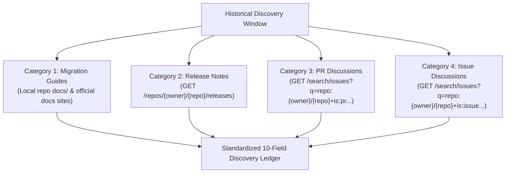
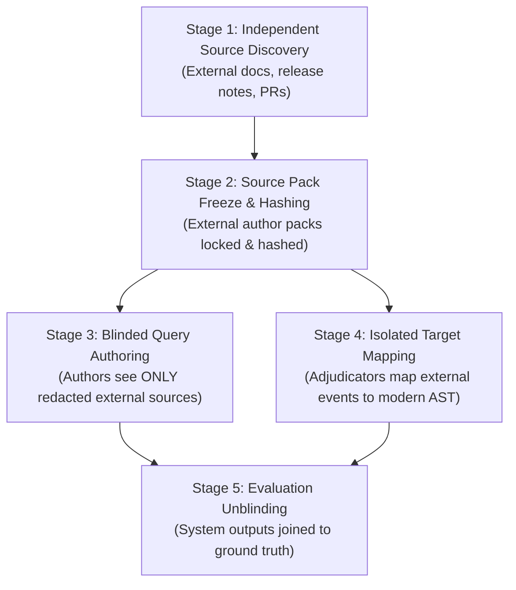

# Retrospect Phase D — Benchmark Protocol: Multi-Repository Exploratory Investigation of Git-History Signals in Code Retrieval (Version 3.5)

> **PHASE D STATUS: CLOSED / BLOCKED — FORMAL HUMAN PROTOCOL APPROVAL REQUIRED**  
> **Document Status:** Proposed Exploratory Study Protocol (Revised Version 3.5 — Final Narrow Methodological Corrections)  
> **Operational Gate:** **STRICTLY CLOSED / BLOCKED** (This document is a formal proposal only. Data collection, query authoring, query selection, split creation, retrieval evaluations, threshold calibration, and simulations remain strictly prohibited pending formal human approval.)  
> **Repository Baseline Reference:** Commit `17ea399217737f8d5fe2c32c310b69c2f812b84d` on `main` (Retrospect repository untouched)  
> **Archival Continuity (Preserved Unchanged):**  
> - Version 3.4 Proposal: [`phase_d_v3_4_exploratory_protocol.md`](file:///C:/Users/ASUS/.gemini/antigravity-ide/brain/739cb121-0ee8-4c36-a7ca-d249d8a7bb85/phase_d_v3_4_exploratory_protocol.md)  
> - Version 3.3 Proposal: [`phase_d_v3_3_exploratory_protocol.md`](file:///C:/Users/ASUS/.gemini/antigravity-ide/brain/739cb121-0ee8-4c36-a7ca-d249d8a7bb85/phase_d_v3_3_exploratory_protocol.md)  
> - Version 3.2 Proposal: [`phase_d_v3_2_exploratory_protocol.md`](file:///C:/Users/ASUS/.gemini/antigravity-ide/brain/739cb121-0ee8-4c36-a7ca-d249d8a7bb85/phase_d_v3_2_exploratory_protocol.md)  
> - Version 3.1 Proposal: [`phase_d_v3_1_exploratory_protocol.md`](file:///C:/Users/ASUS/.gemini/antigravity-ide/brain/739cb121-0ee8-4c36-a7ca-d249d8a7bb85/phase_d_v3_1_exploratory_protocol.md)  
> - Version 3.0 Proposal: [`phase_d_v3_exploratory_protocol.md`](file:///C:/Users/ASUS/.gemini/antigravity-ide/brain/739cb121-0ee8-4c36-a7ca-d249d8a7bb85/phase_d_v3_exploratory_protocol.md)  
> - Version 2.7 Confirmatory Plan: [`phase_d_data_collection_plan_draft.md`](file:///C:/Users/ASUS/.gemini/antigravity-ide/brain/739cb121-0ee8-4c36-a7ca-d249d8a7bb85/phase_d_data_collection_plan_draft.md)  
> - Statistical Protocol Version 1.7: [`benchmark_protocol.md`](file:///d:/base/papers/considered/Retrospect/docs/phase_d/benchmark_protocol.md)  
> - Annotation Guidelines Version 1.7: [`annotation_guidelines.md`](file:///d:/base/papers/considered/Retrospect/docs/phase_d/annotation_guidelines.md)

---

## 1. Change Summary Relative to Version 3.4

Version 3.5 implements targeted methodological and reproducibility corrections to resolve six specific issues identified in Version 3.4, incorporating five narrow post-review consistency refinements:

1. **Pre-Deduplication Canonicalization for Query Selection (Section 4.3):**  
   Reordered candidate selection so input validation, Unicode NFC normalization, and explicit whitespace collapsing occur *before* candidate deduplication. This eliminates the vulnerability where multiple raw strings that normalize to the same canonical identity could occupy multiple candidate slots. Python pseudocode strictly enforces explicit ASCII whitespace trimming (`ASCII_WHITESPACE_CHARS = ' \t\r\n'`) rather than generic `str.strip()`. Reconciled the cluster-slug validation policy (`^[a-z0-9_.-]+/[a-z0-9_.-]+$`) and added a clear synthetic example demonstrating identical canonical mapping.
2. **Empirical Disambiguation of Evaluated Revisions versus Release Tags (Section 6.1):**  
   Audited local git repositories for Fastify and Flask. Resolved the conflation of evaluated checkout commit dates with official release dates: Fastify evaluated commit `f736849` (`Wed Oct 14 2026`, `v6.0.0-alpha.4-28-gf736849a`) is 770 commits ahead of release tag `v5.0.0` (`6bde7d7`, `Tue Sep 17 2024`); Flask evaluated commit `d086db8` (`Wed Oct 7 2026`, `3.1.3-99-gd086db85`) is 99+ commits ahead of release tag `3.1.0` (`ab81496`, `Wed Nov 13 2024`). Retained the intended evaluated commits while documenting tag targets, commit timestamps, and discrepancies for human review.
3. **Reproducible GitHub Search API Specifications (Section 6.2):**  
   Replaced improper free-text query usage on repository-specific REST endpoints (`/repos/{owner}/{repo}/pulls`) with the authoritative GitHub Search API endpoint (`https://api.github.com/search/issues?q=repo:{owner}/{repo}+...`). Fully specified HTTP methods, URL-encoded query parameters, rate limits (30 req/min authenticated), pagination limits (500 results, top 50 inspected), error handling, and local file changelog procedures.
4. **Multi-Stage Independent Ground-Truth Firewall (Section 6.4 & Section 7):**  
   Strengthened the firewall to prevent circularity from `git log -S`, `git blame`, commit diffs, or retrieval engine outputs leaking into query authoring or target annotations. Explicitly split the workflow into five distinct stages: (1) Independent Source Discovery, (2) Source Pack Freeze and Hashing, (3) Blinded Query Authoring, (4) Isolated Target Mapping and Adjudication, and (5) Evaluation Unblinding. Documented practical solo-researcher mitigation protocols, acknowledging unavoidable residual familiarity risks.
5. **Unambiguous Versioned Canonical SymbolID Encoding (Section 5.2):**  
   Replaced the ambiguous string concatenation formula with an unambiguous, versioned, big-endian 32-bit length-prefixed binary serialization (`RetrospectSymbolIDV1:`). Specified exact canonicalization rules for repository names, relative paths, lexical scopes (dot-delimited enclosing declarations; nested local closures excluded with `ERROR_LOCAL_NESTED_SYMBOL`), bare names, and language-specific parameter signatures (JavaScript arity/rest, TypeScript normalized parameter types with whitespace collapsed and return types omitted, Python keyword parameters preserved, Java qualified types with type erasure). Corrected synthetic example byte trace to 29 bytes for signature and 112 bytes total payload. Formally blocked unverified languages under DEC-19.
6. **Harmonized Decision Semantics and Explicit Inclusion for Abstention (Section 9):**  
   Explicitly stated which systems are included in abstention analysis (S1 candidate, B4 proposed baseline) and which are excluded (B1 structural heuristic, B2 unnormalized commit counts, B3 legacy fusion with synthetic rank padding). Completely unified candidate-level score invalidation ($\text{Score}^*(s) = -\infty$) with query-level abstention semantics ($R_{\text{valid}}(q) = \emptyset \lor S_{\text{top}}(q) < \tau$), eliminating formula vs. bullet discrepancies and ensuring consistent metric denominators.
7. **Comprehensive Two-Tier Decision Register (Section 14):**  
   Cataloged the complete Master Lifecycle Decision Register (Section 14.1, covering all 22 decisions **DEC-01 through DEC-22** without omission) to account for all inherited decisions, alongside the Dedicated Table of Human Decisions (Section 14.2, covering all 12 pending decisions with options, neutral trade-offs, provisional recommendations, and required evidence).

---

## 2. Research Question and Exploratory Scope

### 2.1 Primary Exploratory Research Question (EQ1)
> **EQ1:** *Under what conditions does Git history help an LLM retrieve the relevant current code symbol, particularly when that symbol has been renamed, moved, extracted, or substantially rewritten?*

### 2.2 Secondary Exploratory Research Questions
- **EQ2 (Differential Utility by Evolution Type):**  
  How does the retrieval utility of Git history vary across distinct categories of code evolution (`rename`, `cross-file move`, `extraction`, `substantial rewrite`, `merge`)? Where does history provide strong signal, and where does it fail?
- **EQ3 (Rescue Capability vs. Structural Blindness):**  
  In what proportion of evaluation cases does historical evidence rescue an otherwise unretrievable symbol—defined as cases where structural-only search (B1) fails completely ($\text{RR@100} = 0.0$ or $\text{rank} > 100$), but fusion or history-only retrieval places the target in the top-10?
- **EQ4 (Rank Dilution, Obsolete Candidates, and Regressions):**  
  Under what conditions does incorporating Git history degrade retrieval performance, introduce obsolete/deleted symbols into top ranks, or dilute rankings for current-code queries (Category C controls)?
- **EQ5 (Standalone History vs. Multi-Modal Rank Fusion):**  
  How does standalone historical retrieval (B2) compare directly against fused structural-historical retrieval (S1 RRF-v2, B3 RRF-v1)? When does fusion improve upon pure history, and when does structural noise pull down high-confidence historical matches?
- **EQ6 (Fusion Mechanism Hardening vs. Lexical Text Baselines):**  
  Does hardened RRF-v2 (zero-signal gating, fractional tie-breaking) provide measurable retrieval advantages over:
  - Legacy RRF-v1 (fallback ranks and alphabetical tie leakage)?
  - A standard lexical information retrieval baseline (Okapi BM25) indexing concatenated historical commit logs and diffs (B4)?
- **EQ7 (Negative Query Behavior and Abstention Characterization):**  
  How do retrieval scores behave on unanswerable queries targeting permanently deleted functionality (Category D)? Can score-based abstention thresholds ($\tau$) reliably differentiate answerable queries from deleted APIs without cross-repository retraining?

### 2.3 Epistemic Scope and Non-Confirmatory Boundary
This protocol defines an **exploratory study only**. It does not perform confirmatory hypothesis testing, does not claim population-level generalizability across software engineering at large, and makes no claims of broad algorithmic superiority. All quantitative findings represent descriptive characterizations of the purposively audited codebases, clusters, and queries.

---

## 3. Frozen Baseline versus Experimental Implementation Inventory

To prevent ambiguity regarding what code is frozen versus what is experimental or proposed, the table below documents the exact implementation status of all proposed systems relative to the Retrospect repository baseline commit `17ea399217737f8d5fe2c32c310b69c2f812b84d` on `main`:

| System Code | System Name | Actual Source File Path(s) | Existed at Frozen Baseline Commit? | Git Blob SHA / Tracking Status | Verified SHA-256 Byte Digest | Implementation & Evaluation Status |
|---|---|---|:---:|:---:|---|---|
| **B1** | **Structural-Only Baseline** | [`src/structural/retrieval/StructuralRetriever.js`](file:///d:/base/papers/considered/Retrospect/src/structural/retrieval/StructuralRetriever.js) | **YES** | Git Blob: `6dd0952fdb2813235aed0a440718a12af1024c98` | `9380234C73DEEBDBBC12B498CED34469CD99DE6DEB20DAF94AABFA31CBD2FDD6` | **FROZEN — IMPLEMENTATION EVIDENCE** (Available for evaluation) |
| **B2** | **Historical-Only Baseline** | [`src/retrieval/HistoricalRetrievalAdapter.js`](file:///d:/base/papers/considered/Retrospect/src/retrieval/HistoricalRetrievalAdapter.js) | **YES** | Git Blob: `0925b42ebe7a73deba1202f3eee6daa80a253d93` | `60F114D8770D0A70108BC343C21ACF2C9F4389FC226270DEFFCA3CE6C0BCA965` | **FROZEN — IMPLEMENTATION EVIDENCE** (Available for evaluation) |
| **B2 (Helper)** | **Historical Retriever Engine** | [`src/retrieval/HistoricalRetriever.js`](file:///d:/base/papers/considered/Retrospect/src/retrieval/HistoricalRetriever.js) | **YES** | Git Blob: `3a65a798846d41e4641e9396c37467013d1b9e14` | `2499CD9BD20A2C1FB01EDDB890D84483AABC8DE40502F3F3AF1EFF135328CA90` | **FROZEN — IMPLEMENTATION EVIDENCE** (Disambiguated from Adapter) |
| **B3** | **Frozen RRF-v1 Baseline** | [`src/retrieval/UnifiedSearch.js`](file:///d:/base/papers/considered/Retrospect/src/retrieval/UnifiedSearch.js) | **YES** | Git Blob: `4a0ba342d19f69be39ea62694c109a76f6792a5d` | `156E4149BA57BF17B4E0B92ED2968F57510E987595CF4EBEAAC791FF695B844E` | **FROZEN — IMPLEMENTATION EVIDENCE** (Available for evaluation) |
| **B4** | **Historical BM25 Baseline** | None (Proposed file: `src/retrieval/HistoricalBM25Retriever.js`) | **NO** | Not in repository (No files matching `*bm25*`) | `N/A — NOT YET IMPLEMENTED` | **PROPOSED — PENDING FORMAL APPROVAL** (Requires engineering implementation) |
| **S1** | **Hardened RRF-v2 Candidate** | [`src/retrieval/RRFv2.js`](file:///d:/base/papers/considered/Retrospect/src/retrieval/RRFv2.js) | **NO** | Untracked in working tree (`?? src/retrieval/RRFv2.js`) | `343B7819766333A2691130C33CA72A2D5D128F361734869946B98B70289A84F6` | **PROPOSED — PENDING FORMAL APPROVAL** (Implemented post-baseline; pending formal commit freeze) |
| **S1-Abstain** | **RRF-v2 with Abstention** | Diagnostic wrapper around S1 (`RRFv2.js`) | **NO** | Untracked / Conceptual diagnostic specification | `N/A — WRAPPER SPECIFICATION` | **PROPOSED — PENDING FORMAL APPROVAL** (Pending threshold procedure adoption) |

---

## 4. Unit of Analysis, Query Aggregation, and Selection Procedures

### 4.1 Metric Definitions Across Three Analysis Tiers
1. **Query-Level Outcome:** For an individual query $q$, the reciprocal rank at cutoff 100 is:
   $$\text{RR@100}(q) = \begin{cases} \frac{1}{\text{rank}(q)} & \text{if } 1 \le \text{rank}(q) \le 100 \\ 0.0 & \text{otherwise} \end{cases}$$
2. **Cluster-Level Aggregate:** For a lineage cluster $C_j$ containing $m = |Q(C_j)|$ eligible queries, the cluster-level performance is the unweighted arithmetic mean of its query reciprocal ranks:
   $$\text{MRR@100}(C_j) = \frac{1}{|Q(C_j)|} \sum_{q \in Q(C_j)} \text{RR@100}(q)$$
3. **Paired Per-Cluster Difference:** For two systems $\text{Sys}_A$ and $\text{Sys}_B$, the paired cluster difference is:
   $$D_j(\text{Sys}_A, \text{Sys}_B) = \text{MRR@100}_{\text{Sys}_A}(C_j) - \text{MRR@100}_{\text{Sys}_B}(C_j)$$

### 4.2 Primary Estimand Alternatives: Evolution-Focused vs. All-Answerable
Version 3.5 formalizes the two primary estimand reporting designs for supervisor and reviewer selection:

#### Option 1 — Evolution-Focused Primary Estimand (Provisional Recommendation)
- **Primary Population ($Q_{\text{primary}}$):** Comprises **Category A** (obsolete API vocabulary) and **Category B** (contemporary behavioral descriptions of historical APIs) exclusively.
- **Reporting of Category C (Current-Code Controls):** Evaluated and reported in **dedicated control tables** to answer EQ4 (rank dilution on static modern code). Not pooled into primary cluster-weighted $\overline{D}$ or primary MRR@100.
- **Reporting of Category D (Unanswerable Negatives):** Reported strictly in separate abstention diagnostic tables.
- **Trade-off:** Directly addresses EQ1 by isolating refactoring events, preventing high-performing static current-code queries from masking performance variations on complex historical refactorings.

#### Option 2 — All-Answerable Primary Estimand
- **Primary Population ($Q_{\text{primary}}$):** Pools all answerable categories (**Categories A, B, and C**) into a single composite benchmark score.
- **Mandatory Subgroup Stratification:** Category-specific breakdowns (MRR@100 for A, B, C individually) remain strictly mandatory.
- **Trade-off:** Reflects a combined deployment setting across modified and unmodified code, but risks diluting the measured effect size of historical retrieval with trivial current-code matches.
- **Status:** **`PROPOSED — PENDING HUMAN DECISION`** (Cataloged in DEC-17).

---

### 4.3 Query-Count Alternatives and Genuinely Canonical Byte Encoding

#### Query-Count Cap Alternatives:
- **Option A (Include All Eligible Queries):** Retain all candidate queries meeting pre-declared eligibility criteria without capping.  
  *Trade-off:* Maximizes empirical coverage of refactoring events, but large refactoring campaigns (e.g. Flask Sans-I/O with 16 symbols) will dominate raw query-weighted metrics.
- **Option B (Fixed Maximum Query Cap $m_{\max}$):** Apply a fixed maximum query count (e.g., $m_{\max} \le 5$) per lineage cluster.  
  *Trade-off:* Balances contributions across refactoring events, but discards legitimately mined historical symbols.
- **Status:** **`PROPOSED — PENDING HUMAN DECISION`** (Cataloged in DEC-07).

---

#### Mandatory Canonical Selection Protocol (If Option B Is Adopted):

##### 1. Candidate Input Validation and Canonical Identifier Representation:
- **Cluster Identifier ($C_j$):** Formatted as `repository + "/" + cluster_slug`.
  - Must match the strict validation regex: `^[a-z0-9_.-]+/[a-z0-9_.-]+$`.
  - Normalized to Unicode Normalization Form C (NFC).
  - Both repository and cluster_slug are canonicalized to lowercase ASCII strings.
- **Symbol Candidate Identifier ($s$):** Canonical key formatted as `file_path + "::" + qualified_name`.
  - Must be valid UTF-8.
  - File path relative to repository root using forward slashes `/`.
  - Leading and trailing ASCII whitespace (`0x20`, `\t`, `\r`, `\n`) is trimmed.
  - Internal consecutive whitespace within parameter lists or signatures is collapsed to a single space (`0x20`).
  - Case is strictly preserved to prevent conflating distinct identifiers in case-sensitive languages (e.g., `Value` vs. `value`).
  - Normalized to Unicode Normalization Form C (NFC).
- **Mandatory Pre-Deduplication Canonicalization Rule:**
  - Candidate raw strings are **validated and canonicalized BEFORE deduplication**.
  - If two distinct raw input strings (e.g., `"lib/reply.js::send "` and `"lib/reply.js::send"`, or combining character sequences vs. precomposed NFC characters) produce the identical canonical string, they are mapped to the same canonical identity.
  - Exactly one instance is retained in the candidate list.
  - A traceability audit map (`canonical_to_raw_map[canonical_id] = [raw1, raw2]`) is preserved to track mapping back to source records.
  - **No duplicate canonical identity may ever occupy multiple candidate positions.**

##### 2. Synthetic Disambiguation Example:
Suppose an input cluster receives three raw symbol strings:
- Raw String 1: `"lib/reply.js::send "` (trailing space `0x20`)
- Raw String 2: `"lib/reply.js::send"` (clean ASCII)
- Raw String 3: `"lib/reply.js::header"`

*Processing:*
1. Raw String 1 canonicalizes to `"lib/reply.js::send"`.
2. Raw String 2 canonicalizes to `"lib/reply.js::send"`.
3. Raw String 3 canonicalizes to `"lib/reply.js::header"`.
4. Grouping by canonical identity yields two distinct candidates: `"lib/reply.js::send"` (derived from Raw 1 and Raw 2) and `"lib/reply.js::header"`.
5. Only two hashes are computed, preventing Raw 1 and Raw 2 from occupying separate slots.

##### 3. Unambiguous Byte-Level Serialization Format:
The hash input is constructed using an explicit, versioned, big-endian length-prefixed binary stream:

$$\text{Payload} = \text{PrefixBytes} \,\|\, \text{U32BE}(\text{len}(C_j)) \,\|\, \text{Bytes}(C_j) \,\|\, \text{U32BE}(\text{len}(s)) \,\|\, \text{Bytes}(s) \,\|\, \text{U32BE}(\text{len}(\text{salt})) \,\|\, \text{Bytes}(\text{salt})$$

Where:
- $\text{PrefixBytes}$: ASCII string `"RetrospectQuerySelectionV2:"` (27 bytes, hex: `526574726f7370656374517565727953656c656374696f6e56323a`).
- $\text{Bytes}(x)$: The UTF-8 encoded byte array of canonical string $x$.
- $\text{len}(x)$: The exact **number of bytes** in $\text{Bytes}(x)$ (NOT character count).
- $\text{U32BE}(L)$: 32-bit unsigned integer encoding of byte length $L$ in **big-endian byte order** (4 bytes).
- $\text{Bytes}(\text{salt})$: Exactly 32 raw binary bytes generated from CSPRNG ($\text{len}(\text{salt}) = 32$; $\text{U32BE}(32) = \text{0x00000020}$).

##### 4. Language-Neutral Selection Pseudocode:
```python
import hashlib
import struct
import unicodedata
import re

CLUSTER_ID_PATTERN = re.compile(r'^[a-z0-9_.-]+/[a-z0-9_.-]+$')
ASCII_WHITESPACE_CHARS = ' \t\r\n'

def canonicalize_symbol(raw_symbol: str) -> str:
    # 1. Apply Unicode Normalization Form C first
    nfc_str = unicodedata.normalize('NFC', raw_symbol)
    # 2. Trim strictly defined ASCII whitespace characters (0x20, \t, \r, \n)
    trimmed = nfc_str.strip(ASCII_WHITESPACE_CHARS)
    # 3. Collapse multiple internal ASCII whitespace characters to a single space (0x20)
    collapsed = re.sub(r'[ \t\r\n]+', ' ', trimmed)
    return collapsed

def compute_selection_hash(cluster_id: str, canonical_symbol: str, salt_bytes: bytes) -> bytes:
    c_bytes = cluster_id.encode('utf-8')
    s_bytes = canonical_symbol.encode('utf-8')
    
    prefix = b"RetrospectQuerySelectionV2:"
    payload = bytearray()
    payload.extend(prefix)
    payload.extend(struct.pack('>I', len(c_bytes)))    # 4-byte big-endian length
    payload.extend(c_bytes)
    payload.extend(struct.pack('>I', len(s_bytes)))    # 4-byte big-endian length
    payload.extend(s_bytes)
    payload.extend(struct.pack('>I', len(salt_bytes))) # 4-byte big-endian length (always 32)
    payload.extend(salt_bytes)
    
    return hashlib.sha256(payload).digest()

def select_cluster_candidates(cluster_id: str, raw_symbols: list[str], salt_bytes: bytes, m_max: int) -> tuple[list[str], dict]:
    # 1. Validate Cluster ID
    if not CLUSTER_ID_PATTERN.match(cluster_id):
        raise ValueError(f"Invalid cluster ID format: {cluster_id}")
    if len(salt_bytes) != 32:
        raise ValueError("Salt must be exactly 32 raw bytes")
        
    # 2. Canonicalize and Deduplicate BEFORE Hashing
    canonical_to_raw = {}
    for raw in raw_symbols:
        if not raw or not raw.strip(ASCII_WHITESPACE_CHARS):
            continue  # Reject empty candidates
        canon = canonicalize_symbol(raw)
        canonical_to_raw.setdefault(canon, []).append(raw)
        
    unique_canonical_symbols = sorted(list(canonical_to_raw.keys()))
    
    # 3. Hash and Deterministically Order Canonical Candidates
    scored = []
    for canon in unique_canonical_symbols:
        digest = compute_selection_hash(cluster_id, canon, salt_bytes)
        scored.append((digest, canon.encode('utf-8'), canon))
        
    # Unsigned byte comparison of 32-byte digest; tie-break on unsigned canon bytes
    scored.sort(key=lambda item: (item[0], item[1]))
    
    # 4. Select top m_max
    selected_canonical = [item[2] for item in scored[:m_max]]
    return selected_canonical, canonical_to_raw
```

##### 5. Salt Lifecycle, Custody, and Escrow:
1. **CSPRNG Generation:** Generated from a cryptographically secure source (`crypto.randomBytes(32)` providing 256 bits of true entropy).
2. **Pre-Selection Commitment:** Before query selection runs and before candidate author packs are unsealed:
   - Compute $\text{Commitment} = \text{SHA256}(\text{salt})$ (64 hex characters).
   - Record in the frozen pre-registration ledger: commitment hash, generator identity, timestamp (UTC ISO 8601), protocol version (`3.5`), and selection code hash.
3. **Escrow and Custody:** Secret salt held in encrypted escrow by the Academic Project Supervisor. Never exposed to query authors.
4. **Independent Post-Hoc Audit:** Following benchmark finalization, the raw salt is released to the Independent Methodological Reviewer to independently re-run the selection script and verify identical candidate ordering and commitment hash.
5. **Freeze Guarantee:** Cap $m_{\max}$, eligibility rules, salt commitment, and selection implementation are permanently locked prior to selection.

---

## 5. Repository Selection, Relationship, and Contamination Audits

### 5.1 Repository Planning Target
The proposed expansion beyond Fastify and Flask to **4 to 5 total repositories** is an **exploratory qualitative diversity target**, not a statistically justified minimum. It ensures that observations span multiple language paradigms (JavaScript, Python, and potentially Go, Rust, or Java). Adding repositories does not establish statistical independence or generalizability across all software engineering.

---

### 5.2 Disambiguated Phase B Contamination Audit & Canonical SymbolID Specification

#### Phase B Manifest Facts:
- `evaluation_lineage_queries_v4.json`: Contains **40 query records**, **34 answerable queries**, **6 unanswerable queries** (`target = null`), **34 unique target names**, and **15 unique target files**.
- Manifest contains bare string identifiers only (`target_symbol_name`), lacking enclosing classes, AST node types, and parameter signatures.
- Full AST symbol-identity uniqueness across historical revisions is labeled **`UNVERIFIED — REQUIRING CODEBASE AST AUDIT`**.

#### Unambiguous Canonical SymbolID Specification (`RetrospectSymbolIDV1:`):
To prevent identity collisions and ambiguities across languages, Phase D defines an unambiguous, versioned, big-endian length-prefixed binary serialization:

$$\text{SymbolPayload} = \text{PrefixBytes} \,\|\, \text{U32BE}(\text{len}(\text{repo})) \,\|\, \text{repo} \,\|\, \text{U32BE}(\text{len}(\text{file})) \,\|\, \text{file} \,\|\, \text{U32BE}(\text{len}(\text{scope})) \,\|\, \text{scope} \,\|\, \text{U32BE}(\text{len}(\text{name})) \,\|\, \text{name} \,\|\, \text{U32BE}(\text{len}(\text{sig})) \,\|\, \text{sig}$$

$$\text{SymbolID} = \text{SHA256}(\text{SymbolPayload}) \quad \text{(64-character lowercase hexadecimal string)}$$

Where:
- $\text{PrefixBytes}$: ASCII string `"RetrospectSymbolIDV1:"` (21 bytes).
- All strings are UTF-8 encoded, NFC-normalized, with leading/trailing whitespace trimmed.
- $\text{U32BE}(L)$: 32-bit big-endian unsigned integer representing exact encoded byte length.

##### Field Definitions and Language Normalization Rules:
1. `repo`: Canonical `owner/repo` string in lowercase ASCII (e.g. `"fastify/fastify"`, `"pallets/flask"`).
2. `file`: Relative path from repository root using forward slashes `/`, case-preserved (e.g. `"lib/reply.js"`, `"src/flask/app.py"`).
3. `scope`: Enclosing lexical scope:
   - Represented as a dot-delimited chain of named enclosing class, interface, or namespace declarations (e.g. `"Flask"`, `"Reply.prototype"`, `"OuterClass.InnerClass"`). Case-preserved.
   - Module-level / top-level symbols: Represented as empty string `""` ($\text{len} = 0$).
   - **Nested Local Functions / Closures:** Functions declared inside other function bodies, local closures, and anonymous lambda expressions are **strictly excluded** from the benchmark target universe (only exported or top-level/class-level addressable symbols are eligible retrieval targets). If an AST extractor encounters a local nested closure, it is rejected with `ERROR_LOCAL_NESTED_SYMBOL`.
4. `name`: Bare symbol identifier. Case-preserved (e.g. `"send"`, `"wsgi_app"`).
5. `sig`: Canonical parameter signature string:
   - **JavaScript:** Parameter names stripped; normalized strictly to arity and rest indicator: e.g. `"(0)"` for zero arguments, `"(2)"` for two positional arguments, `"(2+rest)"` if a rest parameter is present.
   - **TypeScript:** Parameter names stripped, keeping only normalized type annotations: e.g. `"(string,number)"`. Whitespace around type punctuation (`:`, `,`, `|`, `&`, `=>`) is stripped. Primitives normalized to lowercase (`string`, `number`, `boolean`, `any`, `unknown`, `void`). Parameter modifiers (`readonly`, `public`, `private`) stripped. Optional parameters suffixed with `?` (e.g. `"(string,number?)"`); rest parameters prefixed with `...` (e.g. `"(string,...number[])"`). Return types omitted from signature key to prevent volatility across type refactorings.
   - **Python:** Parameter names preserved in their **exact case** (because Python identifiers and keyword arguments are case-sensitive, e.g. `data` $\ne$ `Data`); Unicode Normalization Form C (NFC) is applied; surrounding whitespace around parameter names, commas, and parentheses is trimmed; tokens are separated by single commas without internal whitespace; default values (e.g., `=None`) and parameter type annotations are stripped to ensure stable canonical matching across unannotated and typed code; `*args` and `**kwargs` markers are preserved with exact identifier case; positional-only `/` and keyword-only `*` parameter markers are preserved if present (e.g. `"(self,environ,start_response)"`). Lowercasing or case-folding of parameter identifiers is **strictly prohibited**.
   - **Java:** Parameter types in canonical qualified form (e.g. `"(com.google.gson.JsonElement,java.lang.Appendable)"`). Parameter names stripped; generics erased to raw types (e.g. `java.util.List`); return types and access modifiers omitted.
   - *Missing vs. Empty:* Missing scope is `""` (0 bytes). Missing signature (e.g. for a class, interface, or variable) is `"NONE"` (4 bytes), distinct from empty parameter list `"()"` (2 bytes).
   - *Unparsable Syntax:* If a file fails parsing, recorded as `"UNPARSED"`.
   - *Language Grammar Blocking Rule (DEC-19):* The binary length-prefixed serialization format (`RetrospectSymbolIDV1:`) provides unambiguous byte-level framing and prevents delimiter ambiguity, but does not by itself resolve semantic ambiguities in complex language grammars. Under DEC-19, proposed approval is strictly scoped to the provisional JavaScript and Python SymbolID rules specified in this section. Advanced TypeScript types (union/intersection/conditional types, type predicates, overloads) and Java generics/type bounds (`? extends T`, raw type conversions) remain unverified and **STRICTLY BLOCKED from benchmark execution** pending dedicated grammar audits and subsequent formal reviewer approval.

##### Synthetic SymbolID Example:
For Python method `Flask.wsgi_app(self, environ, start_response)` in `src/flask/app.py`:
- `repo`: `"pallets/flask"` (13 bytes)
- `file`: `"src/flask/app.py"` (16 bytes)
- `scope`: `"Flask"` (5 bytes)
- `name`: `"wsgi_app"` (8 bytes)
- `sig`: `"(self,environ,start_response)"` (29 bytes: `(` [1B] + `self` [4B] + `,` [1B] + `environ` [7B] + `,` [1B] + `start_response` [14B] + `)` [1B] = 29 bytes)
- Payload Structure: Prefix (21B) + 5 fields with 4-byte lengths (20B) + field bytes (13B + 16B + 5B + 8B + 29B = 71B) = **112 bytes** serialized unambiguously without delimiter collisions.

##### Synthetic Case-Sensitivity Distinctness Example:
Consider two distinct Python methods or overloads in `src/flask/helpers.py` within class `Helper`:
- Method 1: `Helper.format_data(self, data)` $\implies$ `sig` = `"(self,data)"` (11 bytes: `(` [1B] + `self` [4B] + `,` [1B] + `data` [4B] + `)` [1B] = 11B)
- Method 2: `Helper.format_data(self, Data)` $\implies$ `sig` = `"(self,Data)"` (11 bytes: `(` [1B] + `self` [4B] + `,` [1B] + `Data` [4B] + `)` [1B] = 11B)

Both serialized payloads share identical prefixes, repo (`"pallets/flask"`, 13B), file (`"src/flask/helpers.py"`, 20B), scope (`"Helper"`, 6B), and name (`"format_data"`, 11B). Total payload length is $21 + (5 \times 4) + (13 + 20 + 6 + 11 + 11) = 102$ bytes.

However, at byte offset 97 of the serialized payload (the first byte of the parameter name inside `sig`), Method 1 contains ASCII `0x64` (`'d'`) while Method 2 contains ASCII `0x44` (`'D'`).

Because length-prefixed serialization prevents delimiter ambiguity, the serialized field encoding is injective and unambiguous ($\text{SymbolPayload}_1 \ne \text{SymbolPayload}_2$). Under standard cryptographic properties of SHA-256, producing an identical 256-bit hash for distinct payloads is computationally infeasible (though not mathematically impossible):
$$\text{SymbolID}_1 = \text{SHA256}(\text{SymbolPayload}_1) \ne \text{SymbolID}_2 = \text{SHA256}(\text{SymbolPayload}_2) \quad \text{(with overwhelming cryptographic probability)}$$

Strict preservation of identifier case ensures that distinct case-sensitive signatures produce distinct serialized payloads, preventing artificial signature collisions in the canonical representation.

---

## 6. Source Discovery, Revision Pinning, and Stopping Procedure

### 6.1 Disambiguated Historical Windows and Evaluated Revisions
An empirical git audit confirms the separation between official release tags and evaluated checkout commits:

| Repository | Pinned Evaluated Commit SHA | Commit Timestamp (ISO 8601 UTC) | Evaluated Commit Subject / Tree Description | Nearest Associated Release Tag | Official Release Tag Target SHA | Official Tag Release Date | Revision Match Status |
|---|---|---|---|---|---|---|:---:|
| **Fastify** (`fastify/fastify`) | `f736849a10a9b2ca57fb09437feb8294cda76234` | `2026-10-14T08:44:43Z` | `test(server): assert the server is listening...` | `v6.0.0-alpha.4-28-gf736849a` | `6bde7d7b0a51010d56df901cab9be5d9351b0d91` (`v5.0.0`) | `2024-09-17T14:11:22Z` | **EVALUATED COMMIT HEADS PAST v5.0.0** (770 commits ahead of v5.0.0) |
| **Flask** (`pallets/flask`) | `d086db856be187255b8ec61ef409357393020f32` | `2026-10-07T14:02:54Z` | `fix typing` | `3.1.3-99-gd086db85` | `ab8149664182b662453a563161aa89013c806dc9` (`3.1.0`) | `2024-11-13T18:20:07Z` | **EVALUATED COMMIT HEADS PAST 3.1.0** (99+ commits ahead of 3.1.0) |

- **Root Commits:** Fastify root commit `050ede23986f7d2885fbfe47cacab9ecc3e8d9b1` (`2016-09-28T19:10:15Z`); Flask root commit `33850c0ebd23ae615e6823993d441f46d80b1ff0` (`2010-04-06T11:12:57Z`).
- **Revision Discrepancy Note:** The evaluated revisions are fixed working-tree commits from October 2026. They do **not** represent the release points of Fastify v5.0.0 or Flask v3.1.0 (which were released in late 2024). They represent modern repository states evaluating the entire cumulative historical window up to October 2026. This distinction is flagged for supervisor confirmation in DEC-20.

---

### 6.2 Reproducible Source Discovery Procedures across 4 Categories



#### Category 1 (Official Migration Guides — Local & Web):
- *Procedure:* Local file inspection of repository `docs/` (`docs/Guides/Migration-Guide-V*.md` in Fastify; `CHANGES.rst` in Flask) and hosted official documentation sites.
- *Method:* Local file reading; section-by-section audit of all breaking change chapters.

#### Category 2 (Tagged Release Notes — GitHub Releases REST API):
- *Endpoint:* `GET https://api.github.com/repos/{owner}/{repo}/releases`
- *Parameters:* `per_page=100`, `page=1..N`.
- *Procedure:* Chronological traversal of all tagged releases in window.

#### Category 3 (Pull Request Discussions — GitHub Search API):
- *Endpoint:* `GET https://api.github.com/search/issues`
- *Query Syntax:* `q=repo:{owner}/{repo}+is:pr+is:merged+{filter}`
- *Search Templates:*
  1. `repo:{owner}/{repo}+is:pr+is:merged+label:breaking`
  2. `repo:{owner}/{repo}+is:pr+is:merged+"refactor"`
  3. `repo:{owner}/{repo}+is:pr+is:merged+"rename"`
  4. `repo:{owner}/{repo}+is:pr+is:merged+"deprecate"`
- *Parameters:* `sort=updated`, `order=desc`, `per_page=100`, `page=1..5` (max 500 results).
- *Inspection Rule:* Top 50 results per template inspected.

#### Category 4 (Issue Discussions — GitHub Search API):
- *Endpoint:* `GET https://api.github.com/search/issues`
- *Query Syntax:* `q=repo:{owner}/{repo}+is:issue+is:closed+{filter}`
- *Search Templates:*
  1. `repo:{owner}/{repo}+is:issue+is:closed+label:deprecation`
  2. `repo:{owner}/{repo}+is:issue+is:closed+"has been removed"`
  3. `repo:{owner}/{repo}+is:issue+is:closed+"renamed to"`
- *Parameters:* `sort=updated`, `order=desc`, `per_page=100`, `page=1..5`. Top 50 results inspected.

#### Rate Limits, Errors, and Stopping Rules:
- Authenticated requests are subject to GitHub Search API rate limit (30 requests/minute). If `403 rate limit exceeded` is received, sleep until `x-ratelimit-reset`.
- Search stops when: (a) all migration guides are audited, (b) all releases in window are traversed, (c) no new refactoring lineages are found in 3 consecutive minor releases, or (d) query limit reached.

---

### 6.3 Standardized 10-Field Discovery Ledger
Every inspected source passage must be recorded in the Discovery Ledger with these exact 10 fields:
1. `search_id`: Unique identifier (e.g. `SRC-FAST-012`).
2. `source_category`: `Category 1 (Migration)`, `Category 2 (Changelog)`, `Category 3 (PR)`, or `Category 4 (Issue)`.
3. `platform_or_endpoint`: URL or repository-relative path.
4. `exact_query_or_path`: Exact search string, API query parameters, or file section name.
5. `search_timestamp_utc`: ISO 8601 UTC timestamp of execution.
6. `relevant_version_or_tag`: Target software release (e.g. `v4.0.0`).
7. `url_or_stable_id`: Permanent commit SHA, PR number, or immutable URL.
8. `result_status`: `SUCCESS`, `INACCESSIBLE`, `RATE_LIMITED`, or `NOT_FOUND`.
9. `inclusion_decision`: `INCLUDED_CANDIDATE`, `EXCLUDED_NOT_REFACTORING`, or `DUPLICATE_CROSS_REFERENCE`.
10. `exclusion_reason_or_notes`: Rationale for decision and cross-reference links.

---

### 6.4 Multi-Stage Independent Ground-Truth Firewall

To prevent circularity from historical retrieval signals leaking into ground truth, Phase D enforces a strict five-stage firewall:



1. **Stage 1 (Independent Source Discovery):** Change events identified strictly through external documentation, release notes, migration guides, issue discussions, and PR descriptions.
2. **Stage 2 (Freeze of External Source Pack):** Source passages redacted per Section 7.1. Manifest sealed and hashed (SHA-256) before authoring begins. No changes permitted without formal amendment.
3. **Stage 3 (Blinded Query Authoring):** Query authors receive **only** the redacted external source pack. Authors are **strictly forbidden** from inspecting the modern codebase AST, commit diffs, blame, or retrieval engine candidate outputs.
4. **Stage 4 (Isolated Target Mapping and Adjudication):** Mapping the historical event to the modern code symbol is conducted by an independent adjudicator. Adjudicators verify the symbol exists at pinned HEAD without consulting retrieval engine rankings.
5. **Stage 5 (Evaluation Unblinding):** System outputs are executed on frozen benchmark queries and unblinded only after ground-truth mappings are sealed and timestamped.
6. **Solo-Researcher Mitigation and Residual Risk:**
   - *Protocol:* A single researcher must enforce temporal separation: Stage 1 & 2 completed and hashed $\to$ Stage 3 queries authored $\to$ Stage 4 ground-truth mapped $\to$ Stage 5 retrieval executed.
   - *Residual Risk:* A solo researcher cannot eliminate cognitive bias or residual memory of codebase refactorings. Independent reviewer adjudication is strongly recommended (DEC-21).

---

## 7. Query-Source Redaction and Leakage Controls

### 7.1 Objective Redaction Checklist
To preserve authentic developer vocabulary while eliminating trivial answer disclosure, source packs provided to query authors must pass a standardized redaction procedure:
1. **Modern AST Paths and Line Numbers:** Completely redact modern file paths (e.g. `lib/content-type-parser.js`, `src/flask/sansio/scaffold.py`) and line numbers.
2. **Explicit Modern Symbol Names:** In trivial rename or relocation cases where the text explicitly pairs old and new identifiers (e.g. "Method `foo()` was renamed to `bar()`"), mask the successor identifier `bar()` (e.g. "Method `foo()` was renamed to a new accessor; find the modern replacement").
3. **Preservation of Legitimate Technical Vocabulary:** Domain concepts (e.g., "WSGI request context", "JSON serializer", "Ajv schema validation", "content-type header") must **NOT** be stripped. Legitimate developer queries naturally incorporate domain terminology.
4. **Code Snippets:** Example code snippets illustrating the modern target implementation must be removed or generalized.
5. **Direct Links:** Redact URLs, PR links, or commit SHAs pointing directly to the modern target code.

### 7.2 Query Authoring Firewalls
- Query authors must **NEVER** inspect search engine rankings, candidate scores, or evaluation scripts while authoring or finalizing benchmark queries.
- Author packs must be sealed and hashed (SHA-256) prior to unsealing for query generation.

---

## 8. System Definitions and BM25 Ranking Semantics

### 8.1 Evaluated Systems Overview
1. **B1 (Structural-Only Baseline):** AST topology, symbol names, qualified paths, call graphs; zero history. (Frozen at baseline commit `17ea399`).
2. **B2 (Historical-Only Baseline):** Git commit messages, diff tokens, author metadata, lineage chains; zero AST. (Frozen at baseline commit `17ea399`).
3. **B3 (Frozen RRF-v1 Baseline):** Legacy reciprocal rank fusion in [`UnifiedSearch.js`](file:///d:/base/papers/considered/Retrospect/src/retrieval/UnifiedSearch.js) ($k=60$, fallback rank $N$, alphabetical zero-score tie break). (Frozen at baseline commit `17ea399`).
4. **B4 (Historical BM25 Baseline):** Okapi BM25 text index ($k_1=1.2, b=0.75$) over historical commit text. (Proposed default; pending implementation).
5. **S1 (Hardened RRF-v2 Candidate):** Hardened reciprocal rank fusion in [`RRFv2.js`](file:///d:/base/papers/considered/Retrospect/src/retrieval/RRFv2.js) ($k=60$, zero-signal gating, fractional tie-breaks, strict total order). (Implemented post-baseline; pending formal commit freeze).
6. **S1-Abstain (Diagnostic Variant):** S1 candidate pipeline with score threshold gating ($\tau$) on Category D negative queries. (Proposed diagnostic).

### 8.2 Proposed Deterministic BM25 Ranking Semantics (B4)
1. **Document Construction:** For each candidate symbol $s \in \mathcal{S}$ at HEAD, construct a single composite pseudo-document $D_s$ concatenating unique commit messages and diff tokens linked to $s$ via `profileMap`, deduplicating identical commit messages.
2. **Strict Positive-Score Gating:** Only candidate symbols with **strictly positive BM25 scores ($\text{score} > 0.0$)** are returned as retrieved candidates.
3. **Zero-Score Exclusion:** Symbols with score $0.0$ or symbols lacking historical documents are **NOT** returned merely to pad the Top-100 list. They are treated as unretrieved.
4. **Deterministic Tie-Breaking:** Candidates with identical positive scores are sorted strictly by unsigned bytewise comparison of the symbol qualified identifier bytes (`memcmp`).
5. **Zero Rank Credit:** If a relevant target symbol has score $0.0$ or is omitted from the top-100, its reciprocal rank is strictly $0.0$ and its Recall contribution is $0$ at all cutoffs.
6. **Input & Pool Parity:** B4 evaluates the exact same candidate universe $\mathcal{S}$ and receives the exact same query strings as B1, B2, B3, and S1.
7. **Status:** **`PROPOSED — PENDING FORMAL APPROVAL`** (Cataloged in DEC-04).

---

## 9. Negative-Query and Abstention Diagnostics (S1-Abstain)

### 9.1 System Inclusion and Exclusion Boundary for Abstention Analysis
The protocol explicitly defines which systems are evaluated for score-based abstention:

| System Code | System Name | Included in Abstention Analysis? | Valid Score Scale & Range | Methodological Rationale for Inclusion or Exclusion |
|---|---|:---:|---|---|
| **S1** | **Hardened RRF-v2 Candidate** | **YES** | Closed-form $[0.0, 2/61] \approx [0.0, 0.03279]$ | Two-channel RRF with zero-signal gating produces bounded scores suitable for discrete threshold gating. |
| **B4** | **Historical BM25 Baseline** | **YES (Provisional)** | Unbounded $[0.0, \infty)$ | Standard lexical text score; included to evaluate whether keyword text density differentiates answerable from deleted queries. |
| **B1** | **Structural-Only Baseline** | **NO** | Heuristic $[0.0, 1.0]$ | **EXCLUDED:** Heuristic AST match scores reflect token overlap, not calibrated probabilistic confidence. Cannot distinguish deleted APIs from unindexed code. |
| **B2** | **Historical-Only Baseline** | **NO** | Raw integer/recency counts | **EXCLUDED:** Lacks cross-repository normalization; commit frequencies cannot provide calibrated confidence gating. |
| **B3** | **Frozen RRF-v1 Baseline** | **NO** | $[1/(60+N), 2/61]$ | **EXCLUDED:** Fills unranked slots with fallback rank $N$, giving unretrieved candidates synthetic non-zero scores ($1/(60+N)$) that mask zero-signal queries. |

---

### 9.2 Threshold Grid Determination Strategies
- **For S1 (RRF-v2):** Pre-registered 50-point uniform discrete grid spanning the exact mathematical range: $\tau_i = i \times \frac{2}{61 \times 49}$ for $i \in \{0, \dots, 49\}$.
- **For B4 (BM25):** Subject to DEC-18:
  - *Option 1 (Pre-Registered Fixed Numerical Grid):* Fixed thresholds (e.g. $\tau \in \{0.0, 0.5, 1.0, \dots, 25.0\}$). Zero data peeking.
  - *Option 2 (Development-Set Calibrated Grid):* Derived from empirical score percentiles on an independent development split.

---

### 9.3 Comprehensive Decision Semantics and Metric Formulas
Let $R(q)$ be the ordered list of retrieved candidates returned for query $q$, where each candidate $s \in R(q)$ has score $\text{Score}(s)$.

To prevent a single corrupted or unscoreable candidate from invalidating an entire query, scores are validated individually:
- Let $\text{Domain}_{\text{valid}}$ be the valid numerical score domain ($[0.0, 2/61]$ for S1; $[0.0, \infty)$ for B4).
- For each returned candidate $s \in R(q)$:
  $$\text{Score}^*(s) = \begin{cases} \text{Score}(s) & \text{if } \text{Score}(s) \in \text{Domain}_{\text{valid}} \text{ and is a finite real number} \\ -\infty & \text{if } \text{Score}(s) \in \{\text{NaN}, \text{null}, \pm\infty\} \text{ or } \text{Score}(s) \notin \text{Domain}_{\text{valid}} \end{cases}$$
- Let $R_{\text{valid}}(q) = \{s \in R(q) : \text{Score}^*(s) > -\infty\}$ denote the subset of candidates with valid scores. Any candidate with $\text{Score}^*(s) = -\infty$ is disqualified from answering and triggers an audit warning log.

The highest effective candidate score $S_{\text{top}}(q)$ is defined as:
$$S_{\text{top}}(q) = \begin{cases} \max_{s \in R_{\text{valid}}(q)} \text{Score}^*(s) & \text{if } R_{\text{valid}}(q) \ne \emptyset \\ -\infty & \text{if } R_{\text{valid}}(q) = \emptyset \text{ (empty result list or all candidate scores invalid)} \end{cases}$$

#### Decision Rules (Completely Unified):
1. **Empty or Fully Invalid Result List ($R_{\text{valid}}(q) = \emptyset$):** System **abstains** (predicts unanswerable; returns empty answer set $\emptyset$). Classifying an empty or fully invalid result list as answering at $\tau = 0.0$ is strictly prohibited.
2. **Individual Invalid Score:** Any individual candidate with an invalid or out-of-range score is assigned $\text{Score}^*(s) = -\infty$, removing it from $R_{\text{valid}}(q)$. The system proceeds using the remaining valid candidates in $R_{\text{valid}}(q)$. If and only if all candidates in $R(q)$ are invalid ($R_{\text{valid}}(q) = \emptyset$), the system **abstains**.
3. **Threshold Gating Rule:**
   - If $R_{\text{valid}}(q) \ne \emptyset$ and $S_{\text{top}}(q) \ge \tau$, system **answers** with candidate $s^* = \arg\max_{s \in R_{\text{valid}}(q)} \text{Score}^*(s)$ (breaking score ties by canonical byte comparison of symbol IDs per Section 8.2).
   - If $R_{\text{valid}}(q) = \emptyset$ or $S_{\text{top}}(q) < \tau$, system **abstains** (returns empty answer set $\emptyset$).

#### Descriptive Metric Formulas:
- **Coverage / Answer Rate ($\text{Cov}(\tau)$):**
  $$\text{Cov}(\tau) = \frac{1}{|Q|} \sum_{q \in Q} \mathbb{I}(R_{\text{valid}}(q) \ne \emptyset \land S_{\text{top}}(q) \ge \tau)$$
- **False-Answer Rate on Category D ($\text{FAR}_D(\tau)$):**
  $$\text{FAR}_D(\tau) = \frac{1}{|Q_D|} \sum_{q \in Q_D} \mathbb{I}(R_{\text{valid}}(q) \ne \emptyset \land S_{\text{top}}(q) \ge \tau) \quad (\text{Reported as } \text{N/A if } |Q_D| = 0)$$
- **Conditional Answerable MRR@100 ($\text{cMRR@100}(\tau)$):**
  $$\text{cMRR@100}(\tau) = \begin{cases} \frac{1}{|Q_{\text{ans, answered}}(\tau)|} \sum_{q \in Q_{\text{ans, answered}}(\tau)} \text{RR@100}(q) & \text{if } |Q_{\text{ans, answered}}(\tau)| > 0 \\ \text{N/A (undefined)} & \text{if } |Q_{\text{ans, answered}}(\tau)| = 0 \end{cases}$$
  Where $Q_{\text{ans, answered}}(\tau) = \{q \in Q_{\text{ans}} : R_{\text{valid}}(q) \ne \emptyset \land S_{\text{top}}(q) \ge \tau\}$.
- **Strict Anti-Tuning Invariant:** Post-hoc optimization of $\tau$ on held-out test data is strictly prohibited. Abstention analysis is purely descriptive and exploratory.

---

## 10. Metrics and Descriptive Analysis

### 10.1 Primary Metrics
- **Mean Reciprocal Rank (MRR@100):** Evaluated at query and cluster levels.
- **Recall at Cutoffs (Recall@k):** Evaluated at $k \in \{1, 5, 10, 100\}$.
- **Paired Per-Cluster Differences ($D_j$):**
  $$D_j(\text{Sys}_A, \text{Sys}_B) = \text{MRR@100}_{\text{Sys}_A}(C_j) - \text{MRR@100}_{\text{Sys}_B}(C_j)$$

### 10.2 Stratified Multi-Dimensional Reporting
Results must be reported independently across four orthogonal strata:
1. **Evolution Type:** `rename`, `cross-file move`, `extraction`, `substantial rewrite`, `merge`.
2. **Repository:** Independent breakdown for each evaluated repository.
3. **Query Category:** Category A (obsolete vocabulary), Category B (behavioral descriptions), Category C (current-code controls), Category D (unanswerable negatives).
4. **Cluster Size:** Single-query vs. multi-query clusters.

### 10.3 Qualitative Phenomenological Case Studies
- **Rescue Analysis (EQ3):** Qualitative audit of cases where structural retrieval failed completely ($\text{rank}_{\text{B1}} > 100$) but history succeeded ($\text{rank}_{\text{S1}} \le 10$).
- **Regression Analysis (EQ4):** Qualitative audit of cases where structural retrieval succeeded ($\text{rank}_{\text{B1}} \le 5$) but history degraded ranking ($\text{rank}_{\text{S1}} > \text{rank}_{\text{B1}}$).
- **BM25 vs. Graph Fusion Contrast (EQ6):** Auditing queries where S1 outperformed B4 to assess whether multi-modal fusion provides real advantages over standard lexical text search.

---

## 11. Bootstrap and Uncertainty Limitations

Version 3.5 retains the mandatory methodological formulation:

> **Mandatory Methodological Statement:**  
> Bootstrap intervals, if retained, are resampling-based uncertainty summaries conditional on the selected clusters, repository strata, and specified resampling scheme. They do not establish exact finite-sample coverage or population-level generalizability.

- **Resampling Unit:** The Lineage Cluster $C_j$.
- **Stratified Resampling:** Stratified by repository ($M_r$ clusters sampled with replacement within repository $r$).
- **Replicate Count:** $B = 2{,}000$ bootstrap replicates.
- **Small-Strata Limitation:** When $M_r < 15$, empirical bootstrap distributions exhibit discrete step-function artifacts. Bootstrap summaries are strictly secondary to empirical cluster scatter plots and qualitative case studies.

---

## 12. Limitations and Interpretation Boundaries

1. **Purposive Selection Boundary:** Repositories, lineages, and queries are identified through purposive historical mining, not probability sampling. Inferences describe observed properties of the evaluated codebases, not statistical laws of software engineering at large.
2. **Fixed-Factor Scope:** Inferences apply strictly to the specific evaluated projects. Replicability across alternative languages, architectures, and team conventions cannot be assumed.
3. **Latent Inter-Cluster Dependence:** Lineage clustering eliminates atomic commit correlation, but latent dependencies (shared maintainer habits, common PR templates, repository-wide upgrade cycles) may persist.
4. **Maintainer Documentation Perspective:** Sourcing from release notes reflects maintainer announcements. Authentic developer search intent may exhibit different lexical characteristics and vagueness.
5. **No Algorithmic Superiority Declarations:** The study does not declare a single "winning" algorithm. It maps the operational trade-offs between structural search, lexical commit search, and rank fusion.

---

## 13. Approval Checklist and Operational Gates

- [ ] **Checkpoint 1 (Human Methodological Approval):** Academic Project Supervisor and Independent Human Methodological Reviewer formally review and sign off on this Version 3.5 protocol proposal, settling all pending decisions in the Decision Register.
- [ ] **Checkpoint 2 (Repository Feasibility Audits):** Complete read-only audits for Fastify, Flask, Werkzeug (dependence audit), and Express (contamination audit), logging all entries in the 10-Field Discovery Ledger.
- [ ] **Checkpoint 3 (Engineering Implementation of B4 & Freeze of S1):** Implement and unit-test B4 (`HistoricalBM25Retriever.js`); formally commit or freeze S1 (`RRFv2.js`) and record SHA-256 hashes.
- [ ] **Checkpoint 4 (Blinded Author Pack Preparation):** Extract and redact candidate source passages, verifying absence of modern AST lines, modern paths, and target symbols; lock source hashes.

---

## 14. Comprehensive Decision Register and Table of Human Decisions

To provide an unbroken, transparent audit trail across protocol versions, this section presents:
1. **Section 14.1:** The Master Lifecycle Decision Register covering all 22 decision records (**DEC-01 through DEC-22**), establishing their operational evidence status.
2. **Section 14.2:** The Dedicated Table of Human Decisions detailing the material decisions that remain `PENDING APPROVAL` with explicit options, neutral trade-offs, provisional recommendations, and required evidence.

---

### 14.1 Master Lifecycle Decision Register (DEC-01 through DEC-22)

Every decision in the study lifecycle is cataloged below with its precise operational status:

| Decision ID | Area / Dimension | Operational Evidence Status in Version 3.5 | Specification / Agreed Consensus Baseline | Approving Authority |
|:---:|---|---|---|:---:|
| **DEC-01** | **Baseline Commit Definition** | **VERIFIED — DOCUMENTARY EVIDENCE** | Commit `17ea399217737f8d5fe2c32c310b69c2f812b84d` on `main` is the frozen baseline reference. | Research Team / Git Baseline |
| **DEC-02** | **B1, B2, B3 Implementation Status** | **FROZEN — IMPLEMENTATION EVIDENCE** | B1 (`StructuralRetriever.js`), B2 (`HistoricalRetrievalAdapter.js`, `HistoricalRetriever.js`), and B3 (`UnifiedSearch.js`) existed and were tracked at baseline commit. | Engineering Review / Supervisor |
| **DEC-03** | **Candidate S1 Status** | **PROPOSED — PENDING FORMAL APPROVAL** | `src/retrieval/RRFv2.js` is implemented post-baseline as an untracked working-tree file (SHA-256: `343B7819...`); requires formal freeze. | Engineering Review / Supervisor |
| **DEC-04** | **Baseline B4 Implementation** | **PROPOSED — PENDING FORMAL APPROVAL** | Historical BM25 is currently unimplemented; proposed default specification provided in Section 8.2. | Engineering Review / Supervisor |
| **DEC-05** | **Exploratory Redesign Scope** | **APPROVED / CONSENSUS** | Redesign Phase D as an exploratory multi-repository study; retire confirmatory hypothesis tests and sample-size gates. | Academic Project Supervisor |
| **DEC-06** | **Unit of Analysis Estimand** | **PROPOSED — PENDING FORMAL APPROVAL** | Equal cluster weighting ($1/M$) as primary estimand, with mandatory dual reporting of query-weighted means. | Independent Methodological Reviewer |
| **DEC-07** | **Cluster Query Count Cap** | **PROPOSED — PENDING HUMAN DECISION** | **Option A** (include all) vs. **Option B** (fixed cap $m_{\max}$). If Option B, apply pre-deduplication canonicalization and CSPRNG salt commitment. | Academic Project Supervisor |
| **DEC-08** | **BM25 Positive-Score Gating** | **APPROVED / CONSENSUS** | Only candidates with $\text{score} > 0.0$ are retrieved; zero-score candidates are unranked ($\text{RR}=0.0$). | Academic Project Supervisor |
| **DEC-09** | **Source Discovery Procedure** | **APPROVED / CONSENSUS** | 10-Field Ledger; pre-registered windows; 4 categories; GitHub Search API (`/search/issues?q=...`). | Project Supervisor / Reviewer |
| **DEC-10** | **Layered Contamination Audit** | **APPROVED / CONSENSUS** | 6-layer contamination framework beyond file hashes; semantic review and familiarity disclosures. | Independent Methodological Reviewer |
| **DEC-11** | **Werkzeug–Flask Audit Hypothesis** | **PROPOSED — PENDING FORMAL APPROVAL** | Treat Werkzeug–Flask relationship as an audit hypothesis to be verified during Checkpoint 2. | Independent Methodological Reviewer |
| **DEC-12** | **Express Contamination & Blacklist** | **APPROVED / CONSENSUS** | Multi-level blacklist based on verified Phase B audit (34 target names, 15 files, 40 queries). | Independent Methodological Reviewer |
| **DEC-13** | **AST Parser Compatibility Metric** | **PROPOSED — PENDING FORMAL APPROVAL** | Proposed $\ge 95\%$ parse success over production runtime files; cluster excluded if target fails AST extraction. | Academic Project Supervisor |
| **DEC-14** | **Abstention Evaluation Scope** | **APPROVED / CONSENSUS** | S1 candidate and B4 included; B1, B2, B3 excluded; descriptive operating curves; Category D segregated. | Project Supervisor / Reviewer |
| **DEC-15** | **Bootstrap Uncertainty Language** | **APPROVED / CONSENSUS** | Resampling-based uncertainty summary conditional on chosen scheme; small-strata step-function artifacts disclosed. | Independent Methodological Reviewer |
| **DEC-16** | **Approval Authority Model** | **APPROVED / CONSENSUS** | Academic Project Supervisor as primary; Independent Human Methodological Reviewer for peer review; institutional ethics as applicable. | Academic Project Supervisor |
| **DEC-17** | **Primary Estimand Population** | **PROPOSED — PENDING HUMAN DECISION** | **Option 1** (Evolution-focused: A & B primary, C control) vs. **Option 2** (All-answerable: A, B, C pooled). | Academic Project Supervisor |
| **DEC-18** | **BM25 Abstention Grid Strategy** | **PROPOSED — PENDING HUMAN DECISION** | **Option 1** (Pre-registered fixed numerical grid) vs. **Option 2** (Development-set calibrated percentile grid). | Academic Project Supervisor |
| **DEC-19** | **Language-Specific SymbolID Rules & Grammar Scope** | **PROPOSED — PENDING FORMAL APPROVAL** | Binary length-prefixed `RetrospectSymbolIDV1:` framing; proposed approval strictly scoped to provisional JS/Python rules; Java and advanced TS grammars remain strictly blocked pending dedicated grammar audits. | Independent Methodological Reviewer |
| **DEC-20** | **Evaluated Revision Alignment** | **PROPOSED — PENDING HUMAN DECISION** | **Option A** (retain modern October 2026 checkouts) vs. **Option B** (re-pin checkouts to official release tags). | Academic Project Supervisor |
| **DEC-21** | **Solo-Researcher Workflow** | **PROPOSED — PENDING FORMAL APPROVAL** | 5-stage firewall; temporal separation for solo researcher; secondary reviewer audit recommended. | Independent Methodological Reviewer |
| **DEC-22** | **Lineage Cluster Inventory Target** | **PROPOSED — PENDING HUMAN DECISION** | **Option A** (minimum 18 clusters across Fastify/Flask) vs. **Option B** (strictly require $\ge 20$ clusters via third repository). | Academic Project Supervisor |

---

### 14.2 Dedicated Table of Human Decisions Requiring Human Sign-Off

The table below details all **12 material protocol decisions** currently `PENDING APPROVAL` requiring human review, including neutral trade-offs, provisional recommendations, and approval requirements:

| Decision ID | Area / Dimension | Status | Options Considered | Neutral Trade-Off Summary | Provisional Recommendation | Evidence Needed | Approving Authority |
|:---:|---|:---:|---|---|---|---|:---:|
| **DEC-03** | **Candidate S1 Status** | **PENDING APPROVAL** | **Option A:** Commit S1 to repository git tree.<br>**Option B:** Freeze working-tree file via SHA-256 seal. | Committing establishes clean git tracking but alters baseline repo state. SHA-256 seal preserves baseline commit but leaves file untracked. | **Option A (commit on evaluation branch)**. | Git repository branching strategy. | Academic Project Supervisor |
| **DEC-04** | **Baseline B4 Inclusion** | **PENDING APPROVAL** | **Option A:** Implement B4 (`HistoricalBM25Retriever.js`).<br>**Option B:** Exclude B4 from Phase D scope. | Implementing B4 provides standard IR baseline contrast (EQ6). Excluding B4 simplifies scope and avoids new engineering. | **Option A (Implement B4)** to satisfy reviewer baseline rigor. | Engineering resource availability. | Academic Project Supervisor |
| **DEC-06** | **Unit of Analysis Estimand** | **PENDING APPROVAL** | **Option A:** Equal cluster weighting ($1/M$).<br>**Option B:** Raw query-weighted mean. | Equal cluster weighting estimates performance over refactoring events; query weighting estimates performance over developer query instances. | **Option A as primary**, with mandatory dual reporting of Option B. | Statistical protocol review. | Independent Methodological Reviewer |
| **DEC-07** | **Cluster Query Count Cap** | **PENDING APPROVAL** | **Option A:** Include all eligible queries.<br>**Option B:** Fixed cap $m_{\max}$ per cluster. | Option A maximizes refactoring coverage but allows large clusters to dominate query-weighted metrics. Option B balances cluster representation but discards mined refactorings. | **Option B ($m_{\max}=5$)** with CSPRNG salt commitment. | Cluster size distributions from Fastify/Flask audits. | Academic Project Supervisor |
| **DEC-11** | **Werkzeug–Flask Contamination & Shared Codebase Audit** | **PENDING APPROVAL** | **Option A:** Retain as audit hypothesis to be empirically tested in Checkpoint 2.<br>**Option B:** Treat as a priori independent Pallets repositories. | Option A guarantees rigorous verification of shared committer overlap and architectural coupling before declaring cross-repo independence; Option B avoids pre-study audit overhead but risks evaluating coupled codebases maintained by the same core authors. | **Option A (retain as audit hypothesis to be verified during Checkpoint 2)**. | Git commit-log author intersection, shared release governance review, and submodule/utility import audit between Pallets repositories. | Independent Methodological Reviewer |
| **DEC-13** | **AST Parser Compatibility Threshold** | **PENDING APPROVAL** | **Option A:** Require strict $\ge 95\%$ parse-success rate over production runtime files.<br>**Option B:** Evaluate parser compatibility strictly at the candidate cluster level. | Option A ensures overall repository parse hygiene and prevents systemic AST indexing blind spots; Option B maximizes repository eligibility but risks unnoticed corpus truncation from unparsed files. | **Option A ($\ge 95\%$ parse success over production runtime files)**, with cluster-level exclusion fallback. | Empirical Tree-sitter / Babel / Python AST parser runs across candidate repository trees, logging syntax error rates by directory. | Academic Project Supervisor |
| **DEC-17** | **Primary Estimand Population** | **PENDING APPROVAL** | **Option 1:** Evolution-focused (A & B primary, C control).<br>**Option 2:** All-answerable (A, B, C pooled). | Option 1 directly evaluates EQ1 on refactored code without dilution from static code. Option 2 evaluates broad utility but dilutes measured effect size with easy static queries. | **Option 1 (Evolution-focused)** with mandatory Category C control reporting. | Qualitative review of research objectives (EQ1). | Academic Project Supervisor |
| **DEC-18** | **BM25 Abstention Grid Strategy** | **PENDING APPROVAL** | **Option 1:** Pre-registered fixed numerical grid.<br>**Option 2:** Dev-set calibrated percentile grid. | Option 1 guarantees zero data peeking but may miss empirical score densities. Option 2 aligns grid points with data but requires spending sample size on a dev set. | **Option 1** if sample size is constrained; **Option 2** if pilot split is approved. | Pilot score distribution analysis. | Academic Project Supervisor |
| **DEC-19** | **Language SymbolID Rules & Grammar Scope** | **PENDING APPROVAL** | **Option A (Provisional Approval Scoped to JS & Python Only):** Formally approve provisional JavaScript and Python SymbolID rules in Section 5.2 for Phase D, while keeping Java, advanced TypeScript types, and other language grammars strictly blocked pending dedicated grammar audits and separate formal sign-off.<br>**Option B (Universal Grammar Block):** Maintain a complete operational block across all languages (including JS and Python) until formal AST grammar audits and round-trip identity verifications are completed across all planned target repositories. | Option A enables proceeding with audited Fastify (JS) and Flask (Python) codebases while protecting against unvetted grammar ambiguities; Option B provides maximal conservatism upfront but delays any evaluation until multi-language audits are finalized. | **Option A (provisional approval scoped strictly to JavaScript and Python)**; Java and advanced TypeScript remain strictly blocked. | Tree-sitter AST extraction validation on Fastify and Flask; dedicated grammar audit reports required before unblocking Java or TypeScript. | Independent Methodological Reviewer |
| **DEC-20** | **Evaluated Revision Alignment** | **PENDING APPROVAL** | **Option A:** Retain October 2026 commits (`f736849`, `d086db8`).<br>**Option B:** Re-pin checkouts to official release tags (`v5.0.0`, `3.1.0`). | Option A evaluates modern cumulative history but heads past release tags. Option B evaluates historical state at tagged releases but truncates recent history. | **Option A** (retain pinned checkouts; document relationship to tags). | Feasibility audit of existing repository checkouts. | Academic Project Supervisor |
| **DEC-21** | **Solo-Researcher Adjudication Workflow** | **PENDING APPROVAL** | **Option A:** Staged temporal firewall with self-adjudication.<br>**Option B:** Dual-reviewer blinded adjudication. | Option A is practically feasible for a solo student but retains cognitive bias risk. Option B eliminates bias but requires external faculty/reviewer labor. | **Option B** for sample audit (e.g. 20% of cases); **Option A** for primary authoring. | Availability of independent secondary reviewer. | Independent Methodological Reviewer |
| **DEC-22** | **Lineage Cluster Inventory Target** | **PENDING APPROVAL** | **Option A:** Minimum 18 audited clusters across Fastify/Flask (verified as 11 Fastify + 7 Flask in Section 2.4 of data collection plan).<br>**Option B:** Strictly require $\ge 20$ clusters via third repository. | Option A enables immediate study progression on verified codebases. Option B increases cluster diversity but delays unblocking for expansion audits. | **Option A** with expansion repositories serving as exploratory generalization checks. | Cluster validity audit report. | Academic Project Supervisor |

---

## 15. Document Change Log (Version 3.4 $\to$ Version 3.5)

| Section in V3.5 | Nature of Revision Relative to Version 3.4 | Methodological Rationale |
|---|---|---|
| **Section 1 & Header** | Updated version to 3.5; added narrow change summary covering 6 major corrections and 5 consistency refinements; reaffirmed blocked operational gate. | Established clear audit trail of Version 3.5 corrections while keeping gate strictly blocked. |
| **Section 4.3** | Codified pre-deduplication canonicalization; reconciled cluster slug regex; added synthetic deduplication example; updated pseudocode to strictly use `ASCII_WHITESPACE_CHARS = ' \t\r\n'`. | Prevented multiple raw strings normalizing to the same canonical identity from occupying duplicate slots and eliminated Unicode whitespace divergence. |
| **Section 5.2** | Fully specified binary length-prefixed `RetrospectSymbolIDV1:` serialization; defined lexical scope chain (excluding nested closures under `ERROR_LOCAL_NESTED_SYMBOL`); added TS/Java normalization; corrected synthetic example byte count to 29B signature and 112B payload; enforced DEC-19 language blocking. | Replaced ambiguous string concatenation formula with demonstrably unambiguous canonical encoding, verified byte counts, and prevented execution on unverified grammars. |
| **Section 6.1** | Empirically verified and documented separation between evaluated commits (`f736849`, `d086db8`) and release tags (`v5.0.0`, `3.1.0`). | Corrected conflation of checkout commit dates with official tag release dates. |
| **Section 6.2** | Replaced improper REST endpoints with authoritative GitHub Search API specifications (`/search/issues?q=...`). | Ensured source discovery API instructions are technically accurate and reproducible. |
| **Section 6.4 & 7** | Structured 5-stage independent ground-truth firewall and documented solo-researcher mitigation protocol. | Prevented circularity from git blame/diff/retrieval signals leaking into query authoring and labels. |
| **Section 9** | Formally documented inclusion of S1/B4 and exclusion of B1/B2/B3 from abstention analysis; completely harmonized candidate disqualification ($\text{Score}^*(s) = -\infty$) with query abstention ($R_{\text{valid}}(q) = \emptyset \lor S_{\text{top}}(q) < \tau$); aligned all metric formulas. | Prevented inappropriate score comparisons, eliminated formula vs. bullet discrepancies, and protected $\tau = 0.0$ from false answering. |
| **Section 14** | Restructured into Section 14.1 (Master Lifecycle Register DEC-01 through DEC-22) and Section 14.2 (Dedicated Table of Human Decisions covering all 12 pending decisions). | Provided supervisor and reviewer with unbroken decision lineage and transparent trade-offs for all pending sign-offs. |

---

## 16. Formal Operational Gate Statement

> ### **MANDATORY DIRECTIVE: PHASE D STATUS REMAINS CLOSED / BLOCKED**
>
> **The Retrospect Phase D Version 3.5 Protocol is a PROPOSAL ONLY.**  
> 
> In accordance with strict methodological governance:
> 1. No natural-language benchmark queries may be authored or finalized.
> 2. No ground-truth annotations or evaluation cases may be created.
> 3. No candidate repository checkouts may be mutated.
> 4. No dataset manifests or train/development/test splits may be generated.
> 5. No retrieval pipelines (B1, B2, B3, B4, S1) may be executed on benchmark queries.
> 6. No abstention threshold tuning or score-based calibration may occur.
> 7. No power simulations or statistical significance tests may be conducted.
> 8. Quarantined Phase C material and Phase B targets remain strictly quarantined and blacklisted.
>
> **The operational gate remains STRICTLY CLOSED AND BLOCKED pending formal review, amendment, and written approval of this Version 3.5 protocol by the Academic Project Supervisor and an Independent Human Methodological Reviewer.**
