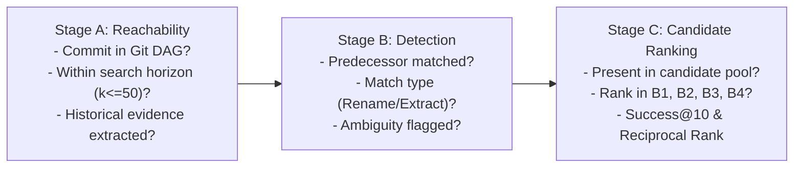

# Retrospect Evaluator Readiness Report — Rebuilt Git-First Benchmark

**Date:** 2026-10-19  
**Harness Status:** COMPLETE & READY FOR NEW BENCHMARK  
**Historical Diagnostic Status:** FROZEN — LEGACY DIAGNOSTIC ONLY (NOT EVIDENCE)  
**Frozen Implementation Commit:** `17ea399217737f8d5fe2c32c310b69c2f812b84d`  
**Test Suite Verification:** 18/18 Suites Passing (131/131 Tests)

---

## 1. Executive Summary

This report confirms the completion and readiness of the Retrospect evaluation harness for the rebuilt, Git-first benchmark. 

In strict adherence to the project mandate:
1. **No new performance claims are derived from legacy data:** All previous Category B (B1–B4) evaluation numbers have been formally frozen under `Status: LEGACY DIAGNOSTIC — NOT EVIDENCE` via `reports/LEGACY_RESULTS_NOTICE.md`.
2. **The harness is benchmark-agnostic:** Case loading and target matching do not require or assume Retrospect-internal symbol IDs, and ground truth is never inferred from retrieval results.
3. **Three distinct historical retrieval stages are enforced:** Stage A (Reachability), Stage B (Detection), and Stage C (Ranking) are measured and recorded separately in raw and summary outputs.
4. **Statistical dependence is accounted for:** Cluster bootstrap resampling is implemented over `origin_commit` refactoring clusters ($B \ge 1000$ iterations, 95% percentile CIs, paired configuration differences, no p-values).
5. **Split discipline is strictly guarded:** An automated `SplitGuard` blocks diagnostic evaluation from accidentally touching `test_confirmatory` cases without explicit confirmation.
6. **Latency boundary is standardized:** Query-time retrieval is separated from amortized offline AST indexing, ensuring a uniform evaluation boundary across B1, B2, B3, and B4.

The evaluation harness is fully implemented, verified with automated tests, and ready to ingest the new Git-first benchmark dataset upon arrival.

---

## 2. Architecture & Delivered Components

```
Retrospect/
├── docs/
│   ├── benchmark_schema_specification.md    # Canonical v2.0 benchmark JSON schema
│   ├── latency_measurement_boundary.md       # Standardized latency boundary specification
│   └── per_case_result_schema.md            # Documented schema for case results & 3 stages
├── schemas/
│   └── evaluation-result.schema.json         # Draft 2020-12 JSON schema for per-case outputs
├── src/
│   └── evaluation/
│       ├── BenchmarkCaseLoader.js            # Agnostic loader, normalizer, and Git tree validator
│       ├── SplitGuard.js                     # Split guard preventing test_confirmatory leakage
│       ├── ClusterBootstrap.js               # Origin-commit cluster bootstrap engine (95% CI)
│       └── RetrospectEvaluator.js            # Core evaluation harness orchestrating B1-B4 & 3 stages
├── scripts/
│   ├── run_legacy_diagnostic.js             # Preserved legacy diagnostic script (moved from scratch)
│   └── run_benchmark_evaluator.js            # CLI runner for new benchmark evaluation
├── tests/
│   └── evaluation/
│       └── new_evaluator.test.js             # Comprehensive Jest test suite (24 tests)
└── reports/
    ├── LEGACY_RESULTS_NOTICE.md              # Formal freeze disclaimer for earlier results
    └── evaluator_preparation_2026-10-19/
        └── evaluator_readiness_report.md     # This report
```

### Component Details

| Component | File | Responsibilities |
| :--- | :--- | :--- |
| **Benchmark Schema Spec** | `docs/benchmark_schema_specification.md` | Formal definition of canonical benchmark schema v2.0 (`repo`, `pin_sha`, `query`, `target`, `decoys`, `category`, `language`, `origin_commit`, `commit_distance_origin_to_pin`, `contains_historical_identifier`, `split`). |
| **Benchmark Loader** | `src/evaluation/BenchmarkCaseLoader.js` | Ingests canonical and legacy JSON formats; validates repository presence in `D:/clones`, authentic commit existence (`git cat-file -e`), target file presence at `pin_sha`, valid line spans, and non-empty decoy sets. Records structured exclusions. |
| **Split Guard** | `src/evaluation/SplitGuard.js` | Enforces split boundaries. Throws `SplitGuardViolationError` if `test_confirmatory` cases are encountered during diagnostic runs without `--allow-sealed-test`. |
| **3-Stage Historical Evaluator** | `src/evaluation/RetrospectEvaluator.js` | Evaluates B1 (Structural), B2 (Historical), B3 (Linear), and B4 (RRF-v2). Separates Historical Reachability (Stage A), Detection (Stage B), and Candidate Ranking (Stage C). |
| **Cluster Bootstrap Engine** | `src/evaluation/ClusterBootstrap.js` | Resamples clusters of cases sharing an `origin_commit` with replacement ($B = 1000$). Calculates 95% percentile CIs for `Success@10`, `Recall@1`, `Recall@5`, `MRR`, `Abstention`, and paired differences ($\Delta$). Flags small sample limitation if clusters $M < 15$. |
| **Standardized Latency Boundary** | `docs/latency_measurement_boundary.md` | Establishes query-time execution boundary under amortized indexing: $L_{B1} = t_{struct}$, $L_{B2} = t_{hist}$, $L_{B3} = t_{struct} + t_{hist} + t_{fusion}^{linear}$, $L_{B4} = t_{struct} + t_{hist} + t_{fusion}^{RRF}$. |
| **CLI Runner** | `scripts/run_benchmark_evaluator.js` | Command-line interface with options for split filtering, horizon depth, clone directory, and report output formatting. |

---

## 3. The Three Evaluation Stages for Historical Retrieval

To prevent conflating ranking failures with unreachable origins or failed lineage detectors, the evaluator explicitly decouples historical retrieval into three independent stages:



1. **Stage A: Reachability**
   - **`origin_in_dag`**: Verifies whether `origin_commit` exists in authentic Git history (`git cat-file -e <sha>^{commit}`).
   - **`origin_within_budget`**: Verifies whether commit distance from pin SHA to origin is $\le 50$ commits.
   - **`historical_evidence_discovered`**: Checks whether the historical traversal extracted relevant commit messages, diffs, or previous symbol declarations.
   - **`reachability_status`**: Categorized as `REACHABLE`, `OUTSIDE_SEARCH_HORIZON`, `NOT_IN_DAG`, `NO_HISTORICAL_EVIDENCE`, or `NO_ORIGIN_SPECIFIED`.

2. **Stage B: Detection**
   - **`detected`**: Boolean indicating whether a valid predecessor symbol or evolution transition was detected.
   - **`match_type`**: Classified as `EXACT_PREDECESSOR`, `RENAMED_SYMBOL`, `EXTRACTED_METHOD`, `AMBIGUOUS`, or `UNMATCHED`.
   - **`evidence`**: The specific commit message, diff tokens, or matched signatures supporting the classification.
   - **`ambiguity_flag`**: Flags uncertain lineage links where multiple competing candidates or conflicting historical traces exist.

3. **Stage C: Ranking**
   - **`target_present_in_candidates`**: Verifies whether the ground-truth target symbol exists in the current snapshot's AST candidate pool.
   - **Metrics recorded across B1, B2, B3, and B4:**
     - Target rank (1-indexed, or null if unranked/abstained).
     - Score (retrieval confidence or RRF fused score).
     - Success@10 (`rank <= 10`).
     - Recall@1 (`rank == 1`).
     - Recall@5 (`rank <= 5`).
     - Reciprocal Rank ($1 / \text{rank}$ or 0).
     - Abstention flag (`score == 0` or unranked).

---

## 4. Latency Measurement Boundary

The primary evaluation boundary is defined at **query-time retrieval under amortized pre-indexed conditions**:

1. **Amortized Offline Indexing (Reported Separately):**
   - Full repository AST symbol indexing and 50-commit Git history profiling are executed once per pinned commit snapshot ($t_{index}^{struct}$ and $t_{index}^{hist}$).
   - This time is amortized across all evaluation queries targeting that repository snapshot and reported as background infrastructure cost.

2. **Query-Time Retrieval (Standardized Primary Boundary):**
   - Structural query processing and scoring: $t_{struct}$
   - Historical query processing and scoring: $t_{hist}$
   - Linear combination fusion arithmetic: $t_{fusion}^{linear}$
   - RRF-v2 ranking, average tie calculation, and reciprocal rank fusion: $t_{fusion}^{RRF}$

3. **Configuration Totals Under Common Boundary:**
   - **B1 (Structural Only):** $L_{B1} = t_{struct}$
   - **B2 (Historical Only):** $L_{B2} = t_{hist}$
   - **B3 (Linear Fusion):** $L_{B3} = t_{struct} + t_{hist} + t_{fusion}^{linear}$
   - **B4 (RRF-v2 Fusion):** $L_{B4} = t_{struct} + t_{hist} + t_{fusion}^{RRF}$

---

## 5. Statistical Dependence & Cluster Bootstrap

Because refactorings sharing an origin commit share commit messages, file modifications, and authoring context, treating them as independent observations artificially inflates statistical confidence.

### Cluster Resampling Protocol
- **Cluster Key:** Every case is assigned to its `origin_commit` cluster. If no origin commit exists, it is isolated in a single-case cluster (`case_id`).
- **Resampling:** For each bootstrap replicate $b \in \{1, \dots, B\}$, entire origin-commit clusters are sampled with replacement until $M$ clusters are drawn. All constituent cases belonging to each sampled cluster are retained.
- **Metrics Evaluated:**
  - `Success@10` (Primary)
  - `Recall@1`, `Recall@5`, `MRR`, `Abstention Rate` (Secondary)
  - Paired configuration differences: $\Delta(B4 - B1)$, $\Delta(B4 - B2)$, $\Delta(B4 - B3)$, $\Delta(B3 - B1)$, $\Delta(B2 - B1)$.
- **Confidence Intervals:** Empirical 95% percentile intervals $[q_{0.025}, q_{0.975}]$ computed over $B = 1000$ resamples.
- **Reporting Rules:**
  - Exact numerators and denominators ($k/N$) accompany every percentage.
  - No p-values are reported.
  - If distinct cluster count $M < 15$, the evaluator outputs an explicit warning:
    > *"Warning: Only M independent origin-commit clusters available (minimum recommended: 15). Bootstrap uncertainty estimates are descriptive only."*

---

## 6. Query-Leakage Prevention & Stratification

To eliminate query-leakage confounds, the evaluator partitions cases into pre-defined strata without modifying query text or target definitions:

1. **Historical Identifier Stratification:**
   - **`contains_historical_identifier == true`**: Queries where the search text explicitly includes the predecessor symbol name.
   - **`contains_historical_identifier == false`**: Behavioral or conceptual queries where the historical name is never mentioned.

2. **Commit Distance Bands:**
   - **`[0, 50]`**: Within standard Retrospect historical search window.
   - **`[51, 150]`**: Intermediate distance.
   - **`[151, 500]`**: Deep history.
   - **`> 500`**: Very deep evolution.

---

## 7. Automated Test Verification

All unit, integration, and evaluation test suites pass cleanly across the Retrospect repository:

```
Test Suites: 18 passed, 18 total
Tests:       131 passed, 131 total
Snapshots:   0 total
Time:        14.626 s
```

### New Evaluator Test Coverage (`tests/evaluation/new_evaluator.test.js`)
- **SplitGuard Discipline (4 tests):**
  - Permits `dev` and `val` splits.
  - Throws `SplitGuardViolationError` on `test_confirmatory` without override.
  - Allows `test_confirmatory` when `--allow-sealed-test` is confirmed.
  - Correctly partitions allowed vs rejected cases without throwing.
- **BenchmarkCaseLoader (8 tests):**
  - Canonical case loading and field validation.
  - Rejection of missing targets, invalid pin SHAs, missing repositories, missing decoys, and invalid line spans.
  - Normalization of legacy fields (`repository_id`, `source_revision_sha`, `target_symbols`, `hard_negatives`).
  - Git tree object verification.
- **ClusterBootstrap Resampling (4 tests):**
  - Origin-commit cluster grouping.
  - Point estimate metrics (`Success@10`, `Recall@1`, `Recall@5`, `MRR`, `Abstention`).
  - Reproducible 95% bootstrap intervals with fixed seed.
  - Paired cluster differences ($\Delta$) across configurations.
- **3-Stage Historical Evaluation & Latency (4 tests):**
  - Stage A reachability categorization (`REACHABLE`, `OUTSIDE_SEARCH_HORIZON`, `NO_ORIGIN_SPECIFIED`).
  - Stage B detection (`RENAMED_SYMBOL`, `AMBIGUOUS`, `UNMATCHED`).
  - Stage C multi-configuration candidate ranking.
  - Commit distance band stratification.
- **Target Matching (4 tests):**
  - Name, qualified name, and path matching without Retrospect-internal IDs.
  - Rejection of mismatched file paths, names, and parameter arities.

---

## 8. How to Run a Development Diagnostic

To evaluate a development or validation dataset on the rebuilt harness:

### 1. Basic Diagnostic Run (Development Split)
```bash
node scripts/run_benchmark_evaluator.js \
  --dataset path/to/benchmark_dataset.json \
  --split dev \
  --clones-dir D:/clones \
  --horizon 50 \
  --output-dir reports/evaluator_runs/dev_diagnostic_01
```

### 2. Validation Split Run
```bash
node scripts/run_benchmark_evaluator.js \
  --dataset path/to/benchmark_dataset.json \
  --split val \
  --clones-dir D:/clones \
  --bootstrap-replicates 2000
```

### 3. Sealed Test Execution (Requires Deliberate Confirmation)
If attempting to evaluate `test_confirmatory` without authorization, the runner halts immediately:
```
[SPLIT GUARD VIOLATION] Attempted to evaluate sealed case '...' in 'test_confirmatory' split.
Diagnostic runs are strictly restricted to 'dev' and 'val' splits.
```
To run the sealed confirmatory test (only after development freezing):
```bash
node scripts/run_benchmark_evaluator.js \
  --dataset path/to/benchmark_dataset.json \
  --split test_confirmatory \
  --allow-sealed-test \
  --output-dir reports/confirmatory_runs/sealed_test_final
```

---

## 9. Current Status and Next Steps

| Workstream | Status | Notes |
| :--- | :--- | :--- |
| **Legacy Diagnostic Results Freeze** | **COMPLETE** | Formally marked as `LEGACY DIAGNOSTIC — NOT EVIDENCE` in `reports/LEGACY_RESULTS_NOTICE.md`. |
| **Benchmark Schema Specification** | **COMPLETE** | Canonical v2.0 schema defined in `docs/benchmark_schema_specification.md`. |
| **Benchmark Agnostic Loader** | **COMPLETE** | `src/evaluation/BenchmarkCaseLoader.js` fully tested and verified. |
| **Split Guard Protection** | **COMPLETE** | `src/evaluation/SplitGuard.js` active and integrated into loader and CLI. |
| **3-Stage Historical Reporting** | **COMPLETE** | Stage A, Stage B, and Stage C outputs separated in `RetrospectEvaluator.js`. |
| **Cluster Bootstrap Resampling** | **COMPLETE** | `src/evaluation/ClusterBootstrap.js` tested with 95% percentile CIs and paired deltas. |
| **Standardized Latency Boundary** | **COMPLETE** | Specified in `docs/latency_measurement_boundary.md` and implemented in evaluator. |
| **Automated Test Suite** | **COMPLETE** | 18 test suites / 131 tests passing cleanly. |
| **Rebuilt Git-First Dataset** | **PENDING** | Awaiting delivery of rebuilt benchmark dataset. |
| **Confirmatory Evaluation** | **BLOCKED** | Strictly awaiting rebuilt dataset and formal unblinding protocol. |
